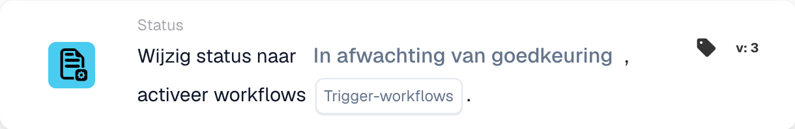
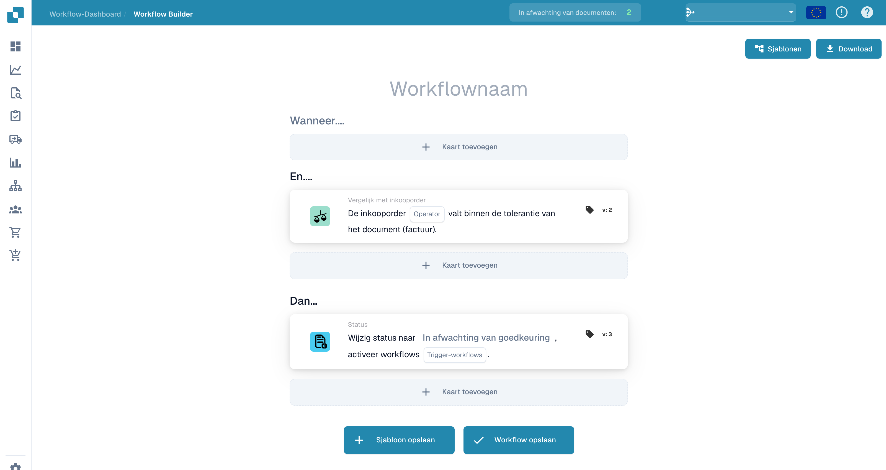
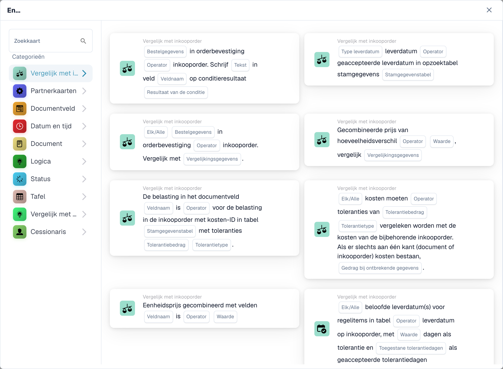

# Toewijzing & status — Praktijkvoorbeelden

Om het overzicht te bewaren, kunt u de workflows verschillende koppen geven, zodat u meteen weet waarover deze workflow gaat.

Maak een nieuwe Workflow aan: Klik op + WORKFLOW TOEVOEGEN

U kunt deze workflows (Test 1, 2, 3) gebruiken om verschillende documenten automatisch toe te wijzen aan de juiste medewerker in het bedrijf.

Als een factuur of ander document een bepaald totaalbedrag overschrijdt dat voorafgaande beoordeling en goedkeuring vereist, kunnen deze documenten onmiddellijk aan de juiste persoon worden toegewezen.

<figure><figcaption></figcaption></figure>

**Test 1: Logicakaart**

When: **Assignee is:** Verantwoordelijke voor ontvangst

En: **Documenttype is:** Factuur

Then: **Assign document to:** Factuurcontroleur

.png>)

**Test 2: Logicakaart**

When: **Assignee is:** Verantwoordelijke voor ontvangst

En: **Documenttype is:** Leveringsbon

Then: **Assign document to:** Leveringscontroleur

.png>)

**Test 3: Logicakaart**

**When:** **Assignee is:** Verantwoordelijke voor ontvangst

**En:Documenttype is:** Orderbevestiging

**Then:** **Assign document to:** Ordercontroleur

.png>)

Het is ook mogelijk om, als het document niet aan één enkele persoon is toegewezen, het vanaf het begin aan een specifieke medewerker toe te wijzen.

<figure><figcaption></figcaption></figure>

Voor een eenvoudiger overzicht van wat er met een document moet gebeuren, kunt u de status voor binnenkomende documenten in deze workflow instellen. Met deze workflow kunt u meteen zien of er bijvoorbeeld een goedkeuring in behandeling is.

**Test 4: Logicakaart**

**Wanneer:Documenttype is:** Leveringsbon

**And:** **Assignee is:** Verantwoordelijke voor ontvangst

**Dan:Status wijzigen in:** In afwachting van goedkeuring

<figure><figcaption>
Niet-opgeslagen workflowconcept voor een statuswijziging.
</figcaption></figure>

.png>)

**Test 5: Logicakaart**

Wanneer: **Documenttype is:** Factuur

And: **Assignee is:** Factuurcontroleur

Vervolgens: **Status wijzigen in:** In afwachting van tweede goedkeuring

<figure><figcaption></figcaption></figure>

.png>)

Als een factuur of ander document een bepaald totaalbedrag overschrijdt dat voorafgaande beoordeling en goedkeuring vereist, kunnen deze documenten onmiddellijk aan de juiste persoon worden toegewezen.

.png>)

**Test 6: Logicakaart**

When: **Assignee is:** Verantwoordelijke voor ontvangst

En: Docfield **total\_amount** is **Groter dan 500**

Then: **Assign document to:** Goedkeuringsverantwoordelijke

<figure><figcaption></figcaption></figure>

.png>)

Het is ook mogelijk om de status in de workflow in te voeren, zodat de toegewezen persoon meteen kan zien welke status dit document heeft en wat er vervolgens mee moet gebeuren.

**Test 7: Logicakaart**

**When:** **Assignee is:** Verantwoordelijke voor ontvangst

**En:** Docfield **total\_amount** is **Groter dan 500**

**Then:** **Assign document to:** Goedkeuringsverantwoordelijke

**Status wijzigen in:** In afwachting van goedkeuring

<figure><figcaption>
Actie voor statuswijziging in een workflowconcept.
</figcaption></figure>

<figure><figcaption></figcaption></figure>

Als er bijvoorbeeld bepaalde of belangrijke informatie in een document ontbreekt die echter belangrijk is en voor verdere verwerking moet worden opgenomen, kunt u de workflow zo instellen dat deze documenten onmiddellijk worden doorgestuurd naar de inkoper en een vervanger.

<figure><figcaption></figcaption></figure>

**Test 9:**

De Workflow met deze logic cards is ontworpen om automatisch te verifiëren dat de hoeveelheid, eenheidsprijs of korting die in een orderbevestiging is vermeld, overeenkomt met de bijbehorende cijfers in de inkooporder. Deze verificatie waarborgt consistentie en nauwkeurigheid tussen wat er is besteld en wat de leverancier bevestigt te leveren.

U kunt deze documenten een specifieke status geven of ze aan een specifieke medewerker toewijzen.

<figure><figcaption>
Workflowconcept met een voorwaarde voor inkoopordervergelijking.
</figcaption></figure>

<figure><figcaption>
Voorwaarden voor vergelijking met een inkooporder selecteren.
</figcaption></figure>

**Logische kaart: hoeveelheid of eenheidsprijs of kortingsmatch**

Deze logic card is ontworpen om automatisch te verifiëren dat de hoeveelheid, eenheidsprijs of korting die in een orderbevestiging is vermeld, overeenkomt met de bijbehorende cijfers in de inkooporder. Deze verificatie waarborgt consistentie en nauwkeurigheid tussen wat er is besteld en wat de leverancier bevestigt te leveren.

**Trigger Condition**

De logica wordt geactiveerd wanneer aan een van de volgende voorwaarden wordt voldaan in een orderbevestiging ten opzichte van de oorspronkelijke inkooporder:

* **Hoeveelheid**: De bestelde hoeveelheid items komt overeen met de door de leverancier bevestigde hoeveelheid.
* **Eenheidsprijs**: De overeengekomen prijs per item komt overeen met de bevestiging van de leverancier.
* **Korting**: Eventuele toegepaste kortingen zijn consistent tussen de inkooporder en de orderbevestiging.
* **Vergelijkingsparameters definiëren**: Stel de specifieke velden (hoeveelheid, eenheidsprijs, korting) in die de logic card op een overeenkomst zal controleren.
* **Automate Verification**: Configureer het systeem om deze gegevens automatisch te vergelijken bij ontvangst van een orderbevestiging.
* **Customize Alerts**: Bepaal de workflow voor het afhandelen van discrepanties, inclusief het aanpassen van waarschuwingen voor handmatige beoordeling.

Deze logic card is essentieel om ervoor te zorgen dat de gegevens van een orderbevestiging overeenkomen met de oorspronkelijke inkooporder, waardoor de integriteit van de inkoopcyclus wordt gewaarborgd.

**Test 10:**

Als u een andere berekening voor toeslagen heeft, of deze slechts op sommige items van toepassing zijn, kunt u de generieke tabelberekeningskaarten gebruiken; sommige daarvan staan ook toe om te filteren op reguliere expressies.

<figure><figcaption></figcaption></figure>

Hierboven staat een berekeningsvoorbeeld voor MTZ met een filter voor artikelnummers die beginnen met 01, 06, 9, 001 of 000.

Bij een handmatige opzet wordt geadviseerd om berekeningen die afhankelijk zijn van nieuwe kolommen in een aparte workflow te splitsen. Om met de berekening door te gaan, kunt u de Run Workflow-kaart gebruiken.

**Workflow uitvoeren**

<figure><figcaption></figcaption></figure>

Met deze kaart kunt u de naam opgeven van een workflow die na de huidige workflow moet worden uitgevoerd als aan de voorwaarden ervan is voldaan en na voorgaande then-kaarten van de huidige workflow. Hoewel uitvoerbare, actieve workflows worden geprioriteerd, kunt u er ook gedeactiveerde workflows mee uitvoeren als het document aan de voorwaarden van de workflows voldoet.

### **Berekende toeslagen toevoegen aan een bestaande kolom** 

Als u alle toeslagen als een negatieve korting in de kortingskolom wilt opnemen, kunt u de berekeningskaart gebruiken. Mogelijk staan er al gegevens in deze kolom; u kunt deze instellen als een van de variabelen op de kaart, de MTZ ervan laten aftrekken en het resultaat weer aan deze kolom toevoegen. Mocht er sprake zijn van lege velden (toeslagen slechts voor sommige items), dan gaat het voor de berekening uit van een 0.

**De gebruiker melden dat de orderbevestiging in DocBits moet worden goedgekeurd**

Nadat u de toeslagen heeft berekend, wilt u mogelijk een specifieke gebruiker informeren om de orderbevestiging te autoriseren. Hiervoor kunt u de meldingskaart gebruiken.

<figure><figcaption></figcaption></figure>

Afhankelijk van de instellingen krijgt de gebruiker een nieuwe taak in DocBits toegewezen en optioneel een e-mail om hen op de hoogte te stellen van hun nieuwe taak.

De bijgewerkte afbeeldingen tonen niet-opgeslagen concepten van voorwaarden en acties. Pas rollen en voorwaarden aan uw eigen organisatie aan.
