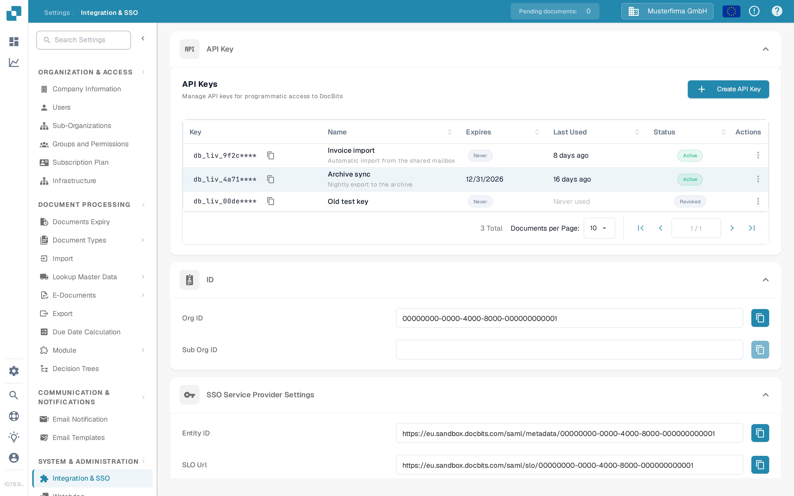
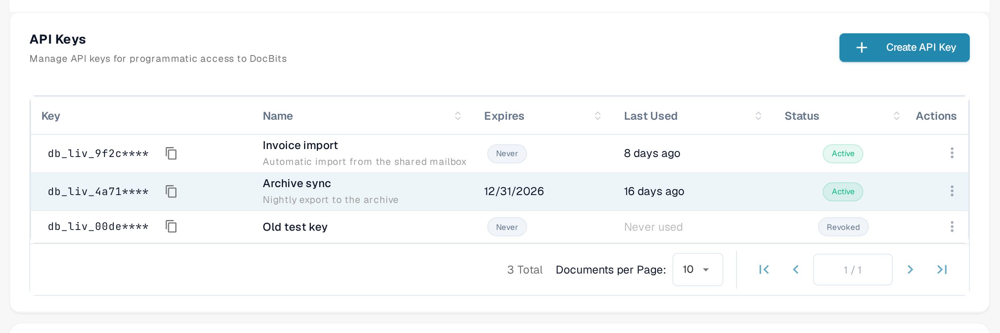
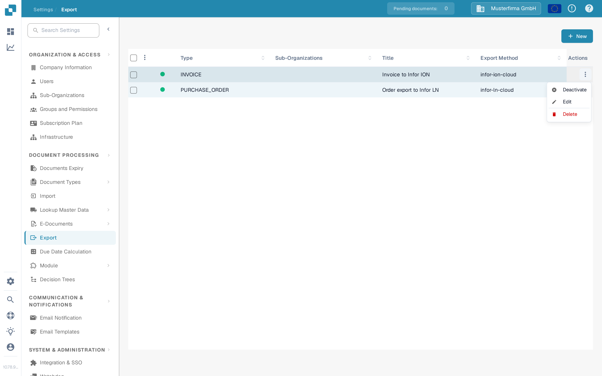
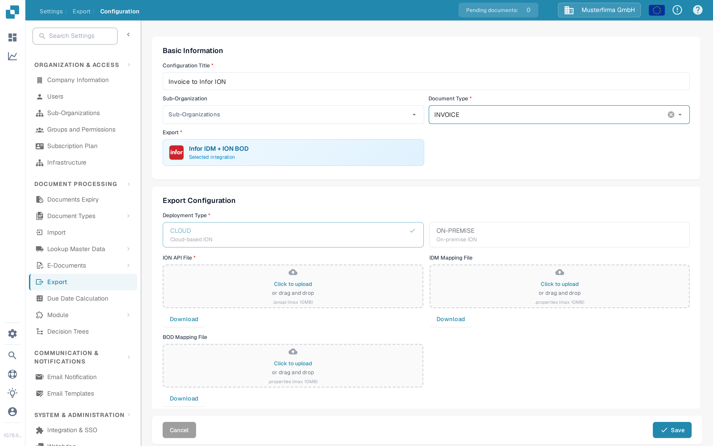

# Test your BOD connection with Postman

## Overview

This page explains how to verify the successful processing of your BOD (Business Object Document) using Postman. You will test the relevant API endpoint by sending a request with your BOD mapping file. Follow the steps below to complete the process.

## Accessing Your API Key and BOD Mapping File

### Retrieving Your API Key

1.  Go to **Settings → Global Settings → Integration & SSO**.

    <figure><figcaption><p>The <strong>API Keys</strong> table on the <strong>Integration &amp; SSO</strong> page. Each row shows the key's masked prefix, name, expiry, last use and status.</p></figcaption></figure>
2.  You can either manually copy your **API key** or click the copy button to copy it to your clipboard.

    <figure><figcaption><p>Click the copy icon next to a key to copy its value. For security, the table shows only the key's prefix followed by `****`; the full key is displayed once, when the key is created. If you no longer have the full key, create a new one as described in <a href="../../administration-and-setup/settings/global-settings/integration/api-key-management.md">API Key Management</a>.</p></figcaption></figure>

    The key list, the copy icon and the three-dot **Actions** menu are described in full on the [API Key Management](../../administration-and-setup/settings/global-settings/integration/api-key-management.md) page.

### **Downloading the BOD Mapping File**

1.  Go to **Settings → Document Processing → Export**.

    <figure><figcaption><p>The <strong>Export</strong> list. Each row is one export configuration; the <strong>Export Method</strong> column shows how the documents are sent.</p></figcaption></figure>
2.  In the **Actions** column of the relevant export entry, click the three-dot menu and select **Edit**.

    <figure><figcaption><p>The row's <strong>Actions</strong> menu is open with <strong>Edit</strong> available. <strong>Edit</strong> opens the export configuration; <a href="../../administration-and-setup/settings/document-processing/export/README.md">Export</a> explains every column and action.</p></figcaption></figure>
3.  Locate the **BOD Mapping File** and click the **Download** button to save it.

    <figure><figcaption><p>The export configuration in edit mode. Under <strong>Export Configuration</strong>, the <strong>BOD Mapping File</strong> field has a <strong>Download</strong> button that saves the mapping file (BOD-Mapping.properties) to your computer. To edit this file, see <a href="../../infor-integration-and-configuration/exporting-to-infor/creating-a-bod-mapping-file.md">Creating a BOD Mapping File</a>.</p></figcaption></figure>

## Test the Endpoint in Postman

1.  **Paste the cURL Command in Postman**

    Open Postman and paste the following cURL command into the **Import** section. Postman will automatically configure the request.

    ```bash
    curl -X 'POST' \
      'https://api.docbits.com/prod-api/import/purchase_order_bod' \
      -H 'accept: application/json' \
      -H 'X-API-KEY:*** \
      -H 'Content-Type: multipart/form-data' \
      -F 'org_id=' \
      -F 'sub_org_id=' \
      -F 'file=@file.xml;type=text/xml' \
      -F 'custom_fields_mapping='
    ```

    <figure><figcaption><p>In Postman, the <strong>Import</strong> button is in the top bar of the window.</p></figcaption></figure>

    <figure><figcaption><p>In the <strong>Import</strong> dialog, paste the cURL command above into the <strong>Paste cURL to import</strong> field. Postman turns it into a ready-made request.</p></figcaption></figure>
2.  **Set the API Key**\
    Go to the **Headers** tab, locate the `X-API-KEY` header, and paste your API key into the **Value** column.

    <figure><figcaption><p>The <strong>Headers</strong> tab of the imported request. Paste the API key you copied in DocBits into the <strong>Value</strong> column of the <code>X-API-KEY</code> row.</p></figcaption></figure>
3.  **Upload the BOD File**\
    Go to the **Body** tab, locate the `file` key, then click **Select Files** in the **Value** column and upload your BOD XML file.

    <figure><figcaption><p>The <strong>Body</strong> tab in <strong>form-data</strong> mode. On the <code>file</code> row, click <strong>Select Files</strong> and choose the BOD XML file you want to test.</p></figcaption></figure>
4.  **Send the Request**\
    Click **Send** to make the API call.

    <figure><figcaption><p>With the key and the file set, click <strong>Send</strong> to run the request against the DocBits API.</p></figcaption></figure>
5.  **Verify the Response**\
    Check the response to confirm that your BOD was processed successfully.

    <figure><figcaption><p>A successful call returns <strong>200 OK</strong> and a JSON body with <code>"success": true</code> — the BOD was processed.</p></figcaption></figure>
