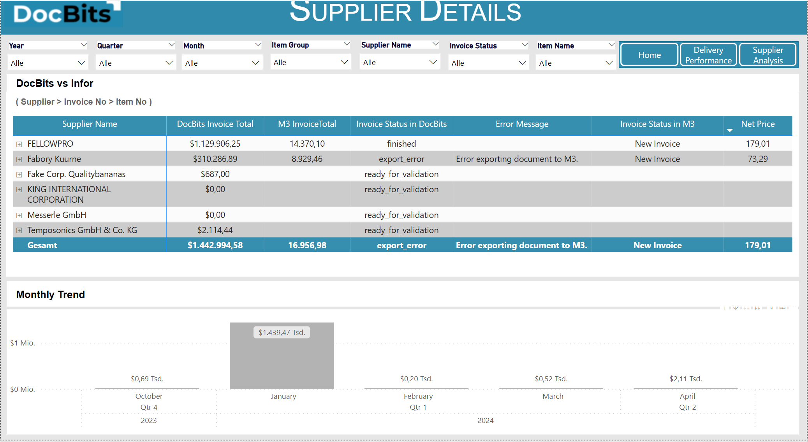

# Połączenie przez bazę danych tylko do odczytu

Ten przewodnik pokazuje, jak połączyć **bazę danych tylko do odczytu DocBits z Power BI Desktop** za pomocą **sterownika ODBC PostgreSQL**. Obejmuje instalację sterownika, konfigurację ODBC, integrację z Power BI i zaplanowane odświeżanie.




#### 1. Zainstaluj sterownik ODBC PostgreSQL

* Pobierz najnowszy sterownik ODBC PostgreSQL (**psqlODBC**) z oficjalnej witryny:
  * [https://www.postgresql.org/ftp/odbc/releases/](https://www.postgresql.org/ftp/odbc/releases/)
* Uruchom instalator i postępuj zgodnie z kreatorem instalacji.

#### 2. Skonfiguruj źródło danych ODBC

* Otwórz **ODBC Data Source Administrator (64-bit)** z Panelu sterowania lub przez wyszukiwarkę systemu Windows.
* Przejdź na kartę **System DSN** i kliknij **Add**.
* Wybierz z listy sterownik **PostgreSQL Unicode(x64)** i kliknij **Finish**.
* Wypełnij wymagane pola danymi uwierzytelniającymi z:\n  **DocBits → Settings → Document Processing → Module → AI Dashboard → Read-Only DB Access**

<figure><figcaption></figcaption></figure>

**Wymagane pola:**

* **Name:** Nazwa połączenia (np. `Sandbox-Read_Only`)
* **Server:** Skopiuj wartość hosta z DocBits
* **Port:** Skopiuj wartość portu z DocBits
* **Database:** Skopiuj nazwę bazy danych z DocBits
* **Username:** Skopiuj nazwę użytkownika z DocBits
* **Password:** Skopiuj hasło z DocBits
* **SSL Mode:** Ustaw na **Require** (zapewnia szyfrowaną komunikację)

#### 3. Połącz bazę tylko do odczytu z Power BI

* Otwórz **Power BI Desktop**.
*   Wybierz **Get Data** → **ODBC** → **Connect**.

    <figure><figcaption></figcaption></figure>
* Z listy DSN wybierz skonfigurowane źródło (np. `Sandbox-Read_Only`).

<figure><figcaption></figcaption></figure>

* Kliknij **OK**. Jeśli zostaniesz o to poproszony, ponownie wprowadź dane uwierzytelniające.
  * Jeśli pojawi się `password authentication failed for user`, sprawdź host, bazę danych, nazwę użytkownika i hasło. W oknie uwierzytelniania wpisz rzeczywiste hasło. Nawiasy klamrowe służące do maskowania znaków w ciągu połączenia ODBC należą do składni sterownika i nie są uniwersalnym rozwiązaniem błędu uwierzytelniania.

#### 4. Wczytaj i przekształć dane

* W panelu **Navigator** rozwiń listę schematów.
* Otwórz schemat **`public`**.
* Zaznacz tabele, które chcesz zaimportować.

* Wybierz:
  * **Load** → Import bezpośrednio do Power BI
  * **Transform Data** → Otwiera Power Query, aby kształtować i filtrować dane przed wczytaniem

#### 5. Zwizualizuj swoje dane

* Użyj obszaru raportu Power BI do budowania pulpitów.
* Przeciągaj pola, dodawaj fragmentatory (slicers), wybieraj typy wykresów i stosuj obliczenia DAX.
* Użyj **Power Query Editor**, aby wyczyścić lub połączyć dane przed utworzeniem wizualizacji.
* Źródło: [Dokumentacja Power BI](https://learn.microsoft.com/en-us/power-bi/)

#### 6. Włącz zaplanowane odświeżanie (opcjonalnie)

Odświeżanie według harmonogramu zależy od licencji lub pojemności obszaru roboczego, łącznika i trybu połączenia. Dla tego połączenia ODBC skonfiguruj osiągalną bramę z odpowiednim sterownikiem, nazwą DSN i poświadczeniami. Sprawdź aktualne wymagania w oficjalnej dokumentacji.

* Aby raporty były zsynchronizowane z PostgreSQL:
* Opublikuj plik `.pbix` w **Power BI Service**.
* Zainstaluj **Power BI Gateway** (tryb Standard) na maszynie z dostępem sieciowym do PostgreSQL.
* W Power BI Service:
  * Przejdź do swojego zestawu danych → **Settings** → **Scheduled Refresh**
  * Przypisz swój DSN i podaj dane uwierzytelniające
* Więcej informacji [tutaj](https://learn.microsoft.com/en-us/power-bi/connect-data/service-gateway-deployment-guidance).&#x20;

#### 7. Przykładowe pulpity i widoki danych&#x20;

<figure><figcaption></figcaption></figure> <figure><figcaption></figcaption></figure> <figure><figcaption></figcaption></figure> <figure><figcaption></figcaption></figure>

[Oficjalna dokumentacja — ODBC](https://learn.microsoft.com/en-us/power-query/connectors/odbc)

[Oficjalna dokumentacja — psqlODBC](https://odbc.postgresql.org/docs/config-opt.html)

[Oficjalna dokumentacja — Power BI](https://learn.microsoft.com/en-us/power-bi/connect-data/refresh-scheduled-refresh)
