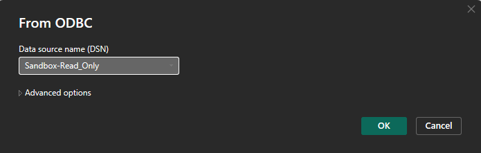

# Verbinden via Alleen-Lezen Database

Deze gids begeleidt u bij het verbinden van **DocBits' Alleen-Lezen Database met Power BI Desktop** met behulp van de **PostgreSQL ODBC-driver**. Het behandelt driverinstallatie, ODBC-configuratie, Power BI-integratie en geplande vernieuwing.




#### 1. Installeer de PostgreSQL ODBC-driver

* Download de nieuwste PostgreSQL ODBC-driver (**psqlODBC**) van de officiële site:
  * [https://www.postgresql.org/ftp/odbc/releases/](https://www.postgresql.org/ftp/odbc/releases/)
* Voer het installatieprogramma uit en volg de installatiewizard.

#### 2. Configureer de ODBC-gegevensbron

* Open **ODBC-gegevensbronbeheer (64-bits)** via Configuratiescherm of Windows Zoeken.
* Ga naar het tabblad **Systeem DSN** en klik op **Toevoegen**.
* Selecteer **PostgreSQL Unicode(x64)** driver uit de lijst en klik op **Voltooien**.
* Vul de vereiste velden in met inloggegevens van:\
  **DocBits → Instellingen → Documentverwerking → Module → AI Dashboard → Alleen-Lezen DB Toegang**

<figure><figcaption></figcaption></figure>

**Vereiste Velden:**

* **Naam:** Een naam voor de verbinding (bijv. `Sandbox-Read_Only`)
* **Server:** Kopieer de hostwaarde uit DocBits
* **Poort:** Kopieer de poortwaarde uit DocBits
* **Database:** Kopieer de databasenaam uit DocBits
* **Gebruikersnaam:** Kopieer de gebruikersnaam uit DocBits
* **Wachtwoord:** Kopieer het wachtwoord uit DocBits
* **SSL-modus:** Stel in op **Require** (zorgt voor versleutelde communicatie)

#### 3. Verbind Alleen-Lezen DB met Power BI

* Open **Power BI Desktop**.
*   Selecteer **Gegevens ophalen** → **ODBC** → **Verbinden**.

* Selecteer uit de DSN-lijst uw geconfigureerde bron (bijv. `Sandbox-Read_Only`).

<figure><figcaption></figcaption></figure>

* Klik op **OK**. Voer inloggegevens opnieuw in indien gevraagd.
  * Controleer bij `password authentication failed for user` de host, database, gebruikersnaam en het wachtwoord. Voer in het aanmeldvenster het werkelijke wachtwoord in. Accolades voor escaping in een ODBC-verbindingsreeks zijn driversyntaxis en geen algemene oplossing voor mislukte authenticatie.

#### 4. Gegevens Laden en Transformeren

* In het deelvenster **Navigator**, vouw de schemalijst uit.
* Open het **`public`** schema.
* Selecteer de tabellen die u wilt importeren.

* Kies:
  * **Laden** → Importeer direct in Power BI
  * **Gegevens Transformeren** → Open Power Query voor vormgeven en filteren vóór laden

#### 5. Visualiseer Uw Gegevens

* Gebruik het Power BI-rapportcanvas om dashboards te bouwen.
* Sleep velden, voeg slicers toe, kies grafiektypen en pas DAX-berekeningen toe.
* Gebruik **Power Query Editor** om gegevens op te schonen of samen te voegen voordat u visuals maakt.
* Referentie: [Power BI Documentatie](https://learn.microsoft.com/en-us/power-bi/)

#### 6. Schakel Geplande Vernieuwing In (Optioneel)

Geplande vernieuwing hangt af van de licentie of capaciteit van de werkruimte, de connector en de verbindingsmodus. Configureer voor deze ODBC-verbinding een bereikbare gateway met het juiste stuurprogramma, DSN en de juiste aanmeldgegevens. Controleer de actuele vereisten in de officiële documentatie.

* Om uw rapporten gesynchroniseerd te houden met PostgreSQL:
* Publiceer uw `.pbix`-bestand naar **Power BI Service**.
* Installeer de **Power BI Gateway** (Standaardmodus) op een machine met netwerktoegang tot PostgreSQL.
* In Power BI-service:
  * Ga naar uw dataset → **Instellingen** → **Geplande Vernieuwing**
  * Wijs uw DSN toe en geef inloggegevens op
* Meer informatie [hier](https://learn.microsoft.com/en-us/power-bi/connect-data/service-gateway-deployment-guidance).

#### 7. Voorbeelddashboards & Gegevensweergaven

[Officiële documentatie — ODBC](https://learn.microsoft.com/en-us/power-query/connectors/odbc)

[Officiële documentatie — psqlODBC](https://odbc.postgresql.org/docs/config-opt.html)

[Officiële documentatie — Power BI](https://learn.microsoft.com/en-us/power-bi/connect-data/refresh-scheduled-refresh)
