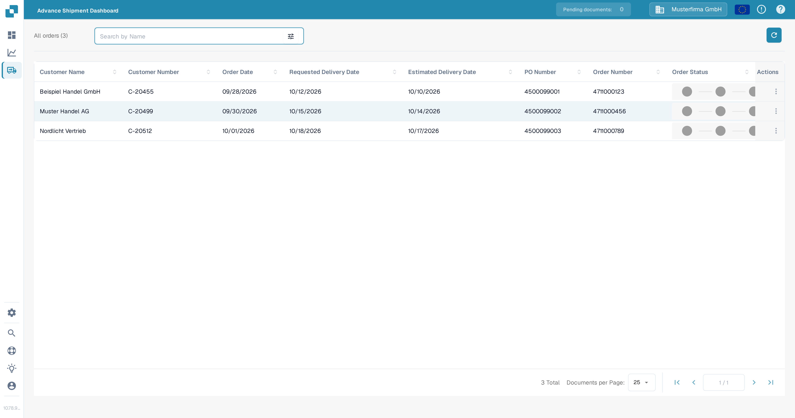

# Advance Shipment Dashboard

The Advance Shipment Dashboard lists all advance shipment orders of your organization in one table. Use the search bar and the filter panel to narrow down the list, open a row to see the order in detail, and use the row actions to download the shipment document as PDF or share the order through a magic link.

<figure><figcaption>
The dashboard with example orders from the synthetic Sandbox organization. The figures will differ in your organization.
</figcaption></figure>


The dashboard is only available when the **Advance Shipment Dashboard** module is switched on. An administrator enables it under **Settings → Module** in the **Dashboards** section — see [Module](../../administration-and-setup/settings/document-processing/module/README.md#dashboards). Without the switch, the page shows an "action not allowed" message instead of the table.


## Columns

| Column | Description |
|--------|-------------|
| **Customer Name** | Name of the customer the order belongs to. |
| **Customer Number** | Customer number assigned in your system. |
| **Order Date** | Date the order was created, shown in your personal date format. |
| **Requested Delivery Date** | Delivery date the customer asked for. |
| **Estimated Delivery Date** | Delivery date currently expected. |
| **PO Number** | Purchase order number linked to the order. |
| **Order Number** | Sales order number. Click the row to open the order detail page. |
| **Order Status** | A three-step progress indicator: the first steps are covered while the order is reserved, allocated or the picking list is printed, the second once it is delivered, the third once it is invoiced. |
| **Actions** | Row menu with **Export** and **Share** — see [Row actions](#row-actions). |

## Searching and filtering

Type in the search bar to filter the list by the entered text; the list updates as you type. The **tune** icon at the end of the search bar opens the filter panel:

| Filter | Description |
|--------|-------------|
| **PO Number** | Show only orders with this purchase order number. |
| **Order Number** | Show only orders with this order number. |
| **Order date** | Show only orders from one specific order date. |
| **After Date / Before Date** | Show only orders in a date range. |
| **Shipments Per Page** | Number of rows shown per page (10, 25 or 50). |
| **Clear filters** | Remove all filters and the search text. |

The **refresh** button next to the search bar reloads the list, for example after new shipments were imported.

## Row actions

Open the **more_vert** (three dots) menu at the end of a row:

* **Export** downloads the shipment document of the order as a PDF file.
* **Share** copies a magic link to your clipboard. Anyone who opens the link sees the order detail page of this shipment without logging in (the link uses the `/share/sales-orders/...` address — see [Web Address Changes](web-address-changes.md#shared-links)). Only share the link with people you trust — the link opens the order directly.

## Your view settings are saved

* **Column order:** Drag a column header to a new position. DocBits saves the order per user, so the table looks the same the next time you open the dashboard.
* **Page size:** The number of rows per page is saved per user as well and is restored on your next visit.
