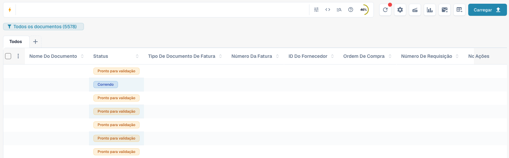
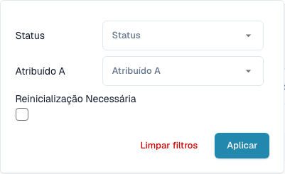
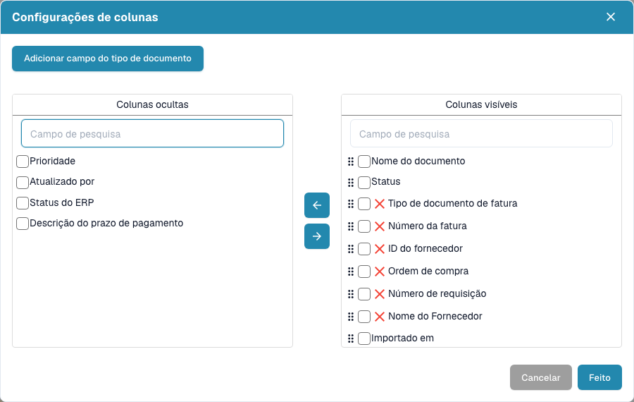

# Painel

O painel é a sua lista de trabalho diária no DocBits. Encontre documentos importados, consulte o estado, abra-os para validação e organize o trabalho da equipa.


As funções disponíveis dependem das suas permissões, do estado do documento e dos módulos ativos na organização. Alguns controlos podem não aparecer. Em janelas de computador mais estreitas, as ações adicionais encontram-se em **Mais**.


<figure><figcaption>
O painel atual com pesquisa, ferramentas, vistas guardadas, tipos de documento e tabela. Os valores dos documentos estão ocultos para proteger os dados.
</figcaption></figure>

## Começar o trabalho diário

1. Confirme a organização ativa e, se disponível, a suborganização.
2. Escolha um tipo de documento ou mantenha **Todos**.
3. Pesquise e filtre os documentos necessários.
4. Verifique o estado e a pessoa atribuída e abra a linha do documento.
5. Atualize a lista depois de processar ou importar documentos.

## Pesquisar e filtrar documentos

Introduza um nome de documento, número de fatura ou outro valor de negócio e prima **Enter**. O ícone de filtro na pesquisa permite escolher estado, pessoa atribuída e documentos que exigem reinício. Confirme com **Aplicar**. Remova filtros individuais ou limpe os filtros se um documento parecer estar em falta. Os separadores de tipos e as vistas guardadas também limitam a lista.

A barra oferece filtros estruturados, uma vista de consulta direta e ajuda sobre campos e sintaxe. Utilize os nomes de campos e os exemplos dessa ajuda. Os nomes técnicos dos campos não mudam com o idioma. As funções avançadas dependem das capacidades de pesquisa ativas.

Com a pesquisa de texto integral ativa, o menu de conteúdo controla a pesquisa de texto simples: o modo automático procura primeiro nos campos de negócio e recorre ao conteúdo quando não há resultados; incluir conteúdo acrescenta resultados dos documentos; apenas campos restringe a pesquisa aos campos. Um indicador identifica os resultados provenientes do conteúdo. Um `+` após o número de resultados indica uma janela limitada: refine a pesquisa.

Se o controlo de datas separado estiver visível, escolha um período de importação predefinido ou personalizado. Com a pesquisa de texto integral está oculto; utilize os campos de data disponíveis na pesquisa.

<figure><figcaption>
Filtre por estado, pessoa atribuída e necessidade de reinício.
</figcaption></figure>

## Ler e organizar a tabela

Cada linha representa um documento. Conforme as colunas configuradas, apresenta nome, estado, tipo, dados de fatura, fornecedor, pessoa atribuída, datas e valores. Clique num cabeçalho ordenável para alterar a ordem. Desloque horizontalmente para ver mais colunas e utilize a paginação e o número de documentos por página para percorrer os resultados.

Se o agrupamento estiver disponível, selecione um campo acima da tabela. Para campos de data, escolha dia, semana ou mês. Abra um grupo para ver os documentos ou remova o agrupamento para regressar à lista normal.

Use **+** junto aos separadores para mostrar outros tipos de documento. Reordene os separadores arrastando-os. Remover um separador altera apenas a vista e não elimina documentos.

Abra a engrenagem e as definições das colunas. Mova colunas entre as listas ocultas e visíveis e arraste as visíveis para as ordenar. Também pode adicionar campos de um tipo de documento. Consulte [Alterar colunas dos documentos](change-document-columns.md).

<figure><figcaption>
Escolha e ordene a informação da tabela nas definições das colunas.
</figcaption></figure>

## Compreender estados e ações

Os estados de processamento indicam passos como OCR, classificação ou exportação. **Pronto para validação** significa que pode verificar o documento. Os estados de aprovação indicam uma aprovação pendente. **Concluído** indica o fim do processamento. Clique no estado **Erro** para consultar os detalhes disponíveis.

Se houver tempos de processamento, passe o ponteiro sobre um estado para ver as fases e a sua duração. Os documentos com possíveis duplicados apresentam um ícone de duplicado; abra-o para comparar os documentos relacionados.

Abra uma linha para trabalhar no ecrã de validação. O menu de ações apresenta as operações permitidas, como atribuir, transferir, consultar o histórico ou reiniciar o processamento. As variantes de transferência dependem do documento e podem incluir anotações ou formatos de fatura eletrónica.

Selecione vários documentos nas caixas e abra o menu do cabeçalho para as ações em lote permitidas: atribuição, união, reinício, reinício da exportação ou eliminação. Verifique a seleção e cada confirmação. Estas ações podem alterar documentos; guardar uma vista altera apenas a apresentação da lista.

## Guardar um painel pessoal

Abra o botão azul de vista abaixo da pesquisa e crie um novo painel. Dê-lhe um nome e escolha visibilidade privada, para todos ou para grupos e utilizadores específicos. Guarde filtros, ordenação e colunas para tarefas recorrentes.

Selecione vistas guardadas no mesmo menu. Guarde alterações posteriores quando a vista lhe pertencer e tiver sido modificada. Não pode substituir uma vista partilhada consigo: crie uma sua. Partilhar uma vista não concede acesso adicional aos documentos. Consulte [Painéis pessoais](personal-dashboards.md).

<figure><figcaption>
Crie um painel com nome e escolha quem o pode ver.
</figcaption></figure>

## Carregar documentos e utilizar ferramentas

Escolha **Carregar**, arraste ficheiros para a janela ou selecione-os no computador e inicie o carregamento. Se disponível, a opção de classificação permite definir expressamente um tipo de documento. Caso contrário, o DocBits classifica os ficheiros automaticamente.

As outras ferramentas atualizam a lista, abrem definições avançadas, iniciam um scanner, mostram estatísticas de estado, iniciam a importação de correio configurada ou pedem uma exportação CSV/Excel. Digitalização e exportação exigem a configuração adequada. Exportar a tabela é diferente de exportar um documento para o ERP. Guarde primeiro as alterações de colunas do painel pessoal, pois a exportação utiliza a configuração guardada. Consulte [Ferramentas do painel](dashboard-tools.md).

<figure><figcaption>
Carregue ficheiros e, se necessário, escolha o tipo de documento antes da importação.
</figcaption></figure>

## Se faltar um documento ou controlo

Verifique primeiro a organização, a vista ativa, o tipo de documento, o texto pesquisado e os filtros. Atualize a lista e consulte outras páginas. Se uma função continuar em falta, peça ao administrador para verificar permissões e módulos.

**Ctrl/Cmd + K** abre a pesquisa rápida global; **Ctrl/Cmd + Q** atualiza o painel; **Ctrl/Cmd + H** abre a ajuda. O menu da engrenagem contém a referência dos atalhos. O eventual contador de documentos pendentes da organização é um indicador para administradores, não o seu contador pessoal de tarefas.
