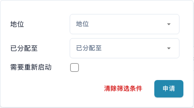
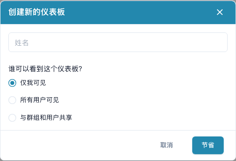
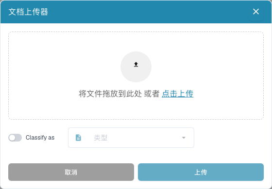

# 仪表板

仪表板是您在 DocBits 中的日常工作列表。您可以查找已导入的文档、查看状态、打开文档进行验证，并与团队协作处理工作。


可用功能取决于您的权限、文档状态以及组织启用的模块，因此部分按钮可能不会显示。在较窄的桌面窗口中，可通过**更多**菜单访问其他工具。


<figure><figcaption>
当前仪表板包含搜索、工具、已保存视图、文档类型和文档表格。为保护数据，文档中的具体值已隐藏。
</figcaption></figure>

## 开始日常工作

1. 检查当前组织，以及可用的子组织。
2. 选择文档类型，或保留**全部**。
3. 使用搜索和筛选查找所需文档。
4. 查看状态列（界面显示为**地位**）和分配对象，然后打开文档行进行处理。
5. 处理或导入文档后刷新列表。

## 搜索和筛选文档

在搜索框中输入文档名称、发票编号或其他业务值，然后按 **Enter**。搜索框中的筛选图标可按状态、分配对象和是否需要重新启动进行筛选，选择后点击**申请**（应用筛选）。找不到文档时，可移除单个筛选标签或清除筛选。文档类型选项卡和已保存视图也会缩小列表范围。

搜索工具栏还提供结构化搜索条件、原始查询视图，以及字段和语法帮助。请使用帮助中提供的字段名称和示例。切换界面语言后，技术字段名称保持不变。高级搜索功能取决于组织启用的搜索能力。

启用全文搜索后，内容搜索菜单决定普通文本搜索的范围：自动模式先搜索业务字段，没有匹配结果时再搜索文档内容；包含内容模式同时纳入内容匹配；仅字段模式只搜索字段。内容结果提示会说明结果是否来自文档内容。结果数量后的 `+` 表示结果窗口有限，请进一步缩小搜索范围。

<figure><figcaption>
按状态、分配对象和是否需要重新启动筛选文档。
</figcaption></figure>

## 阅读和调整文档表格

每一行代表一个文档。根据列配置，您可以看到名称、状态、文档类型、发票数据、供应商、分配对象、日期和金额。点击支持排序的列标题可更改排序。水平滚动可查看其他列；使用分页控件和每页文档数量浏览更多结果。

如果提供分组功能，请在表格上方选择分组字段。对于日期字段，可按日、周或月分组。展开分组可查看其中的文档；取消分组可返回普通文档列表。

点击文档类型选项卡旁的 **+** 可显示其他类型。拖动选项卡可更改顺序。移除选项卡只会更改视图，不会删除文档。

打开齿轮菜单，再打开列设置。在隐藏列和可见列列表之间移动列，并拖动可见列调整顺序。您也可以添加某种文档类型的字段。请参阅[更改文档列](change-document-columns.md)。

<figure><figcaption>
在列设置中选择并排列文档表格显示的信息。
</figcaption></figure>

## 了解状态和文档操作

处理状态表示 OCR、分类或导出等步骤。**准备验证**表示文档可供检查；审批状态表示仍有审批步骤待完成；**已完成**表示处理结束。点击**错误**状态可查看可用的错误详情。

如果存在处理耗时数据，将鼠标悬停在状态上可查看各阶段及其耗时。存在疑似重复文档时会显示重复图标，点击该图标可比较相关文档。

打开文档行后，即可在验证界面中处理文档。行操作菜单提供您有权执行的操作，例如分配、下载、查看历史记录或重新启动处理。下载选项取决于文档，可能包括带批注的版本或电子发票格式。

使用复选框选择多个文档，然后打开表头中的菜单，执行允许的批量操作，例如分配、合并、重新启动、重新导出或删除。请仔细检查所选文档和每次确认。这些操作可能更改文档；保存视图只会更改工作列表的显示方式。

## 保存个人仪表板

打开搜索框下方的蓝色视图按钮，创建新的仪表板。输入名称，并选择仅自己可见、所有用户可见，或与指定群组和用户共享。您可以为重复性工作保存筛选、排序和列配置。

在同一菜单中选择已保存视图。当您修改自己的视图后，可保存更改。您不能覆盖他人共享给您的视图，请创建自己的视图。共享视图不会增加文档访问权限。请参阅[个人仪表板](personal-dashboards.md)。

<figure><figcaption>
创建有名称的仪表板，并选择哪些人可以看到该视图。
</figcaption></figure>

## 上传文档和使用工具

选择**上传**，将文件拖入对话框或从计算机中选择文件，然后开始上传。如果提供分类选项，您可以明确指定文档类型；否则 DocBits 会自动分类导入的文件。

其他工具可刷新列表、打开高级设置、启动扫描仪、显示状态统计、启动已配置的邮件导入，以及请求 CSV 或 Excel 表格导出。扫描和导出需要相应配置。表格导出与将文档导出到 ERP 是不同的操作。请先保存个人仪表板的列更改，再请求导出，因为导出使用已保存的列配置。请参阅[仪表板工具](dashboard-tools.md)。

<figure><figcaption>
上传文件，并根据需要在导入前选择文档类型。
</figcaption></figure>

## 找不到文档或功能时

请先检查组织、当前视图、文档类型、搜索文本和筛选标签。刷新列表并查看其他结果页。如果某项功能仍不可用，请联系管理员检查权限和已启用模块。

**Ctrl/Cmd + K** 打开全局快速搜索；**Ctrl/Cmd + Q** 刷新仪表板；**Ctrl/Cmd + H** 打开帮助。齿轮菜单中提供应用内快捷键参考。如果显示整个组织的待处理文档计数，该计数是面向管理员的指标，并非您的个人任务数量。
