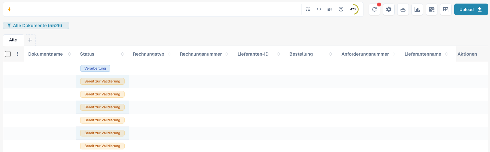
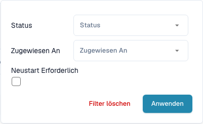
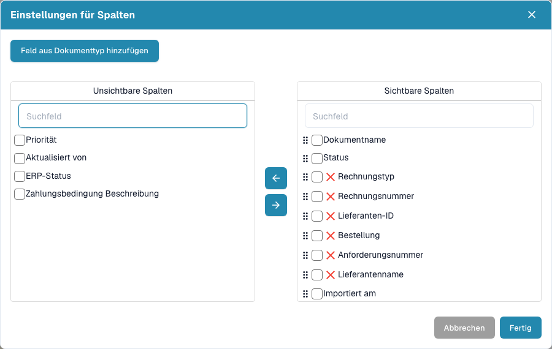
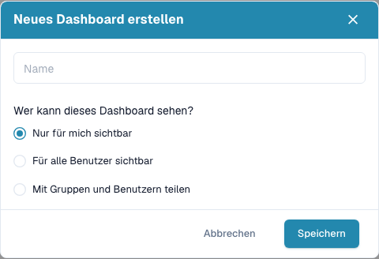
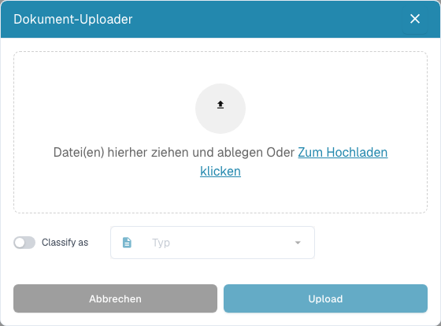

# Dashboard

Das Dashboard ist Ihre tägliche Arbeitsliste in DocBits. Hier finden Sie importierte Dokumente, prüfen ihren Status, öffnen sie zur Validierung und organisieren die Bearbeitung im Team.


Welche Funktionen Sie sehen, hängt von Ihren Berechtigungen, dem Dokumentstatus und den aktivierten Modulen Ihrer Organisation ab. Einzelne beschriebene Schaltflächen können deshalb fehlen. In schmaleren Desktop-Fenstern finden Sie weitere Werkzeugaktionen unter **Mehr**.


<figure><figcaption>
Das aktuelle Dashboard mit Suche und Werkzeugen, gespeicherten Ansichten, Dokumenttypen und Dokumenttabelle. Dokumentwerte sind zum Datenschutz ausgeblendet.
</figcaption></figure>

## Dashboard als Video

### Suche im Arbeitsalltag

Das kurze Suchbeispiel beginnt am Arbeitsplatz einer fiktiven Anwenderin in Köln. Anschließend sehen Sie die deutsche DocBits-Oberfläche bildfüllend: einen Teil des Dateinamens eingeben, mit Enter suchen und den Treffer prüfen. Das zweite Beispiel zeigt, wie die Suche mit aktiviertem Volltext-Modul auch den Dokumentinhalt findet.



### Vollständiger Dashboard-Rundgang

Die fiktive Kundin in Köln zeigt die deutsche DocBits-Oberfläche: eine kombinierte Suche mit AND, Statusfilter, die Hilfe zu Suchfeldern, die Spalteneinstellungen sowie Statusübersicht und Aktualisierung. Die sichtbaren Rechnungswerte stammen aus synthetischen Testdaten. Figur und Stimme sind KI-generiert; die Bedienung wurde im echten DocBits-Testkonto aufgenommen.



[Video mit Untertiteln ansehen](https://docbits-videos.fra1.cdn.digitaloceanspaces.com/settings-assistant/dashboard-tour-customer/v3/de.html) · [Deutsche Untertitel (VTT)](https://docbits-videos.fra1.cdn.digitaloceanspaces.com/settings-assistant/dashboard-tour-customer/v3/de.vtt) · [Transkript](https://docbits-videos.fra1.cdn.digitaloceanspaces.com/settings-assistant/dashboard-tour-customer/v3/de.txt)

## Die tägliche Arbeit beginnen

1. Prüfen Sie die aktive Organisation und gegebenenfalls die Unterorganisation.
2. Wählen Sie einen Dokumenttyp oder lassen Sie **Alle** ausgewählt.
3. Suchen und filtern Sie die benötigten Dokumente.
4. Prüfen Sie **Status** und **Zugewiesen an** und öffnen Sie die Dokumentzeile zur Bearbeitung.
5. Aktualisieren Sie die Liste nach der Verarbeitung oder dem Import von Dokumenten.

## Dokumente suchen und filtern

Geben Sie einen Dokumentnamen, eine Rechnungsnummer oder einen anderen Geschäftswert in das Suchfeld ein und drücken Sie **Enter**. Über das Symbol **Filter** (drei Schieberegler) am rechten Ende der Suchleiste wählen Sie **Status**, **Zugewiesen An** und **Neustart Erforderlich**; bestätigen Sie mit **Anwenden**. Entfernen Sie einzelne Filterchips oder verwenden Sie **Filter löschen**, wenn ein Dokument fehlt. Auch Dokumenttyp-Reiter und gespeicherte Ansichten grenzen die Liste ein.

Im Suchbeispiel wird `350495` als Teil eines Dateinamens eingegeben und mit **Enter** bestätigt. Die Trefferliste zeigt den passenden Demobeleg.

Das Symbol **Blitz** am Anfang des Suchfelds öffnet die Feldauswahl. Sie zeigt zuerst die **Schnellfilter** – fertige Suchen wie **Überfällig**, **Bald fällig**, **Mir zugewiesen**, **Heute eingegangen**, **Wartet auf Validierung** oder **Elektronische Dokumente** – und danach alle durchsuchbaren Felder. Mit der Auswahl wird die passende Bedingung in das Suchfeld übernommen.

Die Suchleiste bietet außerdem strukturierte Suchchips, eine Ansicht für die direkte Suchabfrage und eine Hilfe zu Feldern und Syntax. Übernehmen Sie Feldnamen und Beispiele aus dieser Hilfe. Technische Feldnamen bleiben beim Sprachwechsel unverändert. Erweiterte Suchfunktionen setzen die entsprechenden Suchmodule Ihrer Organisation voraus.

Bei aktivierter Volltextsuche steuert das Menü zur Inhaltssuche die Suche nach einfachem Text: Der automatische Modus durchsucht zuerst Geschäftsfelder und bei fehlenden Treffern den Dokumentinhalt. Der Modus zum Einbeziehen von Dokumentinhalten berücksichtigt auch Inhaltstreffer; der Modus nur für Felder beschränkt die Suche auf Felder. Ein Hinweis kennzeichnet Ergebnisse aus dem Dokumentinhalt. Ein `+` hinter der Trefferzahl zeigt ein begrenztes Ergebnisfenster an. Grenzen Sie die Suche dann weiter ein.

Wenn die separate Datumsbereichsauswahl angezeigt wird, wählen Sie einen vordefinierten oder eigenen Importzeitraum. Bei aktivierter Volltextsuche ist sie ausgeblendet; verwenden Sie stattdessen die verfügbaren Datumsfelder im Suchfeld.

<figure><figcaption>
Dokumente nach Status, zuständiger Person und erforderlichem Neustart filtern.
</figcaption></figure>

## Die Dokumenttabelle lesen und anpassen

Jede Zeile steht für ein Dokument. Je nach Spaltenkonfiguration sehen Sie Name, Status, Dokumenttyp, Rechnungsdaten, Lieferant, zuständige Person, Datumswerte und Beträge. Klicken Sie auf eine sortierbare Spaltenüberschrift, um die Reihenfolge zu ändern. Weitere Spalten erreichen Sie durch horizontales Scrollen. Mit der Seitennavigation und der Anzahl der Dokumente pro Seite wechseln Sie durch die Ergebnisse.

Wenn die Gruppierung verfügbar ist, wählen Sie oberhalb der Tabelle ein Gruppierungsfeld. Bei Datumsfeldern wählen Sie Tag, Woche oder Monat. Öffnen Sie eine Gruppe, um ihre Dokumente zu sehen, oder entfernen Sie die Gruppierung für die normale Dokumentliste.

Über **+** neben den Dokumenttyp-Reitern blenden Sie weitere Reiter ein. Ziehen Sie Reiter in die gewünschte Reihenfolge. Das Entfernen eines Reiters ändert nur die Ansicht und löscht keine Dokumente.

Öffnen Sie das Zahnrad **Erweiterte Einstellungen** rechts neben der Suchleiste und dort die Schaltfläche **Einstellungen für Spalten**. Verschieben Sie Spalten zwischen der ausgeblendeten und der sichtbaren Liste und ordnen Sie sichtbare Spalten per Ziehen an. Sie können auch Felder eines Dokumenttyps hinzufügen. Siehe [Dokumentspalten ändern](change-document-columns.md).

<figure><figcaption>
In den Spalteneinstellungen wählen und ordnen Sie die Informationen der Tabelle.
</figcaption></figure>

## Status und Dokumentaktionen verstehen

Verarbeitungsstatus zeigen Schritte wie OCR, Klassifizierung oder Export an. **Bereit zur Validierung** bedeutet, dass Sie das Dokument prüfen können. Freigabestatus zeigen einen ausstehenden Genehmigungsschritt an. **Exportiert** kennzeichnet den abgeschlossenen Dokumentexport. Klicken Sie bei **Fehler** auf den Fehlerstatus, um verfügbare Fehlerdetails zu öffnen.

Wenn Verarbeitungszeiten vorliegen, bewegen Sie den Mauszeiger über den Status, um Phasen und Dauer zu sehen. Bei möglichen Duplikaten erscheint ein Duplikatsymbol; öffnen Sie es, um die zugehörigen Dokumente zu vergleichen.

Öffnen Sie eine Dokumentzeile, um in der Validierungsansicht zu arbeiten. Im Aktionsmenü der Zeile finden Sie die für das Dokument erlaubten Vorgänge, etwa Zuweisen, Herunterladen, Verlauf oder Neustart der Verarbeitung. Verfügbare Downloadvarianten hängen vom Dokument ab und können Anmerkungen oder elektronische Rechnungsformate enthalten.

Wählen Sie mehrere Dokumente über ihre Kontrollkästchen aus und öffnen Sie das Menü im Tabellenkopf für erlaubte Sammelaktionen, etwa Zuweisen, Zusammenführen, Neustart, Exportneustart oder Löschen. Prüfen Sie Auswahl und Bestätigung sorgfältig. Diese Aktionen können Dokumente verändern; das Speichern einer Ansicht ändert nur die Darstellung der Arbeitsliste.

## Ein persönliches Dashboard speichern

Öffnen Sie die Ansichts-Schaltfläche unter dem Suchfeld und wählen Sie **Neues Dashboard erstellen**. Vergeben Sie einen Namen und wählen Sie **Nur für mich sichtbar**, **Für alle Benutzer sichtbar** oder **Mit Gruppen und Benutzern teilen**. So speichern Sie Filter, Sortierung und Spalten für wiederkehrende Aufgaben.

Wählen Sie gespeicherte Ansichten im selben Menü. Spätere Anpassungen speichern Sie mit **Dashboard-Änderungen speichern**, sobald Ihre eigene Ansicht geändert wurde. Eine mit Ihnen geteilte Ansicht können Sie nicht überschreiben; erstellen Sie stattdessen eine eigene. Das Teilen einer Ansicht erweitert keine Dokumentberechtigungen. Siehe [Persönliche Dashboards](personal-dashboards.md).

<figure><figcaption>
Ein benanntes Dashboard erstellen und seine Sichtbarkeit festlegen.
</figcaption></figure>

## Dokumente hochladen und Werkzeuge nutzen

Wählen Sie **Upload**, ziehen Sie Dateien in den Dialog oder wählen Sie Dateien vom Computer und starten Sie den Upload. Falls verfügbar, legen Sie mit der Klassifizierungsoption einen Dokumenttyp ausdrücklich fest. Andernfalls klassifiziert DocBits die importierten Dateien automatisch.

Die übrigen Werkzeuge aktualisieren die Liste, öffnen erweiterte Einstellungen, starten einen Scanner, zeigen Statusstatistiken, starten den konfigurierten E-Mail-Import oder fordern einen Tabellenexport als CSV beziehungsweise Excel an. Scannen und Tabellenexport erfordern die entsprechende Konfiguration. Ein Tabellenexport ist ein anderer Vorgang als der Export eines Dokuments an Ihr ERP. Speichern Sie Spaltenänderungen an einem persönlichen Dashboard vor dem Export, weil dieser die gespeicherte Spaltenkonfiguration verwendet. Siehe [Dashboard-Werkzeuge](dashboard-tools.md).

<figure><figcaption>
Dateien hochladen und bei Bedarf vor dem Import einen Dokumenttyp auswählen.
</figcaption></figure>

## Wenn ein Dokument oder eine Funktion fehlt

Prüfen Sie zuerst Organisation, aktive Ansicht, Dokumenttyp, Suchtext und Filterchips. Aktualisieren Sie die Liste und prüfen Sie weitere Ergebnisseiten. Fehlt eine Funktion weiterhin, lassen Sie Berechtigungen und aktivierte Module durch Ihre Administration prüfen.

**Strg/Cmd + K** öffnet die globale Schnellsuche. **Strg/Cmd + Q** aktualisiert das Dashboard; **Strg/Cmd + H** öffnet die Hilfe. Die Übersicht der Tastenkürzel finden Sie im Menü **Erweiterte Einstellungen**. Ein gegebenenfalls angezeigter organisationsweiter Zähler ausstehender Dokumente ist eine Administratoranzeige und kein persönlicher Aufgabenzähler.

Verwenden Sie unter Windows/Linux Strg und unter macOS Cmd. Tastenkürzel des Browsers oder Betriebssystems können Vorrang haben.
