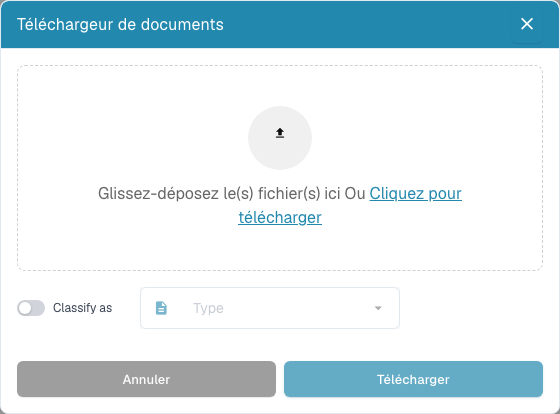
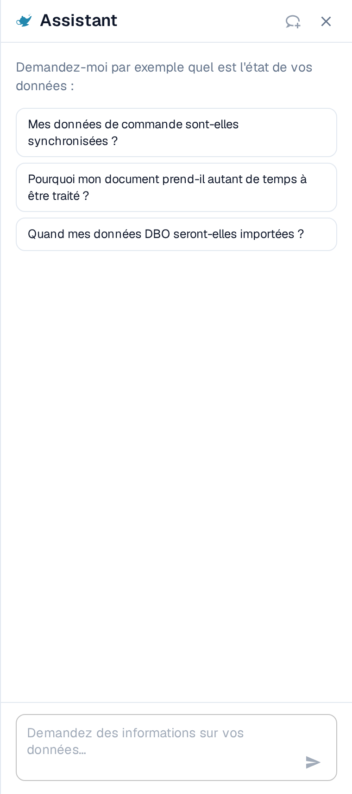

# Outils du tableau de bord

Les outils se trouvent à côté de la recherche. Survolez une icône pour afficher son libellé. Dans les fenêtres de bureau plus étroites, ouvrez **Plus**.

| Outil | Utilisation |
| --- | --- |
| Actualiser | Rechargez la liste et les statuts. Un indicateur signale la disponibilité de données plus récentes. |
| Paramètres avancés (engrenage) | Ouvrez **Plus de paramètres**, la référence **Raccourcis clavier**, le **Journal d’importation** et la boîte de dialogue **Paramètres de colonnes**. Les paramètres de toute l’organisation nécessitent des droits d’administration. |
| Numériser un document | Ouvrez la boîte de dialogue si la numérisation est activée et un scanner compatible est disponible. Choisissez l’appareil et les paramètres avant de commencer. |
| Analyse | Affichez les statistiques de statut et sélectionnez une catégorie pour filtrer la liste. |
| Démarrer l’import de courriels | Lancez un import avec la configuration de messagerie existante. Cette action ne configure pas de boîte mail. |
| Exporter le tableau | Demandez un CSV ou un fichier Excel si l’option est activée. Enregistrez d’abord les changements de colonnes de votre vue personnelle : l’export lit la configuration enregistrée. |
| Télécharger des fichiers | Choisissez ou déposez des fichiers, précisez éventuellement leur type et lancez l’importation. |
| Assistant (lampe) | Ouvre le panneau **Assistant** à côté du tableau de bord pour poser des questions sur l’état de vos données. |

<figure><figcaption>
Importez des fichiers et choisissez leur type de document avant l’importation si nécessaire.
</figcaption></figure>

Le journal aide à vérifier les imports de courriels. Filtrez par objet ou expéditeur et consultez les informations disponibles. La confirmation d’une demande d’export du tableau signifie que la demande a été soumise ; elle ne signifie pas qu’un document a été exporté vers l’ERP.

## Poser des questions sur vos données

L’icône en forme de lampe, dans la barre d’outils, ouvre le panneau **Assistant** à côté du tableau de bord. Posez-y vos questions sur l’état de vos données en langage courant, par exemple :

* Mes données de commande sont-elles synchronisées ?
* Pourquoi mon document prend-il autant de temps à être traité ?
* Quand mes données DBO seront-elles importées ?

Choisissez une des questions proposées ou saisissez la vôtre dans **Demandez des informations sur vos données…**, puis envoyez-la avec la flèche située à droite du champ.

<figure><figcaption>
Le panneau Assistant s’ouvre à côté du tableau de bord et propose des questions pour démarrer.
</figcaption></figure>


L’icône en forme de lampe n’apparaît que si l’assistant est activé pour votre organisation. Si vous ne la voyez pas, contactez votre administrateur.


Le [guide du tableau de bord](README.md) présente la recherche, les actions et les vues enregistrées.
