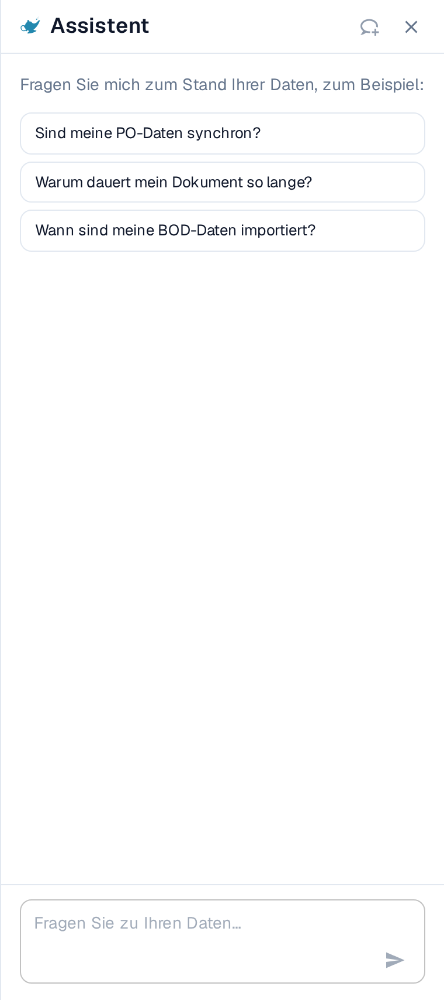

# Dashboard-Werkzeuge

Die Werkzeuge stehen neben der Dashboard-Suche. Bewegen Sie den Mauszeiger über ein Symbol, um seine Beschriftung zu sehen. In schmaleren Desktop-Fenstern finden Sie weitere Aktionen unter **Mehr**.

| Werkzeug | Verwendung |
| --- | --- |
| Aktualisieren | Liste und Status neu laden. Ein Änderungshinweis an der Schaltfläche zeigt an, dass neuere Daten verfügbar sind. |
| Erweiterte Einstellungen (Zahnrad) | **Weitere Einstellungen**, die **Tastaturkurzbefehle**, das **Importprotokoll** und den Dialog **Einstellungen für Spalten** öffnen. Organisationsweite Einstellungen erfordern Administratorrechte. |
| Dokument scannen | Scanner-Dialog öffnen, sofern das Scannen aktiviert und ein kompatibler Scanner verfügbar ist. Gerät und Einstellungen vor dem Start auswählen. |
| Analysen | Statusstatistiken im Dashboard einblenden. Eine Statuskategorie auswählen, um die Liste einzugrenzen. |
| E-Mail-Import starten | Einen Import mit der vorhandenen Postfachkonfiguration starten. Damit wird kein Postfach eingerichtet. |
| Tabelle exportieren | Wenn aktiviert, einen CSV- oder Excel-Export anfordern. Spaltenänderungen am persönlichen Dashboard vorher speichern, da der Export die gespeicherte Konfiguration liest. |
| Upload | Dateien auswählen oder in den Dialog ziehen, bei Bedarf einen Dokumenttyp festlegen und den Upload starten. |
| Assistant (Lampe) | Öffnet die Leiste **Assistant** neben dem Dashboard, in der Sie Fragen zum Stand Ihrer Daten stellen. |

<figure><figcaption>
Dateien hochladen und bei Bedarf vor dem Import einen Dokumenttyp auswählen.
</figcaption></figure>

Das Importprotokoll hilft bei der Prüfung von E-Mail-Importen. Filtern Sie nach Betreff oder Absender und prüfen Sie die verfügbaren Importinformationen. Eine erfolgreiche Tabellenexport-Anforderung bestätigt die Übermittlung des Auftrags. Sie bedeutet nicht, dass ein Dokument an Ihr ERP exportiert wurde.

## Fragen zum Stand Ihrer Daten stellen

Das Lampensymbol in der Werkzeugleiste öffnet rechts neben dem Dashboard die Leiste **Assistant**. Stellen Sie dort Fragen zum Stand Ihrer Daten in normaler Sprache, zum Beispiel:

* Sind meine PO-Daten synchron?
* Warum dauert mein Dokument so lange?
* Wann sind meine BOD-Daten importiert?

Wählen Sie einen der vorgeschlagenen Sätze aus oder schreiben Sie Ihre eigene Frage in das Feld **Fragen Sie zu Ihren Daten…** und senden Sie sie mit dem Pfeil rechts im Feld.

<figure><figcaption>
Die Leiste Assistant öffnet sich neben dem Dashboard und schlägt Fragen für den Einstieg vor.
</figcaption></figure>


Das Lampensymbol erscheint nur, wenn der Assistant für Ihre Organisation aktiviert ist. Sehen Sie es nicht, wenden Sie sich an Ihre Administration.


Suche, Dokumentaktionen und gespeicherte Ansichten erklärt die [Dashboard-Anleitung](README.md).
