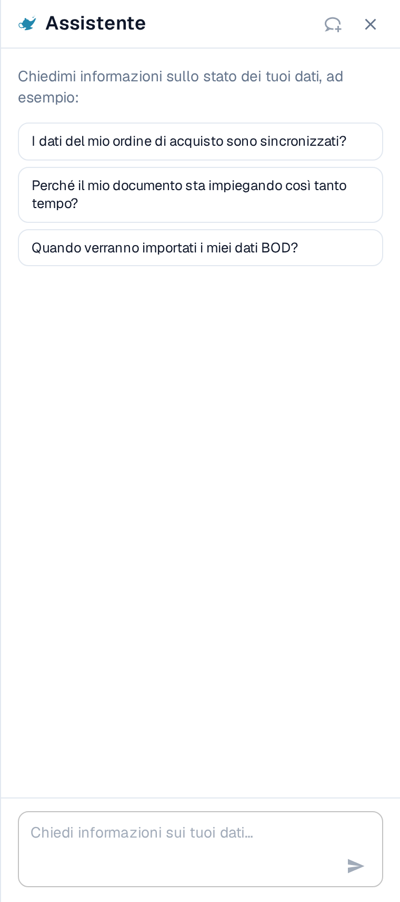

# Strumenti della dashboard

Gli strumenti sono accanto alla ricerca. Passa il puntatore su un’icona per leggerne l’etichetta. Nelle finestre desktop più strette, apri **Altro**.

| Strumento | Utilizzo |
| --- | --- |
| Aggiorna | Ricarica elenco e stati. Un indicatore segnala che sono disponibili dati più recenti. |
| Impostazioni avanzate (ingranaggio) | Apri **Altre impostazioni**, il riferimento **Scorciatoie da tastiera**, **Importa registro** e la finestra **Impostazioni delle colonne**. Le impostazioni dell’intera organizzazione richiedono diritti amministrativi. |
| Scansiona documento | Apri la finestra se la scansione è abilitata e uno scanner compatibile è disponibile. Seleziona dispositivo e impostazioni prima di iniziare. |
| Analisi | Mostra statistiche di stato e seleziona una categoria per filtrare l’elenco. |
| Avvia importazione email | Avvia un’importazione con la configurazione di posta esistente. Questa azione non configura una casella. |
| Esporta tabella | Richiedi CSV o Excel se abilitato. Salva prima le modifiche alle colonne della vista personale: l’esportazione legge la configurazione salvata. |
| Caricare | Seleziona o trascina file, scegli eventualmente un tipo di documento e avvia il caricamento. |
| Assistente (lampada) | Apre il pannello **Assistente** accanto alla dashboard per fare domande sullo stato dei tuoi dati. |

<figure><figcaption>
Carica file e, se necessario, scegli il loro tipo di documento prima dell’importazione.
</figcaption></figure>

Il registro permette di verificare le importazioni email. Filtra per oggetto o mittente e consulta le informazioni disponibili. La conferma di una richiesta di esportazione della tabella indica che il lavoro è stato inviato, non che un documento sia stato esportato verso l’ERP.

## Fare domande sui tuoi dati

L’icona a forma di lampada nella barra degli strumenti apre il pannello **Assistente** accanto alla dashboard. Fai lì le tue domande sullo stato dei dati, in linguaggio naturale, per esempio:

* I dati del mio ordine di acquisto sono sincronizzati?
* Perché il mio documento sta impiegando così tanto tempo?
* Quando verranno importati i miei dati BOD?

Scegli una delle domande proposte oppure scrivi la tua in **Chiedi informazioni sui tuoi dati…** e inviala con la freccia.

<figure><figcaption>
Il pannello Assistente si apre accanto alla dashboard e propone domande per iniziare.
</figcaption></figure>


L’icona a forma di lampada compare solo se l’assistente è attivo per la tua organizzazione. Se non la vedi, rivolgiti all’amministratore.


La [guida alla dashboard](README.md) descrive ricerca, azioni e viste salvate.
