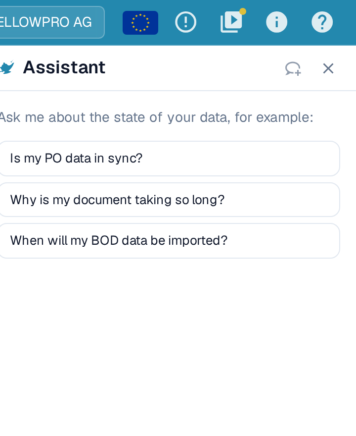

# Dashboard Tools

The toolbar is beside the dashboard search. Hover over an icon to see its label. On narrower desktop windows, open **More** for additional actions.

| Tool | Use |
| --- | --- |
| Refresh | Reload the list and statuses. A change indicator on the refresh button means newer data is available. |
| Advanced settings (gear) | Open column settings, the keyboard-shortcut reference and the email import log. Organization-wide settings require administrator access. |
| Scan document | Open the scanner dialog when document scanning is enabled and a compatible scanner is available. Choose a device and scan settings before starting. |
| Analytics | Show the dashboard status statistics. Select a status category to narrow the list. |
| Start email import | Start an import using the organization's existing mailbox configuration. This does not configure a mailbox. |
| Export this table | Request a CSV or Excel export when enabled. Save changes to a personal dashboard's columns first; the export reads its saved column configuration. |
| Upload | Open the file dialog, select or drop files, optionally choose Classify As, then start the upload. |
| Assistant (lamp) | Open the assistant panel to ask questions about the state of your data. |

<figure><figcaption>
Upload files and optionally choose their document type before importing.
</figcaption></figure>

The import log helps you check email imports. Filter it by subject or sender and inspect the available import information. A successful table-export request confirms that the request was submitted; it does not mean that a document was exported to your ERP.

## Ask about your data

The **Assistant** (the lamp icon in the toolbar) opens a panel beside the dashboard. Ask it about the state of your data in plain language, for example:

* Is my PO data in sync?
* Why is my document taking so long?
* When will my BOD data be imported?

Pick one of the suggested questions or type your own into **Ask about your data…** and send it with the arrow button.

<figure><figcaption>
The assistant opens next to the dashboard with questions you can start from.
</figcaption></figure>


The lamp icon only appears when the assistant is enabled for your organisation. If you do not see it, ask your administrator.


For searching, document actions and saved views, return to the [dashboard guide](README.md).
