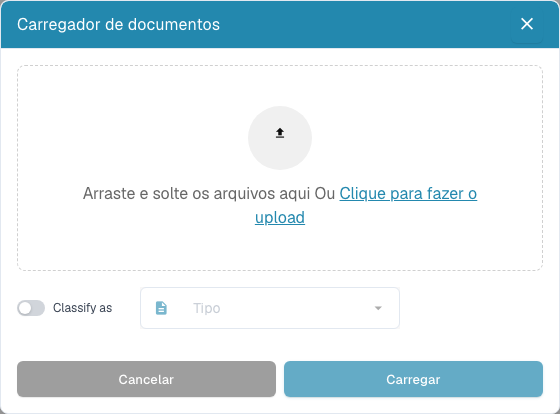
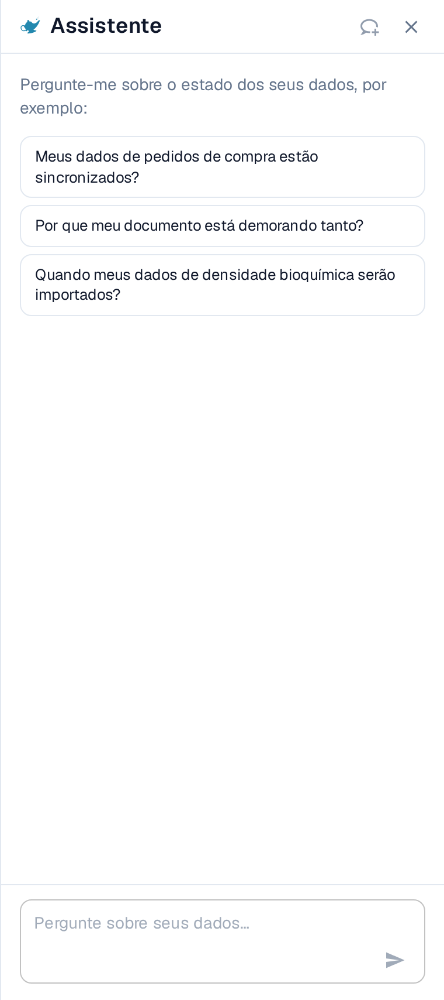

# Ferramentas do painel

As ferramentas estão junto à pesquisa. Passe o ponteiro sobre um ícone para ver a etiqueta. Em janelas de computador mais estreitas, abra **Mais**.

| Ferramenta | Utilização |
| --- | --- |
| Atualizar | Volte a carregar a lista e os estados. Um indicador de alterações assinala dados mais recentes. |
| Definições avançadas (engrenagem) | Abra definições de colunas, atalhos e registo de importação de correio. As definições da organização exigem permissões de administrador. |
| Digitalizar documento | Abra a janela se a digitalização estiver ativa e houver um scanner compatível. Escolha dispositivo e definições antes de iniciar. |
| Análise | Mostre estatísticas de estado e selecione uma categoria para filtrar a lista. |
| Iniciar importação de correio | Inicie uma importação com a configuração de caixa de correio existente. Esta ação não configura uma caixa. |
| Exportar tabela | Peça CSV ou Excel se a opção estiver ativa. Guarde primeiro as alterações de colunas da vista pessoal: a exportação lê a configuração guardada. |
| Carregar | Escolha ou arraste ficheiros, indique opcionalmente um tipo de documento e inicie o carregamento. |
| Assistente (lâmpada) | Abre o painel **Assistente** ao lado do painel para colocar questões sobre o estado dos seus dados. |

<figure><figcaption>
Carregue ficheiros e, se necessário, escolha o tipo de documento antes da importação.
</figcaption></figure>

O registo permite verificar importações de correio. Filtre por assunto ou remetente e consulte a informação disponível. Uma confirmação de pedido de exportação da tabela significa que o pedido foi enviado; não significa que um documento tenha sido exportado para o ERP.

## Perguntar pelo estado dos seus dados

O ícone de lâmpada na barra de ferramentas abre o painel **Assistente** ao lado do painel. Coloque aí as suas questões sobre o estado dos dados em linguagem corrente, por exemplo:

* Os meus dados de pedidos de compra estão sincronizados?
* Por que razão o meu documento está a demorar tanto?
* Quando serão importados os meus dados de BOD?

Escolha uma das questões sugeridas ou escreva a sua em **Pergunte sobre seus dados…** e envie-a com a seta.

<figure><figcaption>
O painel Assistente abre ao lado do painel e sugere questões para começar.
</figcaption></figure>


O ícone de lâmpada só aparece quando o assistente está ativo para a sua organização. Se não o vir, fale com o administrador.


O [guia do painel](README.md) descreve pesquisa, ações e vistas guardadas.
