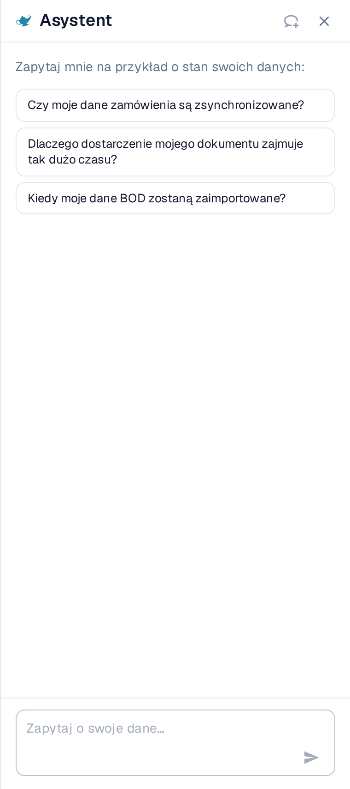

# Narzędzia pulpitu

Narzędzia znajdują się obok wyszukiwarki. Najedź na ikonę, aby zobaczyć jej opis. W węższych oknach na komputerze otwórz **Więcej**.

| Narzędzie | Zastosowanie |
| --- | --- |
| Odśwież | Wczytaj listę i statusy ponownie. Wskaźnik zmian informuje o dostępności nowszych danych. |
| Ustawienia zaawansowane (koło zębate) | Otwórz **Więcej ustawień**, listę **Skróty klawiaturowe**, **Importuj dziennik** oraz okno **Ustawienia kolumn**. Ustawienia całej organizacji wymagają uprawnień administratora. |
| Skanuj dokument | Otwórz okno, jeśli skanowanie jest aktywne i dostępny jest zgodny skaner. Wybierz urządzenie i ustawienia przed rozpoczęciem. |
| Analiza | Pokaż statystyki statusów i wybierz kategorię, aby ograniczyć listę. |
| Rozpocznij import poczty | Uruchom import według istniejącej konfiguracji skrzynki. To działanie nie konfiguruje skrzynki. |
| Eksportuj tabelę | Zleć CSV lub Excel, jeśli opcja jest aktywna. Najpierw zapisz zmiany kolumn widoku osobistego: eksport odczytuje zapisaną konfigurację. |
| Wgrywać | Wybierz lub przeciągnij pliki, opcjonalnie wskaż typ dokumentu i rozpocznij przesyłanie. |
| Asystent (lampa) | Otwiera panel **Asystent** obok pulpitu, w którym można pytać o stan danych. |

<figure><figcaption>
Prześlij pliki i w razie potrzeby wybierz typ dokumentu przed importem.
</figcaption></figure>

Dziennik pozwala sprawdzać importy poczty. Filtruj według tematu lub nadawcy i przeglądaj dostępne informacje. Potwierdzenie zlecenia eksportu tabeli oznacza wysłanie zadania, a nie wyeksportowanie dokumentu do ERP.

## Pytania o stan danych

Ikona lampy na pasku narzędzi otwiera panel **Asystent** obok pulpitu. Zadawaj w nim pytania o stan swoich danych zwykłym językiem, na przykład:

* Czy moje dane zamówienia są zsynchronizowane?
* Dlaczego dostarczenie mojego dokumentu zajmuje tak dużo czasu?
* Kiedy moje dane BOD zostaną zaimportowane?

Wybierz jedno z proponowanych pytań albo wpisz własne w polu **Zapytaj o swoje dane…** i wyślij je strzałką.

<figure><figcaption>
Panel Asystent otwiera się obok pulpitu i podpowiada pytania na start.
</figcaption></figure>


Ikona lampy pojawia się tylko wtedy, gdy asystent jest włączony dla danej organizacji. Jeśli jej nie widać, należy skontaktować się z administratorem.


Wyszukiwanie, działania i widoki opisuje [przewodnik po pulpicie](README.md).
