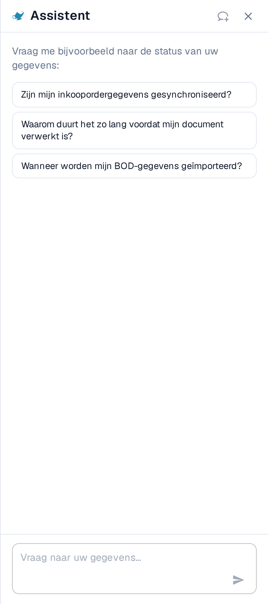

# Dashboard-hulpmiddelen

De hulpmiddelen staan naast het zoekvak. Beweeg de aanwijzer over een pictogram voor het label. Open in smallere desktopvensters **Meer**.

| Hulpmiddel | Gebruik |
| --- | --- |
| Vernieuwen | Laad de lijst en statussen opnieuw. Een wijzigingsindicator betekent dat nieuwere gegevens beschikbaar zijn. |
| Geavanceerde instellingen (tandwiel) | Open **Meer instellingen**, de lijst **Sneltoetsen**, het **Importlogboek** en het venster **Kolommeninstellingen**. Instellingen voor de hele organisatie vereisen beheerdersrechten. |
| Document scannen | Open het scanvenster wanneer scannen is ingeschakeld en een geschikte scanner beschikbaar is. Kies apparaat en instellingen voordat u begint. |
| Analyse | Toon statusstatistieken en kies een categorie om de lijst te filteren. |
| E-mailimport starten | Start een import met de bestaande postvakconfiguratie. Deze actie stelt geen postvak in. |
| Tabel exporteren | Vraag CSV of Excel aan als dit is ingeschakeld. Sla kolomwijzigingen van uw persoonlijke weergave eerst op: de export leest de opgeslagen configuratie. |
| Uploaden | Kies of sleep bestanden, stel eventueel een documenttype in en start de upload. |
| Assistent (lamp) | Opent het paneel **Assistent** naast het dashboard om vragen te stellen over de status van uw gegevens. |

<figure><figcaption>
Upload bestanden en kies zo nodig vóór de import een documenttype.
</figcaption></figure>

Controleer e-mailimports in het importlogboek. Filter op onderwerp of afzender en bekijk de beschikbare informatie. Een geslaagde aanvraag voor een tabelexport bevestigt dat de opdracht is verstuurd; dit betekent niet dat een document naar uw ERP is geëxporteerd.

## Vragen stellen over uw gegevens

Het lamp-pictogram in de werkbalk opent het paneel **Assistent** naast het dashboard. Stel daar in gewone taal uw vragen over de status van uw gegevens, bijvoorbeeld:

* Zijn mijn inkoopordergegevens gesynchroniseerd?
* Waarom duurt het zo lang voordat mijn document verwerkt is?
* Wanneer worden mijn BOD-gegevens geïmporteerd?

Kies een van de voorgestelde vragen of typ uw eigen vraag in **Vraag naar uw gegevens…** en verstuur die met de pijl.

<figure><figcaption>
Het paneel Assistent opent naast het dashboard en stelt vragen voor om mee te beginnen.
</figcaption></figure>


Het lamp-pictogram verschijnt alleen als de assistent voor uw organisatie is ingeschakeld. Ziet u het niet, vraag het dan aan uw beheerder.


De [dashboardhandleiding](README.md) beschrijft zoeken, documentacties en opgeslagen weergaven.
