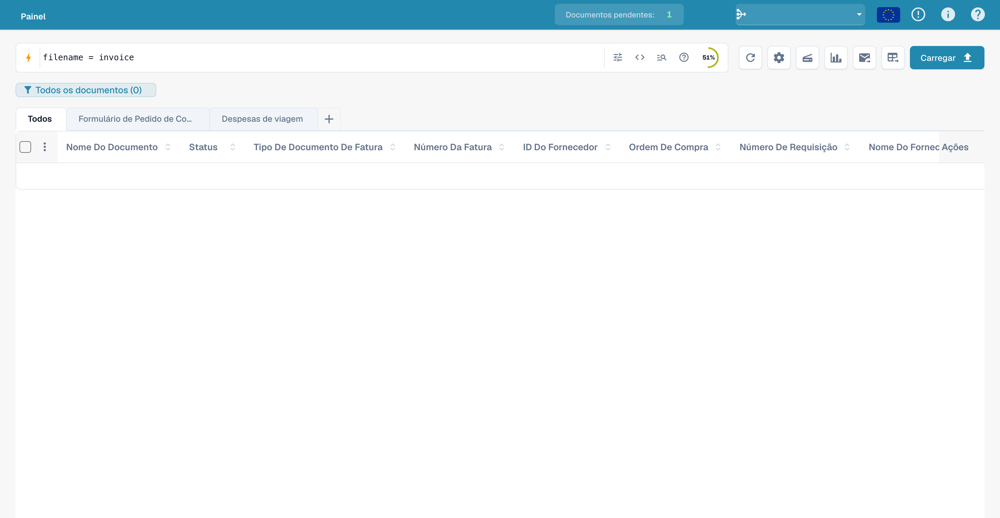
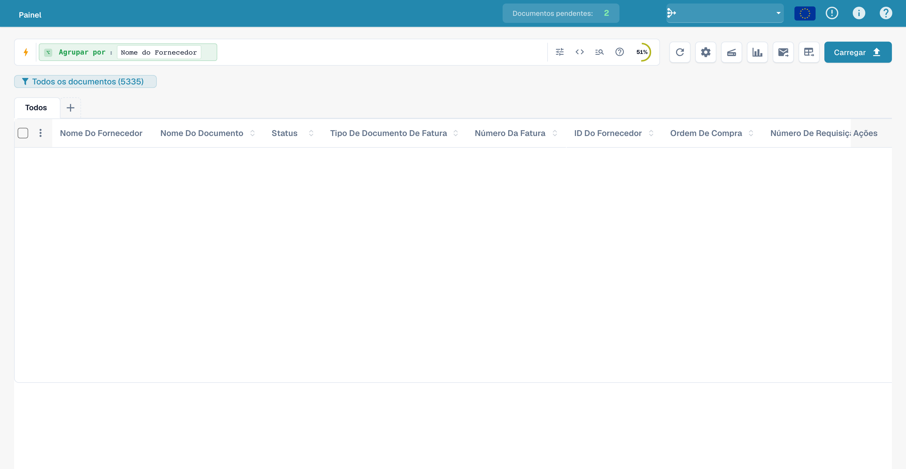
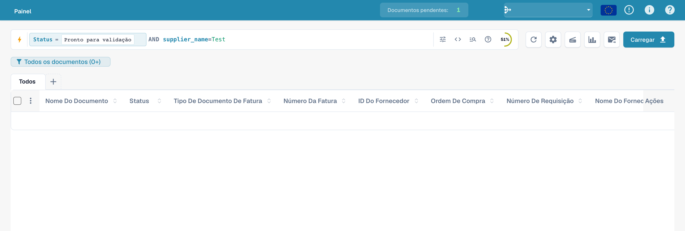
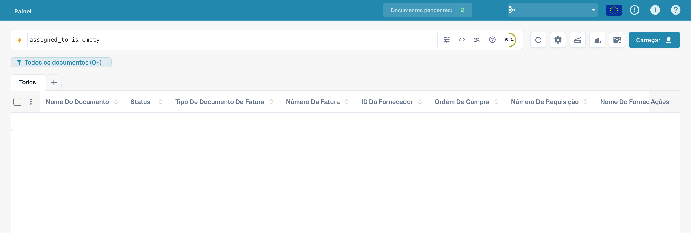
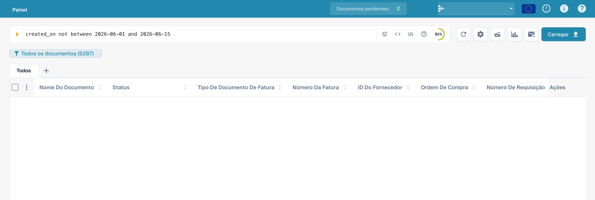
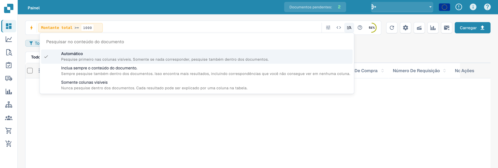
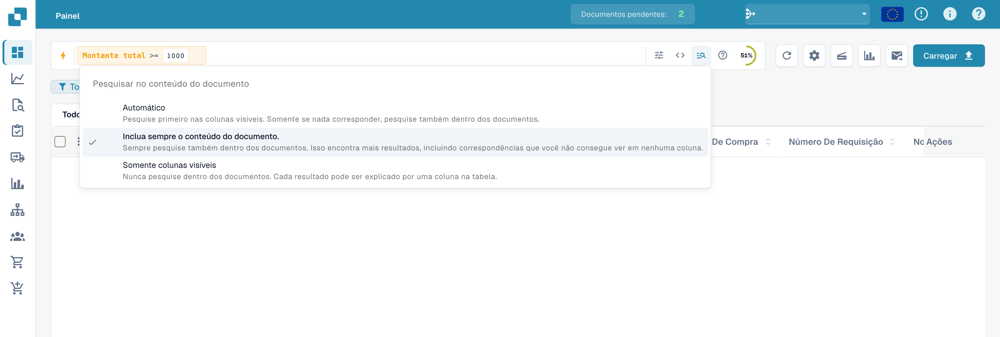
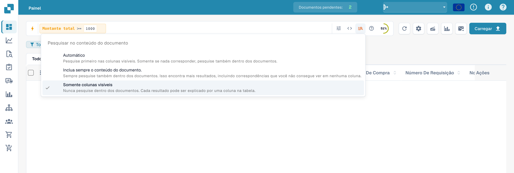

# Pesquisa rápida

A **Quick Search** é a forma mais rápida de encontrar documentos no Dashboard. Você digita o que procura — um nome, um status, um valor, uma data — e a lista de documentos é filtrada instantaneamente.

Este guia está organizado da forma como a pesquisa é construída:

1. **Campos padrão** — as colunas que todo documento tem (nome do documento, status, datas). Sempre disponíveis.
2. **Campos de texto completo (fulltext)** — conteúdo extraído (fornecedor, pedido de compra, número da fatura, valores, itens de linha). Disponíveis quando a pesquisa fulltext está ativada.
3. **Operadores, atalhos e receitas** — a referência completa para quando você já estiver familiarizado.

> Você não precisa memorizar nada: clique na barra de pesquisa e escolha um campo e um valor na lista — a Quick Search monta a consulta para você. Os exemplos abaixo também mostram a forma digitada, para que você possa copiá-los diretamente.

<figure><figcaption><p>Pesquisa rápida no painel em português.</p></figcaption></figure>

---

## Como a barra de pesquisa funciona — chips, barra de ferramentas e visualização bruta

Antes dos campos em si, é útil saber como a barra está organizada.

### As condições viram chips

Quando você conclui uma condição (um campo, um operador e um valor), a Quick Search a transforma em um **chip** — uma pílula colorida dentro da barra — e inicia uma nova. Um chip mostra o **campo**, o **operador** e o **valor**, com um **×** para removê-lo. Os chips têm cores de acordo com o local em que os dados estão:

| Cor do chip | Tipo de campo |
|-------------|---------------|
| **Azul** | Coluna padrão (nome do documento, status, datas) |
| **Laranja** | Campo fulltext / extraído (fornecedor, valor, número da fatura) |
| **Roxo** | Pesquisa vetorial (semântica) |
| **Verde** | Pesquisa de texto OCR |

Clique em um chip para editá-lo (ele volta a se expandir como texto); clique em **×** para excluí-lo. Vários chips combinados são lidos como **AND** por padrão.

### A barra de ferramentas

Na extremidade direita da barra:

- **ⓘ Help** — abre a referência **Pesquisa no painel — Campos e sintaxe** do aplicativo, com todos os campos, operadores e atalhos disponíveis no seu workspace.
- **Filtros** (três barras deslizantes) — um painel rápido para os filtros comuns **Status**, **Atribuído a** e **Reinicialização necessária**, com **Limpar filtros** e **Aplicar**.
- **Resumo do índice** — um pequeno anel de progresso que mostra quanto do seu índice fulltext já foi construído (exibido apenas quando a pesquisa fulltext está ativada).

### Visualização padrão vs. bruta

A barra normalmente mostra sua consulta como chips (**visualização padrão**). Mude para a **visualização bruta** para ver e editar a consulta como texto simples (por exemplo, `status=ready_for_validation AND supplier_name=Test`) — útil para copiar, compartilhar ou digitar diretamente uma consulta longa. Sua consulta é mantida na troca e lembrada quando você recarrega o Dashboard.

---

## Parte 1 — Campos padrão

Os campos padrão são as próprias colunas do documento. Eles estão **sempre disponíveis**, esteja a pesquisa fulltext ativada ou não.

### Encontrar documentos pelo nome

O nome do documento é a pesquisa mais comum. Há três formas de correspondência — todas **sem diferenciar maiúsculas de minúsculas**:

#### `=` → começa com

```
filename=invoice
```

Encontra documentos cujo nome **começa com** "invoice". A correspondência ignora maiúsculas e minúsculas, então todos estes correspondem a `filename=invoice`:

```
Invoice.pdf   iNVoice.pdf   iNvoiCE.pdf   INVOICE.pdf
Invoice.xml   iNVoice.xml   iNvoiCE.edi   …
```

Ele **não** corresponde a `XYZ_Invoice.pdf` (nesse caso "invoice" está no meio — use `:` para isso).

<figure><figcaption><p>Introdução de consulta pelo nome do ficheiro.</p></figcaption></figure>

#### `:` → contém (em qualquer posição)

```
filename:invoice
```

Use `:` para encontrar a palavra **em qualquer posição** do nome — `2026_Invoice.pdf`, `vietnam_einvoice_sample.xml`, `scan_invoice_copy.pdf`.

<figure><figcaption><p>Pesquisa por parte do nome do ficheiro: filename:invoice.</p></figcaption></figure>

#### `="…"` → começa *ou* termina com

```
filename="invoice"
```

As aspas fazem o `=` corresponder a nomes que **começam ou terminam** com o valor — útil para um código no início ou para o final de um arquivo.

> **As três em uma linha:** `=` → começa com · `:` → contém · `="…"` → começa ou termina com. Todas ignoram maiúsculas e minúsculas. Você pode ver esse resumo a qualquer momento pelo **ícone de ajuda** na barra de pesquisa (próxima seção).

### Encontrar documentos por status

```
status=ready_for_validation
```

O status é uma lista fixa, então `=` é uma correspondência **exata** e a barra oferece um seletor de valores quando você digita `status=`.

<figure><figcaption><p>Introdução de filtro pelo estado técnico ready_for_validation.</p></figcaption></figure>

### Encontrar documentos por data

```
created_on>2026-05-25
```

Use `>`, `<`, `>=`, `<=` para intervalos de datas. Você também pode usar datas **relativas**: `today()`, `today()-7` (últimos 7 dias), `today()+30` (próximos 30 dias).

<figure><figcaption><p>Consulta de documentos criados após 25 de maio de 2026.</p></figcaption></figure>

### Encontrar documentos por subtipo de fatura

```
invoice_sub_type="Cost Invoice"
```

O subtipo de fatura é uma lista fixa (por exemplo, **Fatura de Custo** ou **Nota fiscal de compra**), então `=` é uma correspondência **exata** e a barra oferece um seletor de valores quando você digita `invoice_sub_type=`. Use `invoice_sub_type!="Cost Invoice"` para tudo, exceto esse subtipo.

---

## Parte 2 — Campos fulltext

Os campos fulltext pesquisam o **conteúdo extraído** dos seus documentos — fornecedor, pedido de compra, número da fatura, valores, itens de linha. Eles aparecem em **laranja** e ficam disponíveis quando a **pesquisa fulltext está ativada** para a sua organização. As regras de correspondência são exatamente as mesmas dos campos de texto padrão (`=` começa com, `:` contém, `="…"` começa ou termina com).

### Encontrar documentos de um fornecedor

```
supplier_name=Test
```

Começa com, aplicado ao nome do fornecedor extraído. Use `supplier_name:Example` para corresponder em qualquer posição, ou `supplier_name:"Example"` para colocar entre aspas um valor com espaços.

<figure><figcaption><p>Exemplo de consulta de fornecedor: supplier_name=Test.</p></figcaption></figure>

### Encontrar documentos por pedido de compra

```
purchase_order=PO
```

Começa com, aplicado ao número do pedido de compra extraído — ótimo para um prefixo de pedido de compra.

<figure><figcaption><p>Exemplo de consulta de ordem de compra: purchase_order=PO.</p></figcaption></figure>

### Encontrar documentos por valor

```
total_amount>5000
```

Use `>`, `<`, `>=`, `<=` ou `between 100 and 500` para uma faixa.

<figure><figcaption><p>Introdução de filtro por montantes totais superiores a 5000.</p></figcaption></figure>

Para uma faixa de valores, use `between`:

```
total_amount between 1000 and 5000
```

Isso é uma forma abreviada de `total_amount>=1000 AND total_amount<=5000`.

<figure><figcaption><p>Introdução de consulta por montantes entre 1000 e 5000.</p></figcaption></figure>

### Encontrar o que está faltando

```
supplier_name=""
```

`=""` significa "este campo **não está preenchido**"; `supplier_name!=""` significa "tem algum fornecedor".

<figure><figcaption><p>Introdução de filtro por nome de fornecedor vazio.</p></figcaption></figure>

A mesma verificação de presença funciona em qualquer campo — por exemplo, documentos que ainda não têm um código de atribuição de AP:

```
ap_assignment_code=""
```

<figure><figcaption><p>Pesquisa de documentos sem atribuição AP.</p></figcaption></figure>

---

## Filtros inteligentes — com um clique

O ícone **raio** no início do campo de pesquisa abre o seletor de campos. No topo desse
seletor estão os **Filtros inteligentes**: pesquisas prontas que você aplica com um único
clique. Cada uma é apenas um atalho para uma consulta que você também poderia digitar:

| Filtro inteligente | Encontra | Equivale a digitar |
|--------------|----------|--------------------|
| ⚠️ **Atrasado** | Com vencimento ultrapassado | `invoice_due_date<today()` |
| 🕐 **Em breve** | Vencendo nos próximos 7 dias | `invoice_due_date<=today()+7` |
| 👤 **Atribuído a mim** | Itens que aguardam sua ação | `assigned_to=<you>` |
| 📅 **Caixa de entrada de hoje** | Importados hoje | `imported_on>=today()` |
| 📋 **Validação pendente** | Prontos para serem validados | `status=ready_for_validation` |
| 🧾 **Documentos eletrônicos** | Faturas eletrônicas (XML, ZUGFeRD, EDI) | `is_edoc=true` |
| ✅ **Correspondência completa de PO** | Totalmente correspondentes a um pedido de compra | `po_match_status=full_matched` |
| ➗ **Correspondência parcial de PO** | Parcialmente correspondentes a um pedido de compra | `po_match_status=partial_matched` |
| 📉 **Sob correspondência PO** | Quantidade ou preço unitário abaixo do pedido de compra | `po_match_status=under_matched` |

Os três filtros de **Correspondência PO** e os campos fulltext exigem que a pesquisa fulltext esteja ativada para a sua organização.

<figure><figcaption><p>Ajuda sobre consultas e filtros da pesquisa rápida.</p></figcaption></figure>

---

## Agrupando resultados

Em vez de uma lista plana, você pode **agrupar** os resultados por qualquer campo — fornecedor, status, tipo de documento, suborganização ou um intervalo de datas. Adicione um agrupamento pela barra de pesquisa:

```
group by supplier_name
```

A lista passa a mostrar **cabeçalhos de grupo** recolhíveis, cada um com o nome do grupo e uma **contagem** (por exemplo, *Example (12)*). Clique em um cabeçalho para expandir ou recolher o grupo. Em campos de data, você pode agrupar por **dia, semana ou mês**.

<figure><figcaption><p>Introdução de consulta com agrupamento por fornecedor.</p></figcaption></figure>

O agrupamento combina com qualquer filtro — `status=ready_for_validation group by
supplier_name` agrupa apenas os documentos correspondentes. Ao clicar em um grupo, você **detalha** o resultado: o valor desse grupo é aplicado como filtro e você volta à lista plana dessa seleção.

---

## Parte 3 — Operadores, conectores, atalhos

### A ajuda integrada

O **ícone de ajuda** na barra de pesquisa abre uma referência completa de todos os campos, operadores e atalhos disponíveis no seu workspace — incluindo quais campos são padrão e quais são fulltext.

<figure><figcaption><p>A ajuda integrada <strong>Dashboard Search — Fields &#38; Syntax</strong>, que lista todos os operadores e como os valores são correspondidos.</p></figcaption></figure>

### Como o `=` corresponde, por tipo de campo

Toda correspondência de texto ignora maiúsculas e minúsculas.

| Tipo de campo | Exemplo | `=` significa |
|---------------|---------|---------------|
| Texto (nome, fornecedor, pedido de compra) | `filename=invoice` | **começa com** |
| Texto, em qualquer posição | `filename:invoice` | **contém** |
| Texto, início *ou* fim | `filename="invoice"` | **começa ou termina com** |
| Status / tipo / PO match (listas fixas) | `status=finished` | **exato** |
| Identificadores (número da fatura, ID do fornecedor) | `invoice_number=INV-100` | **exato** |
| Número | `total_amount>5000` | faixa (`> < >= <= between`) |
| Data | `created_on>2026-01-01` | faixa + `today()±N` |

### Operadores

| Operador | Significado |
|----------|-------------|
| `=` | começa com (texto) / exato (lista, número, data) |
| `:` | contém (texto, em qualquer posição) |
| `="…"` | começa com ou termina com (texto) |
| `!=` | o oposto de `=` |
| `>` `<` `>=` `<=` | maior / menor que |
| `between … and …` | faixa inclusiva |
| `field=""` / `field!=""` | está vazio / está preenchido |
| `today()`, `today()-7`, `today()+30` | datas relativas |

### Conectores

Combine condições com **AND** (ambas verdadeiras), **OR** (qualquer uma), **NOT** e parênteses `( … )` para agrupar:

```
status=ready_for_validation AND supplier_name=Test
(status=error OR status=failed) AND created_on>today()-1
```

<figure><figcaption><p>Ligação de condições de estado e fornecedor com AND.</p></figcaption></figure>

### Exemplos de consultas

As imagens mostram consultas introduzidas na interface em português. Os dados dos documentos estão ocultos. Uma imagem da barra de filtros não comprova uma contagem exata de resultados.

#### Operador de comparação em texto

```
created_on gt 2026-05-25
```

<figure><figcaption><p>Operador de comparação gt numa consulta de data.</p></figcaption></figure>

#### Antes de hoje

```
created_on < today()
```

<figure><figcaption><p>Comparação de created_on com today().</p></figcaption></figure>

#### A partir de uma data de criação

```
created_on >= 2026-06-01
```

<figure><figcaption><p>Introdução de data de criação a partir de 1 de junho de 2026.</p></figcaption></figure>

#### Sem responsável atribuído

```
assigned_to is empty
```

<figure><figcaption><p>Pesquisa de documentos sem responsável atribuído.</p></figcaption></figure>

#### Filtro de estado

```
status=ready_for_validation
```

<figure><figcaption><p>Exemplo de filtro de estado na pesquisa rápida.</p></figcaption></figure>

#### Fora de um período

```
created_on not between 2026-06-01 and 2026-06-15
```

<figure><figcaption><p>Introdução de consulta fora de um intervalo de datas.</p></figcaption></figure>

#### Estados alternativos

```
status=ready_for_validation OR status=exported
```

<figure><figcaption><p>Ligação de dois estados técnicos com OR.</p></figcaption></figure>

#### Excluir uma condição de fornecedor

```
NOT supplier_name=Test
```

<figure><figcaption><p>Exclusão de uma condição de fornecedor com NOT.</p></figcaption></figure>

#### Parte do nome do ficheiro

```
filename:invoice
```

<figure><figcaption><p>Pesquisa de um termo nos nomes de ficheiros.</p></figcaption></figure>

#### Consulta do número da fatura

```
invoice_number=INV
```

<figure><figcaption><p>Exemplo de consulta com invoice_number.</p></figcaption></figure>

#### Atribuição vazia

```
assigned_to=""
```

<figure><figcaption><p>Introdução de atribuição vazia: assigned_to=&quot;&quot;.</p></figcaption></figure>

#### Consulta de moeda

```
currency=EUR
```

<figure><figcaption><p>Introdução de filtro de moeda: currency=EUR.</p></figcaption></figure>

#### Vencimento anterior a hoje

```
invoice_due_date<today()
```

<figure><figcaption><p>Introdução de data de vencimento anterior a today().</p></figcaption></figure>

#### Limite de montante

```
total_amount>=1000
```

<figure><figcaption><p>Introdução de montante total igual ou superior a 1000.</p></figcaption></figure>

## Incluir o conteúdo do documento

O menu de pesquisa de conteúdo determina se a consulta inclui o texto do documento. Esta opção é independente dos prefixos técnicos vector:, ocr: e ai:.

### Automaticamente

Pesquisa primeiro nas colunas visíveis. Sem correspondências, inclui o conteúdo se a organização tiver as funcionalidades necessárias.

<figure><figcaption><p>Inclusão automática do conteúdo dos documentos na pesquisa rápida.</p></figcaption></figure>

### Incluir sempre o conteúdo

Inclui explicitamente o conteúdo dos documentos. As funcionalidades de pesquisa necessárias devem estar disponíveis.

<figure><figcaption><p>Inclusão permanente do conteúdo dos documentos na pesquisa rápida.</p></figcaption></figure>

### Apenas colunas visíveis

Limita a pesquisa às colunas visíveis do painel.

<figure><figcaption><p>Pesquisa limitada às colunas visíveis.</p></figcaption></figure>

### Receitas

| Você quer… | Digite isto |
|------------|-------------|
| Prontos para validar, totalmente correspondentes | `status=ready_for_validation AND po_match_status=full_matched` |
| Este fornecedor, esta semana | `supplier_name=Test AND created_on>today()-7` |
| Faturas vencidas de alto valor | `total_amount>5000 AND invoice_due_date<today()` |
| Dois fornecedores ao mesmo tempo | `supplier_name=ExampleA OR supplier_name=ExampleB` |
| Documentos com erro de hoje | `(status=error OR status=failed) AND created_on>today()-1` |
| Notas de crédito eletrônicas | `is_edoc=true AND sub_doc_type=CREDIT_NOTE` |
| Por prefixo de pedido de compra | `purchase_order=PO-2026` |

> Os campos laranja (fulltext) exigem que a **pesquisa fulltext** esteja ativada para a sua organização. Um `%` ou `_` literal em um valor é tratado como um caractere normal.
