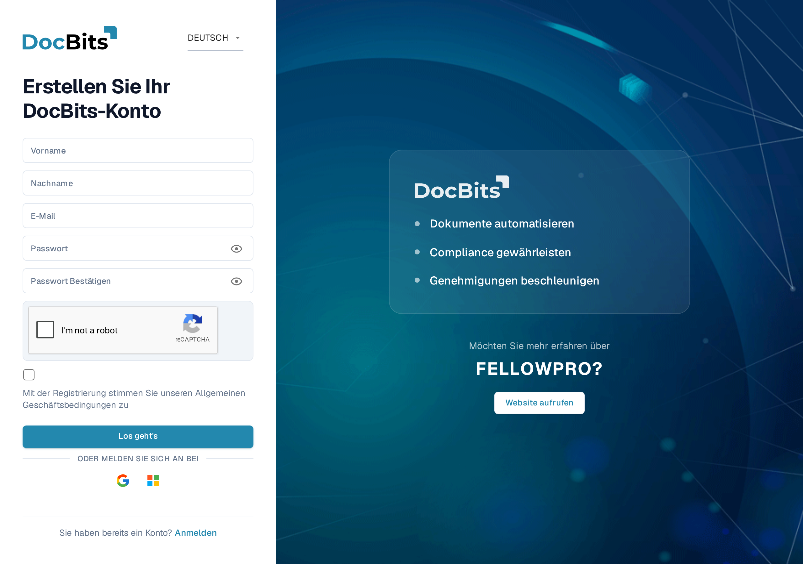
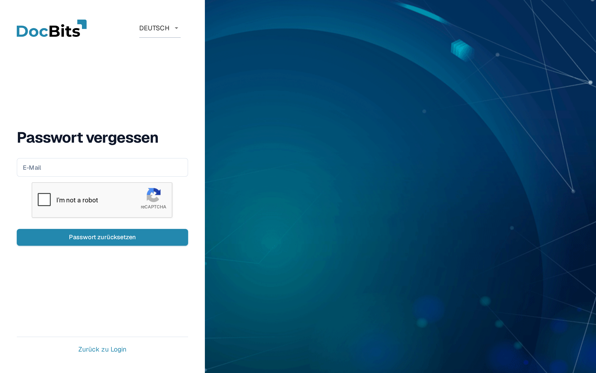
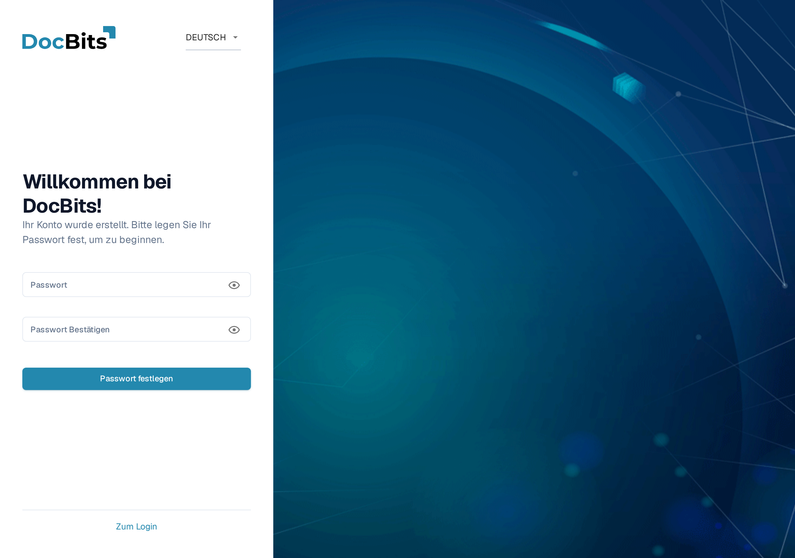

# Erste Schritte und Anmeldung — Volltext (DE-Übersetzung der EN-Quelle `main` @ 507f98296)

Diese Seite erklärt, wie Sie ein DocBits-Konto erhalten und wie Sie sich anmelden, wenn Sie Ihr Passwort nicht haben:

* [Registrierung](#registrierung) — erstellen Sie Ihr eigenes DocBits-Konto.
* [Passwort vergessen](#passwort-vergessen) — setzen Sie Ihr Passwort mit einem Reset-Link zurück.
* [Erstes Passwort für vom Administrator angelegte Konten](#erstes-passwort-für-vom-administrator-angelegte-konten) — legen Sie das erste Passwort für ein Konto fest, das Ihr Administrator für Sie erstellt hat.

Die Anmeldung mit einem bestehenden Konto und die Zwei-Faktor-Authentifizierung werden unter [Zwei-Faktor-Authentifizierung (2FA)](../../overview-and-basics/two-factor-authentication.md) behandelt. Verwenden Sie das Sprachmenü oben rechts auf diesen Formularen, wenn Sie eine andere Anzeigesprache benötigen.

## Registrierung

Sie können selbst ein DocBits-Konto auf der Registrierungsseite erstellen. Öffnen Sie sie über den **Register**-Link auf dem Anmeldebildschirm oder rufen Sie `https://app.docbits.com/register` auf (verwenden Sie die Webadresse, die Ihre Organisation erhalten hat).

<figure><figcaption>
Das Registrierungsformular. Alle Felder sind Pflichtfelder, sofern nicht anders angegeben.
</figcaption></figure>

Füllen Sie das Formular aus:

1. **Vorname** und **Nachname** — Ihr Name, wie er in DocBits erscheinen soll.
2. **E-Mail** — Ihre geschäftliche E-Mail-Adresse. Sie ist Ihr Anmelde-Identifikator.
3. **Passwort** und **Passwort Bestätigen** — siehe die Passwortregeln unten. Eine Checkliste unter dem Passwortfeld zeigt, welche Regeln Ihr Passwort bereits erfüllt.
4. Wenn die Seite ein **reCAPTCHA**-Widget anzeigt, lösen Sie es. Das Widget erscheint nur, wenn in Ihrer DocBits-Instanz Bot-Schutz aktiviert ist.
5. Setzen Sie das Häkchen, um zu bestätigen, dass Sie den **Allgemeinen Geschäftsbedingungen** zustimmen.
6. Klicken Sie auf **Los geht's**. Wenn Sie bereits ein Konto haben, klicken Sie unten auf **Anmelden**, um zur Anmeldeseite zurückzukehren. **Website aufrufen** öffnet die DocBits-Website mit Produktinformationen.

Mit dem Augensymbol neben einem Passwortfeld können Sie die eingegebenen Zeichen anzeigen oder verbergen.

### Passwortregeln

Ihr Passwort muss:

* zwischen **8 und 20 Zeichen** lang sein,
* mindestens einen **Großbuchstaben** und einen **Kleinbuchstaben** enthalten,
* mindestens eine **Ziffer** enthalten,
* mindestens ein **Sonderzeichen** enthalten (`!@#$%^&*()_+=\[{]\};:,.<>?/\|~-`).

Nur Buchstaben, Ziffern und diese Sonderzeichen sind zulässig.

### Registrierung mit Google oder Microsoft

Statt eines Passworts können Sie auf die Schaltfläche **Google** oder **Microsoft** unter **ODER MELDEN SIE SICH AN BEI** klicken. DocBits erstellt Ihr Konto über Ihren Identitätsanbieter, und Sie melden sich später auf dieselbe Weise an.

### Bestätigen Sie Ihre E-Mail-Adresse

Nach dem Absenden des Formulars zeigt DocBits eine Bestätigungsseite an und sendet eine **Verifizierungs-E-Mail** an die von Ihnen eingegebene Adresse. Öffnen Sie die E-Mail und klicken Sie auf den Link darin — er führt Sie zu einer Bestätigungsseite, die Ihre Adresse verifiziert. Wenn die E-Mail nicht ankommt, bietet die Bestätigungsseite eine Option an, die E-Mail erneut zu senden. Sobald die Adresse verifiziert ist, klicken Sie auf **Anmelden** und melden Sie sich mit Ihrer E-Mail-Adresse und Ihrem Passwort an.

## Passwort vergessen

Wenn Sie Ihr Passwort vergessen haben:

1. Klicken Sie auf dem Anmeldebildschirm auf **Passwort vergessen?**.
2. Geben Sie auf der Seite **Passwort vergessen** Ihre **E-Mail**-Adresse ein und klicken Sie auf **Passwort zurücksetzen**. Falls ein reCAPTCHA-Widget angezeigt wird, lösen Sie es zuerst.

   <figure><figcaption>
Die Seite Passwort vergessen. Geben Sie Ihre Konto-E-Mail-Adresse ein, und DocBits sendet Ihnen einen Reset-Link.
</figcaption></figure>

   Wenn Sie Ihr Passwort nicht zurücksetzen wollen, klicken Sie auf **Zurück zu Login**, um zur Anmeldung zurückzukehren.

3. DocBits sendet Ihnen einen **Passwort-Reset-Link** per E-Mail. Öffnen Sie die E-Mail und klicken Sie auf den Link — er öffnet die Reset-Seite.
4. Geben Sie Ihr **neues Passwort zweimal** ein. Es gelten dieselben Passwortregeln wie bei der [Registrierung](#passwortregeln), und eine Checkliste zeigt, welche Regeln erfüllt sind.
5. Klicken Sie auf **Passwort zurücksetzen**. DocBits bestätigt die Änderung und bringt Sie zurück zum Anmeldebildschirm, wo Sie sich mit dem neuen Passwort anmelden können.


Reset-Links laufen nach kurzer Zeit ab. Wenn der Link nicht mehr funktioniert, wiederholen Sie die obigen Schritte, um einen neuen anzufordern.


## Erstes Passwort für vom Administrator angelegte Konten

Wenn Ihr Administrator Sie als Benutzer anlegt (siehe [Benutzer](../../administration-and-setup/settings/global-settings/groups-users-and-permissions/users/README.md)), erhalten Sie eine E-Mail mit Ihren Anmeldedaten und einem Link zum Festlegen Ihres **ersten Passworts**. Der Link öffnet die Seite **Passwort festlegen**:

<figure><figcaption>
Die Seite Passwort festlegen, angezeigt nachdem ein Administrator Ihr Konto erstellt hat.
</figcaption></figure>

1. Klicken Sie auf den Link in der Einladungs-E-Mail. Die Seite begrüßt Sie mit „Willkommen bei DocBits! Ihr Konto wurde erstellt. Bitte legen Sie Ihr Passwort fest, um zu beginnen."
2. Geben Sie Ihr Passwort zweimal ein — es gelten dieselben [Passwortregeln](#passwortregeln).
3. Klicken Sie auf **Passwort festlegen**. Anschließend können Sie sich mit Ihrer E-Mail-Adresse und diesem Passwort anmelden.

Die Augensymbole zeigen an oder verbergen, was Sie eingegeben haben. Wenn Sie das Festlegen abbrechen, bringt Sie **Zum Login** zurück zur Anmeldung.

Der Link ist an Ihr Konto gebunden und funktioniert nur einmal. Wenn er abläuft, bevor Sie ihn verwenden, bitten Sie Ihren Administrator, die Einladung erneut zu senden, oder verwenden Sie **Passwort vergessen?** mit Ihrer E-Mail-Adresse.
