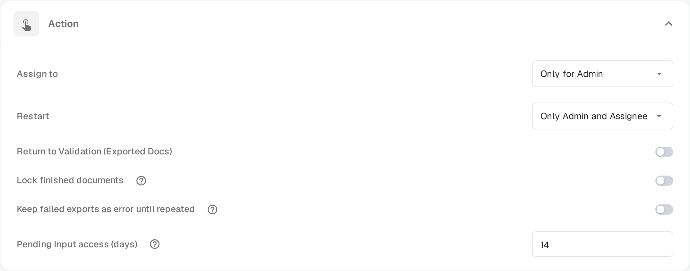

# Pending Input

**Pending Input** pauzira dokument dok čekate odgovor kolege. Pitanje postavljate u toku aktivnosti dokumenta i označavate osobe koje treba da odgovore. Dokument napušta aktivni red dok ne odgovore, a označene osobe mogu ga otvoriti samo za čitanje preko linka u svojoj e-pošti.

Status se pojavljuje na [kontrolnoj tabli](dashboard/README.md) kao **Pending Input**, a radnu listu možete filtrirati po njemu.

## Traženje unosa

1. Otvorite dokument na ekranu koji nudi tok aktivnosti — ekrani za odobravanje i pregled to nude — i izaberite ikonu oblačića za razgovor u traci sa alatkama.
2. Napišite pitanje i otkucajte **@** pa ime osobe koju želite da pitate. Izaberite osobu iz liste koja se pojavi. Označavanje daje pristup: samo označene osobe dobijaju link ka dokumentu.
3. Kada je osoba označena, ispod polja za unos pojavljuje se okvir sa dve mogućnosti:

* **Comment only** (samo komentar) – pitanje se objavljuje u toku aktivnosti, a status ostaje nepromenjen. Koristite ovo kada vam treba samo odgovor i ne želite da zadržite dokument.
* **Send & set to Pending Input** (pošalji i postavi na Pending Input) – pitanje se objavljuje, a dokument prelazi u čekanje. Napušta aktivni red i ostaje pauziran dok označena osoba ne odgovori.

Označene osobe dobijaju e-poštu sa linkom ka dokumentu. **Enter** ili ikona za slanje i dalje objavljuju običan komentar bez davanja pristupa; **Shift+Enter** započinje novi red. Na dokumentu koji je već pauziran ili na dokumentu koji još ne može biti pauziran, okvir nudi pitanje bez opcije pauziranja.

## Odgovaranje na zahtev

Unos se traži od vas kada vas kolega označi u toku aktivnosti.

* Otvorite link iz e-pošte. Stranica **Pending Input** prikazuje levo stranice dokumenta, a desno tok aktivnosti, sa oznakom **Pending Input**.
* Vaš pristup je samo za čitanje: možete čitati dokument i odgovoriti u toku aktivnosti, ali ne možete menjati polja ni izvoziti.
* Napišite odgovor u toku aktivnosti i pošaljite ga. Osoba koja je pitala dobija obaveštenje, a razgovor ostaje u istoriji dokumenta.
* Zaglavlje stranice pokazuje koliko traje vaš pristup, na primer **Read-only access until 09.11.2026**. Pristup se takođe završava čim dokument nastavi dalje.

Ako otvorite link nakon što je zahtev odgovoren ili nakon što je vaš pristup istekao, stranica vas obaveštava da je zahtev rešen ili da je istekao i da nije potrebna nikakva radnja.

## Zatvaranje zahteva

Dokument ostaje pauziran dok osoba kojoj je dodeljen ne preuzme odgovor.

1. Otvorite dokument sa kontrolne table. Pauzirani dokument se otvara direktno na svojoj stranici **Pending Input**.
2. Pročitajte odgovor u toku aktivnosti.
3. Izaberite **Resolve & Proceed** (reši i nastavi). Dokument se nastavlja u sledećem statusu svog toka rada, pa odmah dolazite na ekran na kome nastavljate rad.

Samo osoba kojoj je dokument dodeljen ili član grupe kojoj je dodeljen može zatvoriti zahtev. Administratori i odobravaoci mogu otvoriti pauzirani dokument samo za čitanje da vide zašto čeka.

## Podešavanje perioda pristupa

Funkcija je dostupna u svakoj organizaciji. Možete podesiti koliko dugo osoba koja je upitana zadržava pristup dokumentu:

1. Otvorite **Podešavanja → Dashboard**.
2. Proširite **Action**.
3. U polje **Pending Input access (days)** unesite ceo broj dana. Podrazumevana vrednost je **14**, a potreban je najmanje jedan dan.
4. Sačuvajte izmene.

Period počinje slanjem zahteva. Završava se ranije kada se dokument zatvori ili pređe u drugi status.

<figure><figcaption>
Pending Input access (days) in the Action section of the Dashboard settings. The screenshots are in English because the app has no Serbian interface.
</figcaption></figure>
