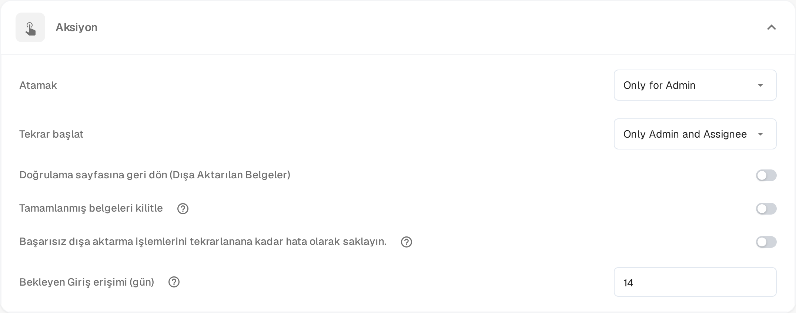

# Pending Input

**Pending Input**, bir meslektaşınızın yanıtını beklerken belgeyi duraklatır. Soruyu belgenin aktivite akışında sorar ve yanıtlaması gereken kişileri etiketlersiniz. Yanıt gelene kadar belge etkin kuyruktan çıkar ve etiketlenen kişiler, e-postalarındaki bağlantı üzerinden belgeyi salt okunur olarak açabilir.

Durum, [gösterge panelinde](dashboard/README.md) **Pending Input** olarak görünür ve çalışma listesini bu duruma göre filtreleyebilirsiniz.

## Girdi isteme

1. Belgeyi aktivite akışı sunan bir ekranda açın — onay ve inceleme ekranları bunu sunar — ve araç çubuğundaki konuşma balonu simgesini seçin.
2. Sorunuzu yazın ve **@** işaretinden sonra sormak istediğiniz kişinin adını yazın. Görünen listeden kişiyi seçin. Erişimi veren şey etiketlemedir: belge bağlantısını yalnızca etiketlenen kişiler alır.
3. Bir kişi etiketlendiğinde, yazı alanının altında iki seçenekli bir kutu görünür:

* **Comment only** (yalnızca yorum) — soru aktivite akışında yayımlanır, durum değişmez. Yalnızca bir yanıt gerekiyorsa ve belgeyi bekletmek istemiyorsanız bunu kullanın.
* **Send & set to Pending Input** (gönder ve Pending Input'a al) — soru yayımlanır ve belge beklemeye alınır. Belge etkin kuyruktan çıkar ve etiketlenen kişi yanıtlayana kadar duraklatılmış kalır.

Etiketlenen kişilere belge bağlantısını içeren bir e-posta gönderilir. **Enter** veya gönderme simgesi erişim vermeden normal bir yorum yayımlamaya devam eder; **Shift+Enter** yeni satır başlatır. Zaten duraklatılmış bir belgede veya henüz duraklatılamayan bir belgede kutu, soruyu duraklatma seçeneği olmadan sunar.

## Bir isteği yanıtlama

Bir meslektaşınız sizi aktivite akışında etiketlediğinde girdi istenir.

* E-postadaki bağlantıyı açın. **Pending Input** sayfası solda belgenin sayfalarını, sağda aktivite akışını ve **Pending Input** rozetini gösterir.
* Erişiminiz salt okunurdur: belgeyi okuyabilir ve aktivite akışında yanıtlayabilirsiniz, ancak alanları değiştiremez ve dışa aktaramazsınız.
* Yanıtınızı aktivite akışında yazıp gönderin. Soruyu soran kişi bilgilendirilir ve görüşme belgenin geçmişinde kalır.
* Sayfanın başlığı erişiminizin ne kadar sürdüğünü gösterir, örneğin **Read-only access until 09.11.2026**. Belge ilerlediğinde erişim de sona erer.

Bağlantıyı istek yanıtlandıktan sonra veya erişiminiz sona erdikten sonra açarsanız sayfa, isteğin çözüldüğünü ya da süresinin dolduğunu ve işlem yapmanız gerekmediğini belirtir.

## İsteği kapatma

Belge, atanan kişi yanıtı ele alana kadar duraklatılmış kalır.

1. Belgeyi gösterge panelinden açın. Duraklatılmış bir belge doğrudan **Pending Input** sayfasında açılır.
2. Yanıtı aktivite akışında okuyun.
3. **Resolve & Proceed** (çöz ve devam et) seçeneğini seçin. Belge, iş akışındaki sonraki durumda devam eder; böylece doğrudan çalışmaya devam ettiğiniz ekrana gelirsiniz.

İsteği yalnızca belgenin atandığı kişi veya belgenin atandığı grubun bir üyesi kapatabilir. Yöneticiler ve onaylayıcılar, duraklatılmış bir belgeyi neden beklediğini görmek için salt okunur olarak açabilir.

## Erişim süresini ayarlama

Özellik her kuruluşta kullanılabilir. Yapılandırabileceğiniz şey, girdi istenen bir kişinin belgeye erişimini ne kadar süre koruduğudur:

1. **Ayarlar → Dashboard** bölümünü açın.
2. **Aksiyon** bölümünü genişletin.
3. **Bekleyen Giriş erişimi (gün)** alanına tam sayı olarak gün girin. Varsayılan değer **14**'tür ve en az bir gün gereklidir.
4. Değişikliklerinizi kaydedin.

Süre, istek gönderildiğinde başlar. Belge kapatıldığında veya başka bir duruma geçtiğinde daha erken sona erer.

<figure><figcaption>
Gösterge paneli ayarlarının Aksiyon bölümünde Bekleyen Giriş erişimi (gün). Üstteki izin değerleri ürün tarafından hâlâ İngilizce gösteriliyor.
</figcaption></figure>
