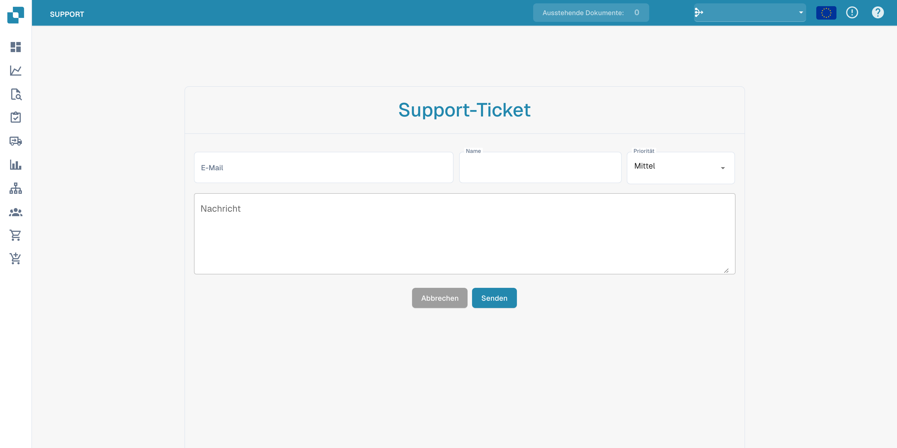
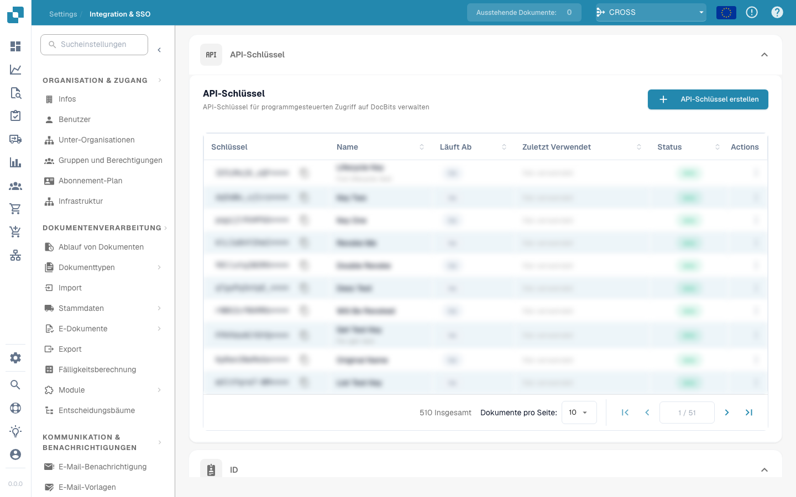

# Benutzer-Support


DocBits-Anleitung für Support-Tickets: Fehler melden, Dateien anhängen und schneller Hilfe erhalten


### Benutzer-Support 

Sollten Sie beim Verwenden von DocBits auf Herausforderungen stoßen oder Fragen haben, konsultieren Sie bitte dieses Benutzerhandbuch oder wenden Sie sich an unser Support-Team um Hilfe. Unser Engagement besteht darin, allen Benutzern ein reibungsloses Erlebnis zu bieten. Klicken Sie einfach auf die Support-Schaltfläche in Ihrer DocBits-App und Sie können ein Support-Ticket erstellen.

<figure><figcaption></figcaption></figure>

<figure><figcaption></figcaption></figure>

Sie können uns auch über unsere FELLOWPRO-Seite kontaktieren:



Im Validierungsbildschirm können Sie direkt Tickets für das jeweilige Dokument erstellen und einen Screenshot des Problems beifügen. Klicken Sie einfach auf die Schaltfläche "Ticket erstellen", das Support-Fenster öffnet sich und Sie können sofort loslegen.

<figure><figcaption></figcaption></figure>

<figure><figcaption>
Deutsches Supportformular vor dem Absenden.
</figcaption></figure>



<figure><figcaption></figcaption></figure>
