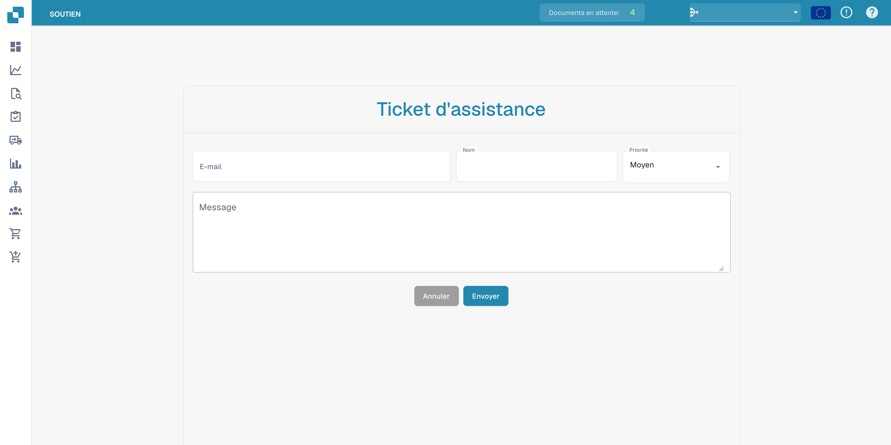

# Support Utilisateur


DocBits Tutoriel sur les tickets d'assistance : signaler des bogues, joindre des fichiers et obtenir de l'aide plus rapidement


### Support Utilisateur 

Si vous rencontrez des difficultés ou si vous avez des questions lors de l'utilisation de DocBits, veuillez consulter ce manuel de l'utilisateur ou contacter notre équipe de support pour obtenir de l'aide. Notre engagement est de fournir une expérience fluide pour tous les utilisateurs. Il vous suffit de cliquer sur le bouton de support dans votre application DocBits et vous pourrez créer un ticket de support.

<figure><figcaption></figcaption></figure>

<figure><figcaption></figcaption></figure>

Vous pouvez également nous contacter via notre page FELLOWPRO:



Dans l'écran de validation, vous pouvez directement créer des tickets pour le document particulier et inclure une capture d'écran du problème. Il vous suffit de cliquer sur le bouton "Créer un ticket", la fenêtre de support s'ouvre et vous pouvez commencer immédiatement.

<figure><figcaption></figcaption></figure>

<figure><figcaption>
Formulaire d’assistance avant envoi.
</figcaption></figure>
