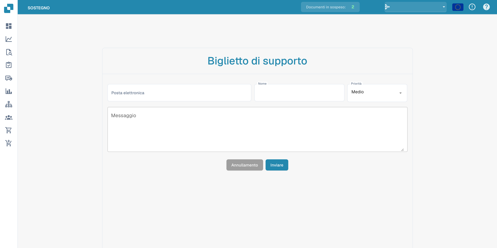

# Supporto Utente


DocBits Tutorial sui ticket di supporto: segnala bug, allega file e ricevi assistenza più velocemente


### Supporto Utente 

Qualora tu incontri delle sfide o abbia domande durante l'utilizzo di DocBits, ti preghiamo di consultare questo manuale utente o di contattare il nostro team di supporto per assistenza. Il nostro impegno è quello di fornire un'esperienza senza intoppi per tutti gli utenti. Basta fare clic sul pulsante di supporto nella tua app DocBits e potrai creare un ticket di supporto.

<figure><figcaption></figcaption></figure>

<figure><figcaption></figcaption></figure>

Puoi anche contattarci tramite la nostra pagina FELLOWPRO:



All'interno della Schermata di Validazione puoi creare direttamente ticket per il documento specifico e includere uno screenshot del problema. Basta fare clic sul pulsante "Crea ticket", si apre la finestra di supporto e puoi iniziare immediatamente.

<figure><figcaption></figcaption></figure>

<figure><figcaption>
Modulo di assistenza prima dell’invio. L’etichetta Biglietto di supporto indica un ticket di assistenza.
</figcaption></figure>
