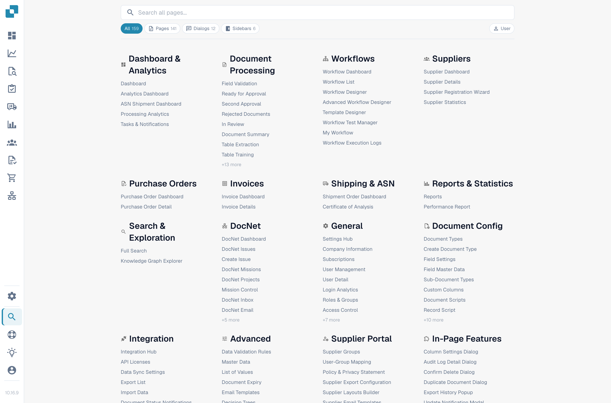
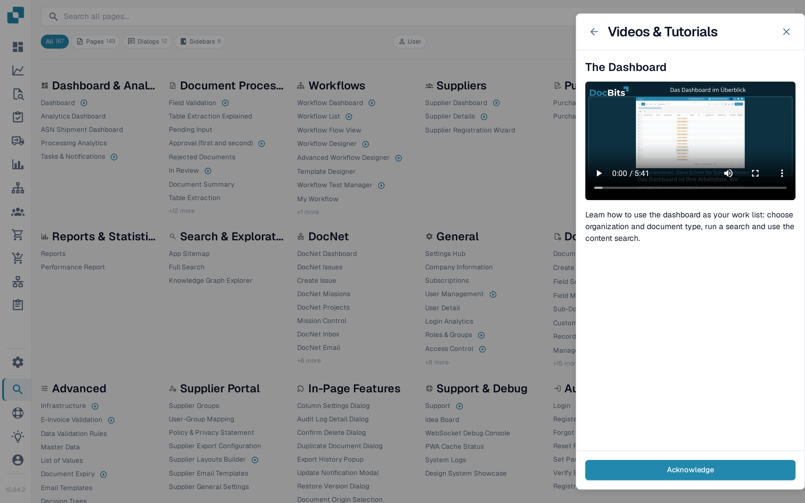

# Sitemap

The Sitemap is the full, searchable index of everything DocBits exposes — every page, dialog, sidebar entry, action, and in-page feature, grouped by category. It is the long-form companion to [Global Quick Search](global-quick-search.md).

## How to access

Open the Sitemap from the sidebar (entry near the bottom), or press <kbd>Cmd</kbd>/<kbd>Ctrl</kbd> + <kbd>K</kbd> and choose **View all results**. The direct URL is `/sitemap`.

<figure><figcaption>
Sitemap with category overview and search header.
</figcaption></figure>

## Browsing the catalog

The Sitemap is grouped into categories that mirror the structure of the app — Settings, Document Processing, Workflow, Validation, and so on. Each category lists its pages, then its in-page features grouped by subcategory.

Entries are colour-coded by type:

* **Page** — a full navigable route.
* **Dialog** — a modal opened from somewhere in the app.
* **Sidebar / Panel / Menu** — a navigation surface or contextual panel.
* **Action** — a button or shortcut that performs something without navigating.

Click any entry to jump straight to it. Entries that need a parameter (such as a document type or document ID) include an inline selector — choose the value before clicking through.

## Training videos in the list

Entries for pages that have a training video show a video icon after the name — not only in Settings, but everywhere in the catalog, for example on the Dashboard, Field Validation, the Workflow pages or Pending Input. Select the icon to play that page's video in the **Videos & Tutorials** panel while you stay on the sitemap.

<figure><figcaption>
Entries with a training video carry a video icon; selecting it opens that video in the panel.
</figcaption></figure>

The panel still lists every video by topic, so you can also browse and search the whole library from the icon in the top bar. See [Videos & Tutorials](videos-and-tutorials.md).

## Searching and filtering

The sticky header at the top of the page hosts the search box and the filter pills. Type a few characters to live-filter the list across labels and descriptions. Use the type pills to narrow to a single entry type — for example, only **Dialog** entries.

The current search and filter are added to the URL, so a filtered view can be bookmarked or shared.

<mark>The Sitemap respects the same permission gating as the rest of DocBits. Pages you cannot access do not appear.</mark>

## Developer mode

A **User / Dev** toggle in the header turns on extra detail used by partner developers:

* The internal route path for each entry.
* Parameter tags (`:docType`, `:docId`, deep-link keys).

Developer mode is remembered in your browser. Switch back to User mode for the regular reading view.

## Back-to-top

The Sitemap is long. Once you scroll past the first screen, a back-to-top button appears in the bottom right corner.
