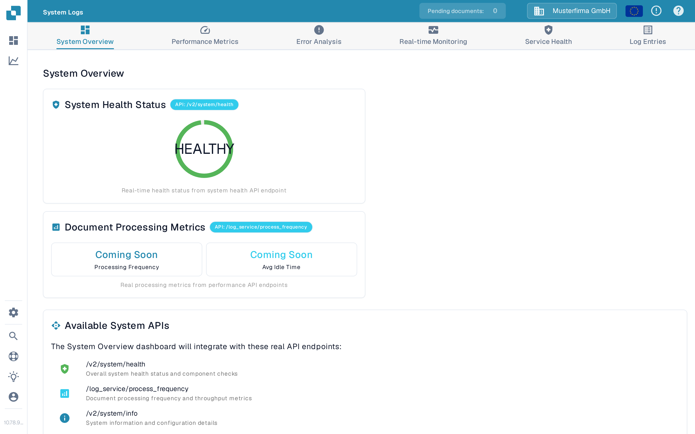
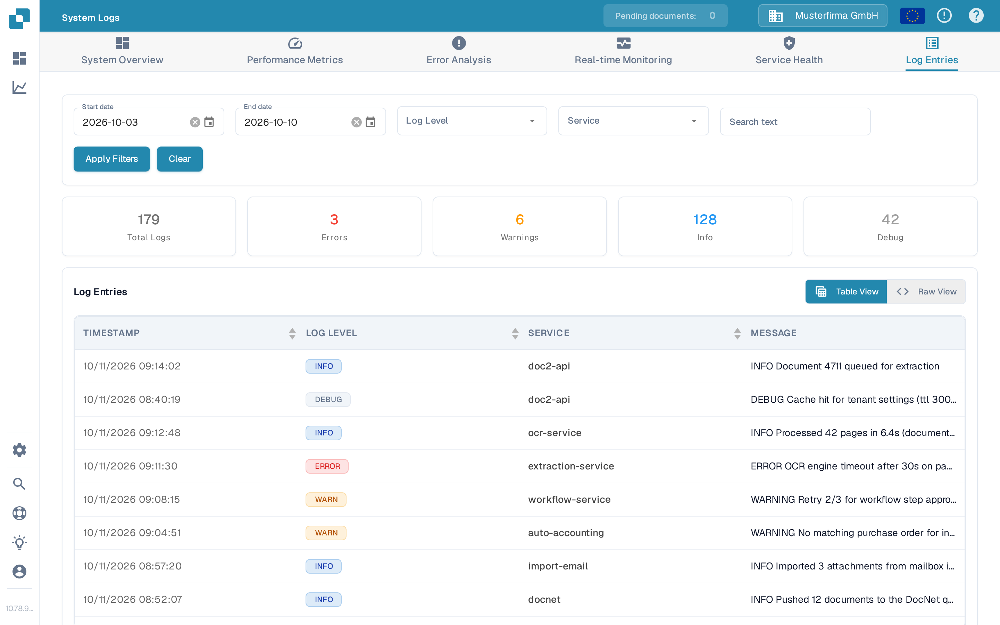
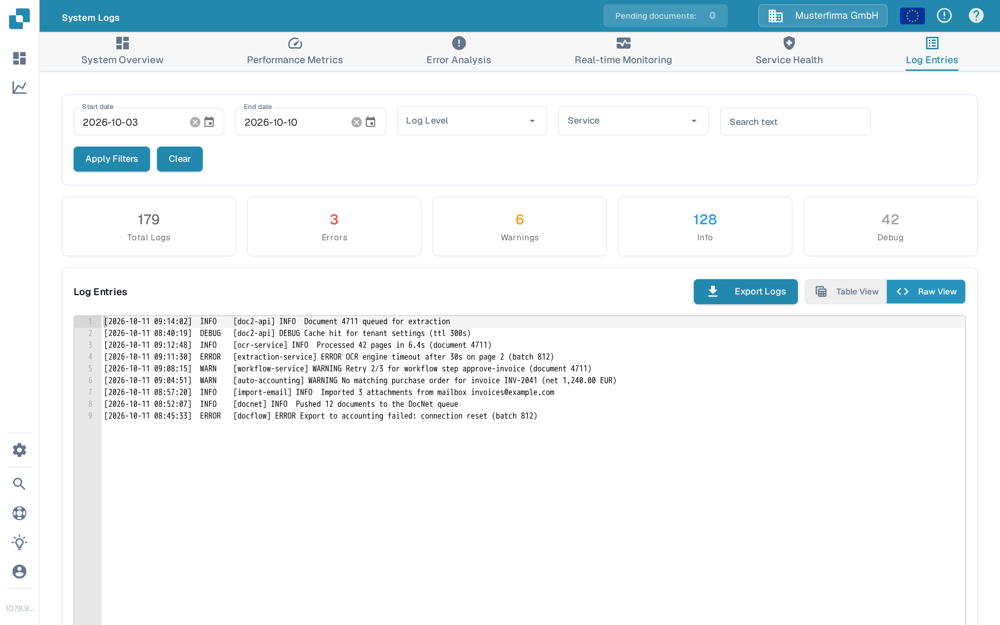

# System Logs

System Logs is an administrator-only page that shows what DocBits did recently, service by service: imports, OCR and extraction runs, workflow steps, exports, and background jobs each write short log entries here. When a document did not arrive, a workflow step failed, or an export returned an error, this page shows what the system actually did and when — the raw material for deciding whether it was a one-off or a recurring problem.

It is a technical tool for administrators. Non-admin users do not see it; [create a support ticket](technical-support-in-docbits/create-a-ticket.md) instead and let support read the logs.

## How to access

Open DocBits as an administrator and go to `/system-logs` — for example `https://sandbox.docbits.com/system-logs`. You can also find it by searching for **System Logs** in the [Global Quick Search](global-quick-search.md).

For a one-click snapshot of your own browser session instead of the system's history, use the [Debug Collector](debug-collector.md).

## The six tabs

The page opens with six tabs across the top; the Log Entries tab is the one with working data today.

| Tab | What it is for |
| --- | --- |
| **System Overview** | An overview of system health and processing metrics, plus a list of the interfaces the dashboards will build on. |
| **Performance Metrics** | Planned charts for organization and supplier performance and processing bottlenecks. |
| **Error Analysis** | Planned summaries that group recurring errors and show how often each pattern occurs. |
| **Real-time Monitoring** | Planned live views that follow log entries as they are written. |
| **Service Health** | Planned status cards for the individual DocBits services. |
| **Log Entries** | The searchable log table — the part you will actually use to investigate an issue. |

<figure><figcaption>
System Overview today: the health gauge is live, the processing metrics are placeholders.
</figcaption></figure>

Many cards on the first five tabs are marked **Coming Soon**. They are placeholders — DocBits is building these dashboards on interfaces that are not finished yet, so clicking them shows no data today. Only the health gauge and the Log Entries tab already show real values.

## Investigating with Log Entries

The Log Entries tab lists what the system did in the last seven days. Each row shows the timestamp, the severity badge, the service that wrote the entry, and the message.

<figure><figcaption>
Log Entries: filters on top, summary cards in the middle, the log table below.
</figcaption></figure>

### Narrow the list with filters

1. Set the **Start date** and **End date**. Both fields open a calendar when you click the calendar icon; the list defaults to the last seven days.
2. Pick a **Log Level** if you only want one severity (for example ERROR).
3. Pick a **Service** to follow one component — for example, only the OCR service if page recognition seems slow.
4. Type a **Search text** to keep only entries containing that phrase, such as a document number or batch ID.
5. Click **Apply Filters** to reload the list. **Clear** resets everything back to the last seven days without a level, service, or search text.

### Read the summary cards

Between the filters and the table, five cards count the entries of the last seven days: **Total Logs**, **Errors**, **Warnings**, **Info**, and **Debug**.

Clicking a card is a shortcut for the matching filter: **Errors** keeps only the error entries, **Warnings** only the warnings, and so on. Clicking **Total Logs** removes the level filter again.

### Open a single entry

Click a row to expand it. The detail panel shows the full timestamp, the level, the service, and the complete message — useful when the table truncates a long message. Use the arrow buttons to step through the neighbouring entries without closing the panel, and the ✕ to close it again.

### Table View and Raw View

* **Table View** is the default: one row per log entry with columns for timestamp, log level, service, and message.
* **Raw View** shows the same entries as plain text lines, in the order the services wrote them:

<figure><figcaption>
Raw View: the same log data as plain text, ready to copy or export.
</figcaption></figure>

Raw View adds an **Export Logs** button. It downloads the log data as a text file — including your active filters and date range — for example, to attach to a support ticket when you [create a ticket](technical-support-in-docbits/create-a-ticket.md). The table view itself has no export; switch to Raw View first.

Below the table, **Logs Per Page** sets how many entries are shown at once, and the page numbers move through longer result lists.

## Typical checks before contacting support

1. Open the Log Entries tab and look at the summary cards: are there errors at all?
2. Click the **Errors** card to see only errors, then narrow further with a service or search text.
3. Open a matching entry and read the full message — it usually names the document, batch, or step that failed.
4. Switch to **Raw View** and click **Export Logs** to attach the log data when you [create a support ticket](technical-support-in-docbits/create-a-ticket.md).

## Related pages

* [Debug Collector](debug-collector.md) — capture your browser session (network calls, console errors) in one step, while System Logs shows the system's own history.
* [Admin privileges](../../administration-and-setup/settings/global-settings/groups-users-and-permissions/users/admin-privileges.md) — which users can open this page.
* [Create a ticket](technical-support-in-docbits/create-a-ticket.md) — where to send the exported logs.
