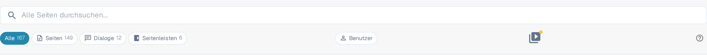

# Hilfe-Symbole

Überall in DocBits wurden Hilfe-Symbole platziert, um Ihnen dabei zu helfen, zu lernen und zu verstehen, was eine Funktion tatsächlich bewirkt und wie sie Sie bei Ihrer Dokumentenverarbeitung unterstützen kann. Es ist das kleine Fragezeichen am rechten Rand der Symbolleiste einer Seite, neben einer einzelnen Einstellung oder in einem Dialog.

Diese Hilfe-Symbole sehen wie folgt aus

<figure><figcaption>
Das Hilfesymbol am rechten Rand der Symbolleiste — hier auf der Sitemap-Seite
</figcaption></figure>

Klicken Sie auf ein Hilfe-Symbol, öffnet sich die passende Seite dieser Dokumentation in einem neuen Tab, sodass Sie den richtigen Artikel nicht suchen müssen. Das Symbol folgt der Sprache, in der Sie DocBits verwenden, und fällt auf Englisch zurück, wenn eine Übersetzung noch nicht veröffentlicht ist.


Nicht jede Ansicht hat ein Hilfe-Symbol. Fehlt es auf Ihrer Seite, öffnen Sie die [Sitemap](../../end-user-section/sitemap.md) oder nutzen Sie die [Globale Schnellsuche](../../end-user-section/global-quick-search.md) (<kbd>Cmd</kbd>/<kbd>Ctrl</kbd>+<kbd>K</kbd>), um den Artikel zu finden.

