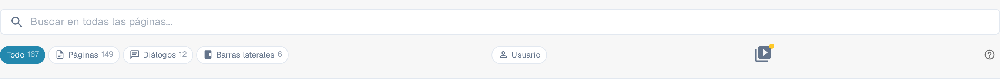

# Iconos de ayuda

Se han colocado iconos de ayuda en todo DocBits para ayudarte a aprender y comprender lo que realmente hace una función y cómo puede ayudarte con el procesamiento de tus documentos. Es el pequeño icono de interrogación del extremo derecho de la barra de herramientas de una página, junto a un ajuste concreto o dentro de un cuadro de diálogo.

Estos iconos de ayuda se ven de la siguiente manera

<figure><figcaption>
El icono de ayuda en el extremo derecho de la barra de herramientas, aquí en la página Mapa del sitio
</figcaption></figure>

Al hacer clic en un icono de ayuda se abre en una pestaña nueva la página correspondiente de esta documentación, sin tener que buscar el artículo adecuado. El icono sigue el idioma en el que usas DocBits y recurre al inglés cuando una traducción aún no está publicada.


No todas las pantallas muestran un icono de ayuda. Si la tuya no lo tiene, abre el [Mapa del sitio](../../end-user-section/sitemap.md) o usa la [Búsqueda Rápida Global](../../end-user-section/global-quick-search.md) (<kbd>Cmd</kbd>/<kbd>Ctrl</kbd>+<kbd>K</kbd>) para encontrar el artículo.

