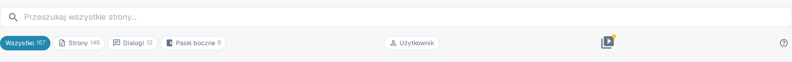

# Ikony Pomocy

Ikony pomocy zostały umieszczone w całym DocBits, aby pomóc Ci w nauce i zrozumieniu, co naprawdę robi dana funkcja i jak może Ci pomóc w przetwarzaniu dokumentów. To mała ikona znaku zapytania na prawym końcu paska narzędzi strony, obok pojedynczego ustawienia lub w oknie dialogowym.

Te ikony pomocy wyglądają następująco

<figure><figcaption>
Ikona pomocy na prawym końcu paska narzędzi — tutaj na stronie Mapa Witryny
</figcaption></figure>

Kliknięcie ikony pomocy otwiera w nowej karcie odpowiednią stronę tej dokumentacji, więc nie musisz szukać właściwego artykułu. Ikona działa w języku, w którym używasz DocBits, i wraca do angielskiego, jeśli tłumaczenie nie zostało jeszcze opublikowane.


Nie każdy ekran ma ikonę pomocy. Jeśli Twój jej nie ma, otwórz [Mapę Witryny](../../end-user-section/sitemap.md) lub użyj [Globalnego Szybkiego Wyszukiwania](../../end-user-section/global-quick-search.md) (<kbd>Cmd</kbd>/<kbd>Ctrl</kbd>+<kbd>K</kbd>), aby znaleźć artykuł.

