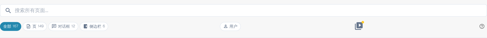

# 帮助图标

DocBits 中各处都放置了帮助图标，帮助您了解各项功能的实际作用，以及它们如何协助您处理文档。 它就是页面工具栏最右侧的小问号图标，也可能出现在单个设置项旁或对话框中。

这些帮助图标如下所示：

<figure><figcaption>
工具栏右端的帮助图标——此处为站点地图页面
</figcaption></figure>

点击帮助图标，会在新标签页中打开本文档中对应的页面，您不必再查找正确的文章。图标会跟随您使用 DocBits 的语言；若该页面尚未提供译文，则回退到英文。


并非每个界面都有帮助图标。如果当前页面没有，请打开[站点地图](../../end-user-section/sitemap.md)或使用[全局快速搜索](../../end-user-section/global-quick-search.md)（<kbd>Cmd</kbd>/<kbd>Ctrl</kbd>+<kbd>K</kbd>）查找该文章。

