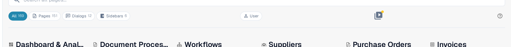

# Help Icons

Help icons are placed all around DocBits in order to assist you in learning and understanding what a feature really does and how it can assist you with your document processing. They are the small question-mark icon at the right end of a page toolbar, next to a single setting or in a dialog.

These help icons look as follows

<figure><figcaption>
The help icon at the right end of the toolbar — here on the Sitemap page
</figcaption></figure>

Click a help icon and the matching page of this documentation opens in a new tab, so you do not have to search for the right article. The icon follows the language you use DocBits in and falls back to English where a translation is not published yet.


Not every screen carries a help icon. If the screen you are on has none, open the [Sitemap](../../end-user-section/sitemap.md) or use [Global Quick Search](../../end-user-section/global-quick-search.md) (<kbd>Cmd</kbd>/<kbd>Ctrl</kbd>+<kbd>K</kbd>) to find the article.

