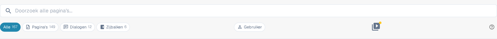

# Help-pictogrammen

Help-pictogrammen zijn overal in DocBits geplaatst om je te helpen bij het leren en begrijpen wat een functie echt doet en hoe het je kan helpen bij je documentverwerking. Het is het kleine vraagtekentje aan de rechterkant van de werkbalk van een pagina, naast een enkele instelling of in een dialoogvenster.

Deze help-pictogrammen zien er als volgt uit

<figure><figcaption>
Het help-pictogram aan de rechterkant van de werkbalk — hier op de Sitemap-pagina
</figcaption></figure>

Klik op een help-pictogram en de bijbehorende pagina van deze documentatie opent in een nieuw tabblad, zodat je niet hoeft te zoeken naar het juiste artikel. Het pictogram volgt de taal waarin je DocBits gebruikt en valt terug op Engels wanneer een vertaling nog niet is gepubliceerd.


Niet elk scherm heeft een help-pictogram. Heeft jouw scherm er geen, open dan de [Sitemap](../../end-user-section/sitemap.md) of gebruik de [Globale Snelzoek](../../end-user-section/global-quick-search.md) (<kbd>Cmd</kbd>/<kbd>Ctrl</kbd>+<kbd>K</kbd>) om het artikel te vinden.

