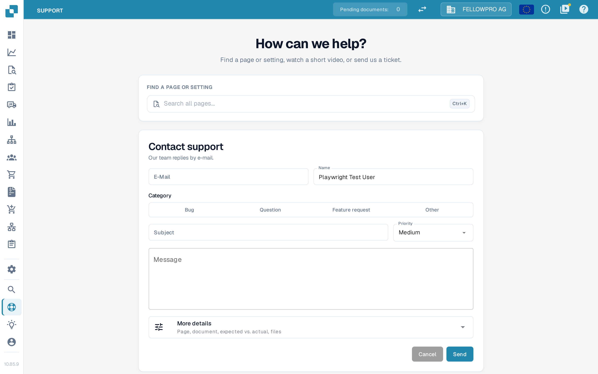
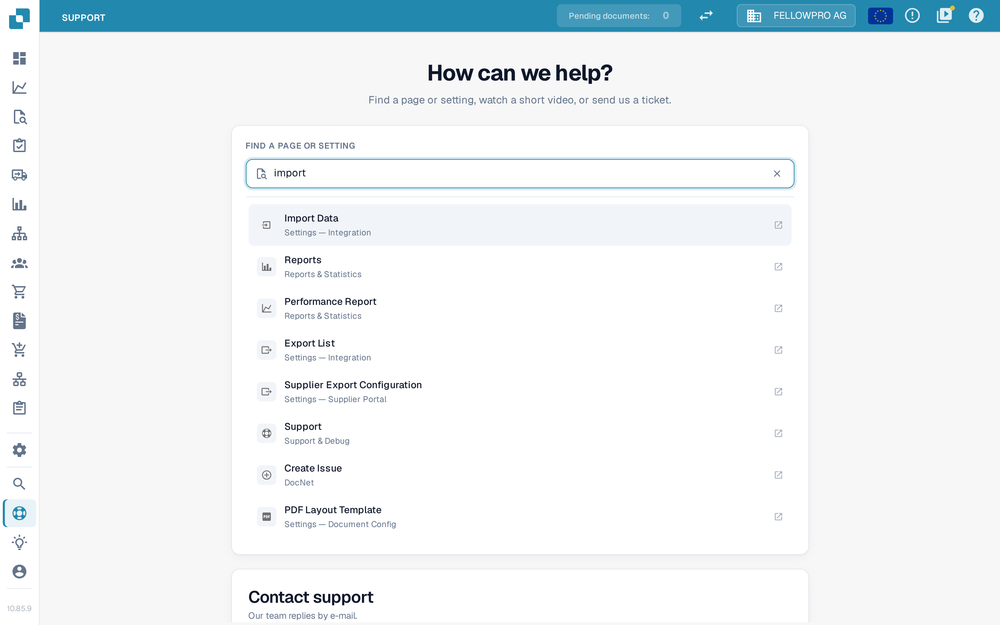
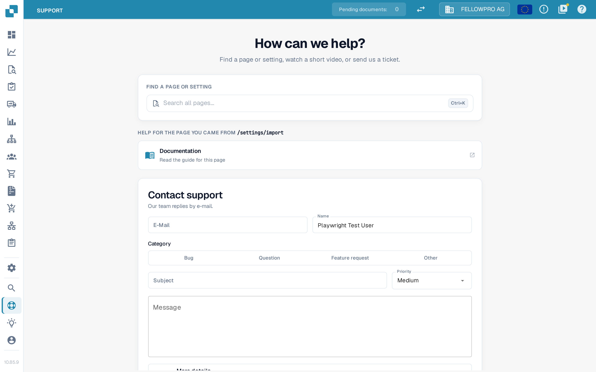
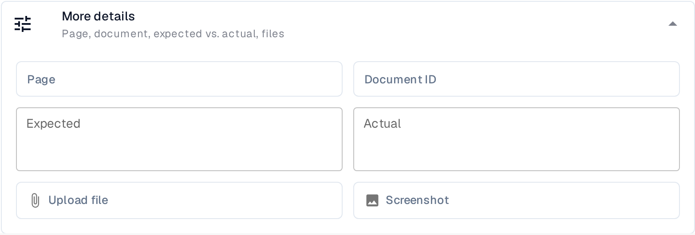

# Support page

The **Support** page is the single place to get unstuck: find the page or setting you are looking for, open the help for the page you just left, or send the support team a ticket. Open it from **Support** in the left sidebar.

<figure><figcaption>
The Support page: find a page, get help for where you came from, or send a ticket.
</figcaption></figure>

## Find a page or setting

Often you do not need a ticket — you need the right screen. Type what you are looking for into **Search all pages…** under **FIND A PAGE OR SETTING** and DocBits lists the matching pages and settings.

<figure><figcaption>
The search covers pages and settings, not just top-level menu entries.
</figcaption></figure>

* The search opens with **Ctrl+K** as well.
* Results open in a **new tab**, so anything you have already typed into the ticket form below is kept.
* You only see what you may use: pages from the modules your organisation has enabled, and only those your permissions allow. Administrator-only pages are not listed for other users.

This is the same search as on the "page not found" screen, so the behaviour is familiar.

## Help for the page you came from

When you open Support from another screen, DocBits adds a **HELP FOR THE PAGE YOU CAME FROM** section and names that page, for example `/settings/import`.

<figure><figcaption>
Opened from Settings → Import, Support offers the help that belongs to that page.
</figcaption></figure>

Up to two tiles appear, depending on what exists for that page:

| Tile | What it does |
|------|---------------|
| **Watch training video** | Plays that page's training video in the **Videos & Tutorials** panel, without leaving Support. |
| **Documentation** | Opens the docs.docbits.com article for that page in a new tab. |

If a page has neither a video nor an article, the section is left out. Reaching Support directly from the sidebar — rather than from a specific screen — also leaves it out, because there is no page to offer help for.

## Send a ticket

**Contact support** sends a structured ticket to the DocBits support team, who reply by e-mail.

Fill in the main part of the form:

| Field | Notes |
|-------|-------|
| **E-Mail** / **Name** | Your address and name, so the team can answer. Administrators enter them; other users see their own name and address shown as a "sending as" line instead. |
| **Category** | **Bug**, **Question**, **Feature request** or **Other**. Choosing the right one routes the ticket faster. |
| **Subject** | One line naming the problem. |
| **Priority** | **Low**, **Medium** (the default), **High** or **Urgent**. |
| **Message** | What happened, in your own words. |

### Add more details

Open **More details** — *Page, document, expected vs. actual, files* — to give the team what they usually have to ask for.

<figure><figcaption>
More details: the context that turns a report into something reproducible.
</figcaption></figure>

| Field | What to put in it |
|-------|-------------------|
| **Page** | The screen where the problem happens. Prefilled with the page you came from. |
| **Document ID** | The document the problem occurred on, when it concerns one specific document. |
| **Expected** | What you expected DocBits to do. |
| **Actual** | What it did instead. |
| **Upload file** | A file that shows the problem — for example the invoice that was not read correctly. |
| **Screenshot** | A picture of the screen as you see it. |


Never put a password, an API key or a one-time code into the message, a screenshot or an uploaded file. Support never needs them.


Select **Send** to submit the ticket, or **Cancel** to discard the draft. DocBits confirms when the ticket has been sent.
