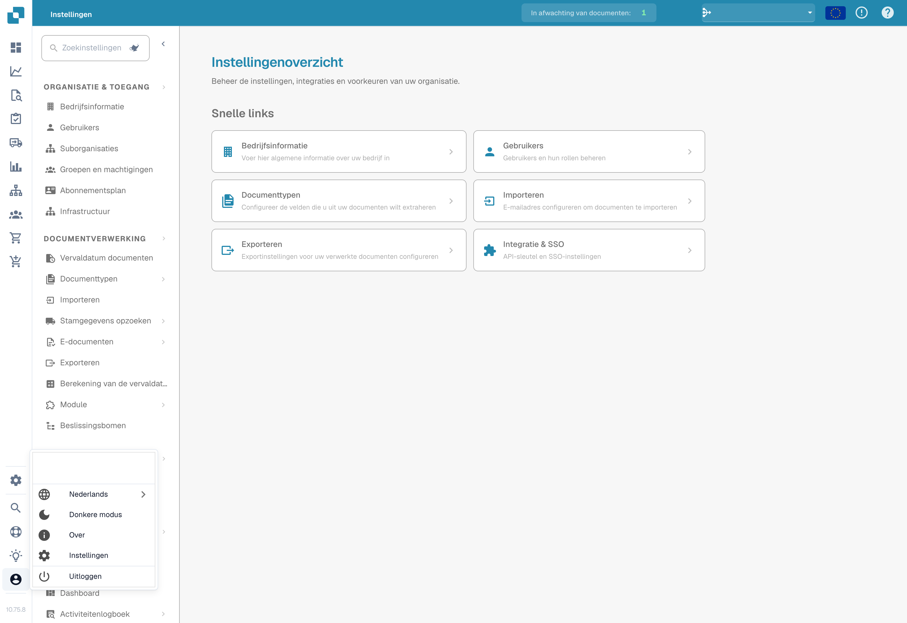

# Gebruikersconfiguratie-opties

Om uw instellingen te configureren, klikt u op het gebruikerspictogram in de linkerbenedenhoek van het scherm. Hier kunt u verschillende opties aanpassen:



<figure><figcaption></figcaption></figure>

<figure><figcaption>
Gebruikersmenu en taalkeuze.
</figcaption></figure>

**Taal**

* **Selecteer Voorkeurs Taal:** Kies uw gewenste taal uit de beschikbare opties.

**Donkere modus**

* **Schakel Dark Mode in:** Schakel de Dark Mode in of uit voor een comfortabelere kijkervaring.

**Gebruikersinstellingen**

In dit gedeelte kunt u de volgende voorkeuren aanpassen:

* **Datum Patroon:** Pas aan hoe datums worden weergegeven.
* **Bedrag Opmaak:** Stel uw voorkeur in voor numerieke waarden.
* **Naam:** Werk uw naam bij.
* **Wachtwoord:** Wijzig uw wachtwoord voor de beveiliging van uw account.
* **Lettergrootte:** Pas de tekstgrootte aan voor betere leesbaarheid.
* **Dual Monitor Modus:** Schakel deze functie in als u twee monitoren gebruikt.

<figure><figcaption></figcaption></figure>

**Uitloggen**

* **Uitloggen:** Klik hier om veilig uit te loggen uit uw account.
