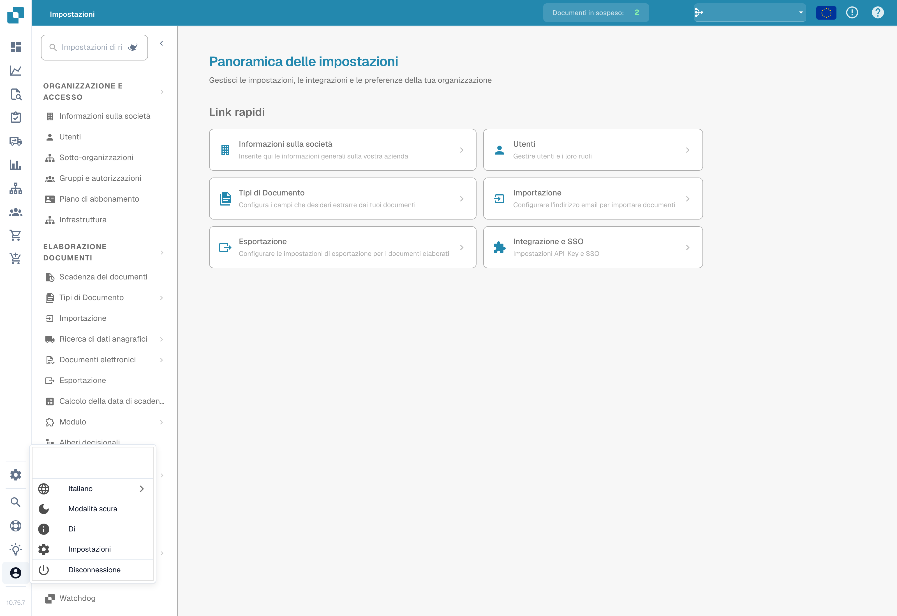

# Opzioni di Configurazione Utente

Per configurare le tue impostazioni, fai clic sull'icona dell'utente situata nell'angolo in basso a sinistra dello schermo. Qui puoi personalizzare diverse opzioni:



<figure><figcaption></figcaption></figure>

<figure><figcaption>
Menu utente e selezione della lingua.
</figcaption></figure>

**Lingua**


Come cambiare la lingua in DocBits (Tutorial sulle impostazioni utente)


* **Seleziona Lingua Preferita:** Scegli la tua lingua desiderata tra le opzioni disponibili.

**Modalità scura**

* **Attiva Dark Mode:** Abilita o disabilita la Dark Mode per un'esperienza di visione più confortevole.

**Impostazioni Utente**

In questa sezione, puoi regolare le seguenti preferenze:

* **Formato Data:** Personalizza come vengono visualizzate le date.
* **Formattazione Importo:** Imposta il tuo formato preferito per i valori numerici.
* **Nome:** Aggiorna il tuo nome.
* **Password:** Cambia la tua password per la sicurezza dell'account.
* **Dimensione del Carattere:** Regola la dimensione del testo per una migliore leggibilità.
* **Modalità Doppio Monitor:** Abilita questa funzione se stai utilizzando due monitor.

<figure><figcaption></figcaption></figure>

**Disconnetti**

* **Disconnetti:** Fai clic qui per disconnetterti in modo sicuro dal tuo account.
