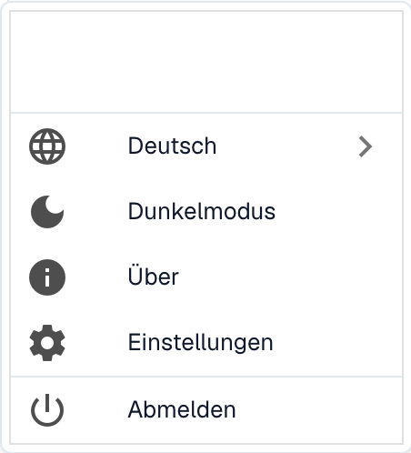
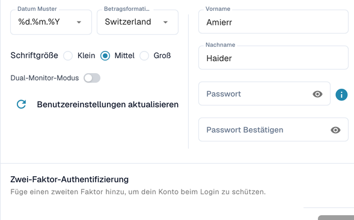

# Benutzerkonfigurationsoptionen

Um Ihre Einstellungen zu konfigurieren, klicken Sie auf das Benutzer-Icon in der unteren linken Ecke des Bildschirms. Hier können Sie mehrere Optionen anpassen:



<figure><figcaption></figcaption></figure>

<figure><figcaption>
Deutsches Benutzermenü mit Sprache, Dunkelmodus, Einstellungen und Abmelden. Kontoname und Initialen sind ausgeblendet.
</figcaption></figure>

**Sprache**


Sprache in DocBits ändern – Anleitung zu den Benutzereinstellungen


* **Bevorzugte Sprache auswählen:** Wählen Sie Ihre gewünschte Sprache aus den verfügbaren Optionen.

**Dunkelmodus**

* **Zum Dunkelmodus wechseln:** Aktivieren oder deaktivieren Sie den Dunkelmodus für ein angenehmeres Seherlebnis.

**Benutzereinstellungen**

In diesem Abschnitt können Sie die folgenden Präferenzen anpassen:

* **Datumsformat:** Passen Sie an, wie Daten angezeigt werden.
* **Betragsformatierung:** Legen Sie Ihr bevorzugtes Format für numerische Werte fest.
* **Name:** Aktualisieren Sie Ihren Namen.
* **Passwort:** Ändern Sie Ihr Passwort zur Sicherheit Ihres Kontos.
* **Schriftgröße:** Passen Sie die Textgröße für bessere Lesbarkeit an.
* **Dual Monitor Mode:** Aktivieren Sie diese Funktion, wenn Sie zwei Monitore verwenden.

<figure><figcaption></figcaption></figure>

**Abmelden**

* **Abmelden:** Klicken Sie hier, um sich sicher von Ihrem Konto auszuloggen .