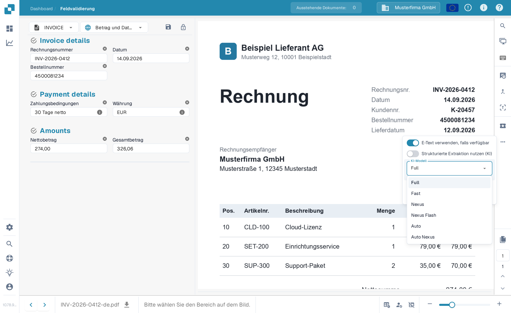

# Lieferantenspezifisches KI-Modell für Feld- und Tabellenextraktion

Im Werkzeugbereich des **Validierungsbildschirms** können Sie das KI-Modell für die **Feldextraktion** und **Tabellenextraktion** auswählen.\
Dieser Einstieg ändert die Überschreibung im aktuellen Extraktionsvorlagen-Kontext. Sie wird je Organisation und Vorlage (`tfidf_id`) gespeichert. Die Lieferantenzuordnung bedeutet nicht, dass damit sämtliche Vorlagen oder historischen Dokumente dieses Lieferanten geändert werden. Ohne Überschreibung gilt die anwendbare Organisationseinstellung.

Um das Modell zu ändern, öffnen Sie das Optionsmenü, indem Sie auf die Schaltfläche **Mehr Optionen** (drei Punkte) auf der rechten Seite des Bildschirms klicken, und wählen Sie dann eines der verfügbaren Modelle: 

Das Menü bietet **Full**, **Fast**, **Nexus**, **Nexus Flash**, **Auto** und **Auto Nexus**. Verfügbarkeit und Kosten richten sich nach Ihrer aktuellen Umgebung und den vereinbarten Konditionen. Keine Option ist für jedes Dokument grundsätzlich die genaueste oder schnellste; „Fast“ ist kein allgemeingültiger Organisationsstandard.

Ein Modellwechsel kann eine Bestätigung erfordern und die Extraktion erneut starten. Prüfen Sie deshalb Dokument und Geltungsbereich vor dem Bestätigen. Das bloße Öffnen des Menüs ändert die Einstellung nicht; die Abbildungen belegen keinen ausgeführten Modellwechsel.

<figure><figcaption>
Öffnen Sie das Optionsmenü und wählen Sie das KI-Modell für diesen Lieferanten.
</figcaption></figure>

<figure><figcaption>
Das Dropdown KI-Modell mit den sechs verfügbaren Optionen.
</figcaption></figure>

Vergleichen Sie verfügbare Modelle mit freigegebenen Testdokumenten und prüfen Sie extrahierte Werte, Laufzeit und Kosten. Ein Wechsel kann ein Dokument erneut verarbeiten und garantiert keine Verbesserung.

Um den **Organisationsstandard** zu konfigurieren oder **vorlagenbezogene Überschreibungen** zu prüfen, lesen Sie bitte die entsprechende Dokumentation [**hier**](../../../administration-and-setup/settings/document-processing/classification-and-extraction/ai-model.md).
