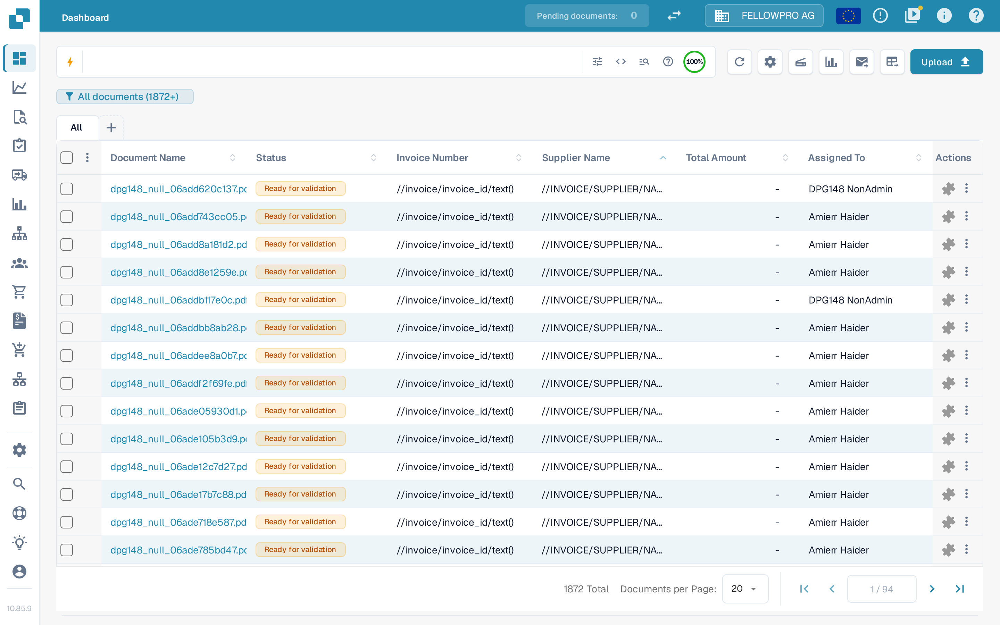
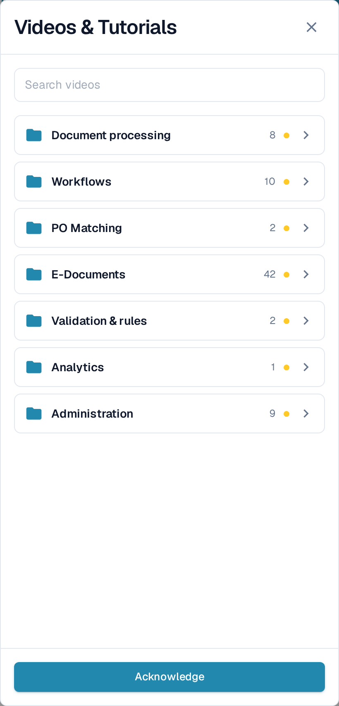
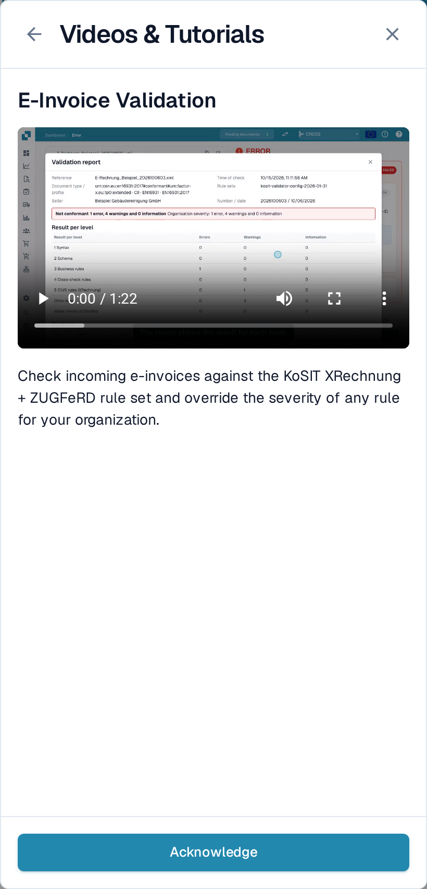

# Videos & Tutorials

**Videos & Tutorials** plays short DocBits videos without leaving the page you are working on. The videos are grouped by topic, so you can find the one that matches the task in front of you.

## Open the panel

The video icon sits in the icon group at the right end of the top bar, between the recent-errors icon and the information and help icons.

<figure><figcaption>
The video icon sits in the icon group, with a yellow dot while videos are unacknowledged.
</figcaption></figure>

* The icon itself is **white**, like its neighbours in the group.
* A **small yellow dot** on its top-right corner marks that at least one video has not been acknowledged.
* The dot disappears once you have acknowledged every video.

Select the icon to open **Videos & Tutorials** as a panel on the right.


The icon belongs to the header icon group, so it is hidden where that whole group is hidden: on the **Settings → Document Types** pages and on narrow screens. You can still reach every video from the [sitemap](sitemap.md), where pages with a video carry a video icon.


<figure><figcaption>
The panel opens on the list of topics. Each topic is a folder with its number of videos.
</figcaption></figure>

## Browse a topic

The panel opens on the **topic folders**, for example **Document processing**, **Workflows**, **E-Documents** or **Administration**. A folder shows how many videos it contains and a **NEW** marker while it holds a video you have not acknowledged.

Select a folder to open it. Inside you find the videos of that topic and, where the topic is large, further folders that group them, such as **Countries** under **E-Documents**. A breadcrumb at the top and the back arrow take you up one level. A video you opened from a folder returns to that folder when you close it.

<figure><figcaption>
Open a topic to see its videos and its subfolders.
</figcaption></figure>

## Search for a video

Type into **Search videos** to look through every topic at once. Each result names the folder it belongs to, for example **Workflows › Building workflows**, so you know where the video sits. The search also matches topic and folder names and ignores capitals and accents.

<figure><figcaption>
The search covers all topics and shows the folder of every result.
</figcaption></figure>

Clear the search field to return to the topic folders.

## Watch a video and acknowledge it

Select a video to play it in the panel. The title and a short description say what the video covers.

<figure><figcaption>
Play the video in the panel, then acknowledge it.
</figcaption></figure>

Select **Acknowledge** when you have watched the video. This marks it as seen for your user only: the **NEW** marker on the video and on its folder disappears for you, and the yellow dot on the top-bar icon goes away once nothing is left unacknowledged. Other users still see their own unacknowledged videos.

## Videos for administrators and for users

* Videos marked **Admin** are meant for administrators. Administrators see both administrator and end-user videos in the panel; end users see the end-user videos only.
* If a video is not available in your interface language, the English version is shown with a language code such as **EN**.
