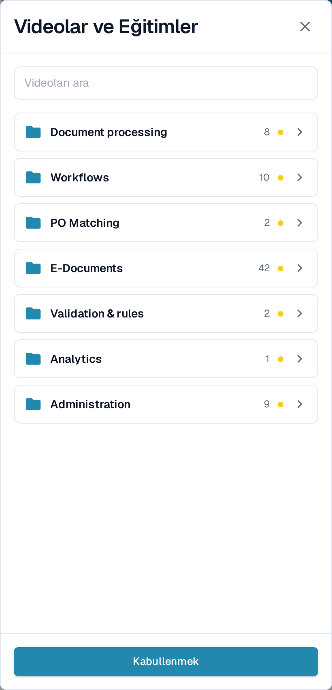
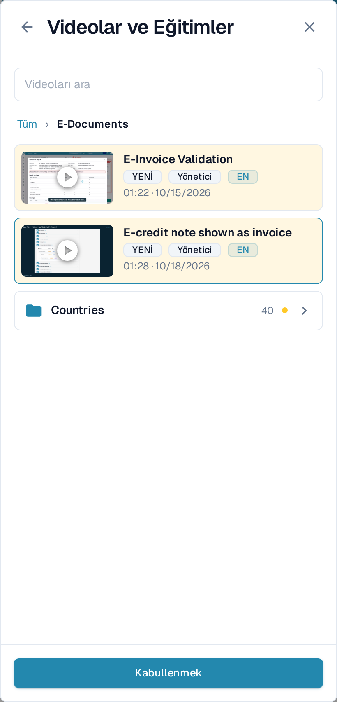
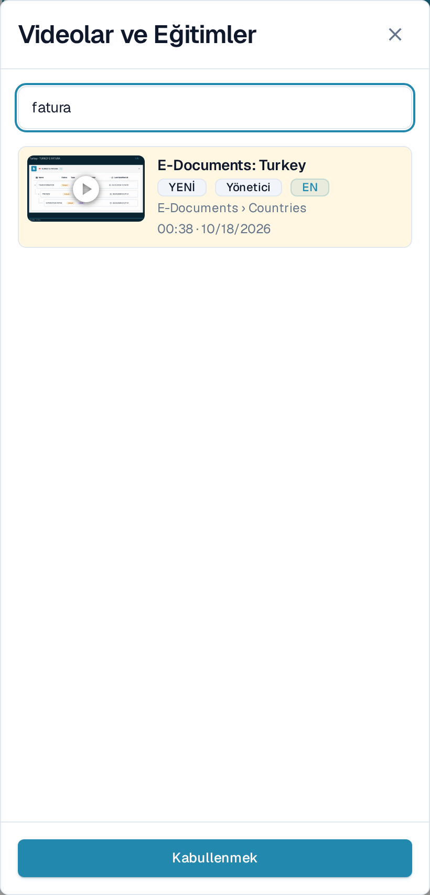
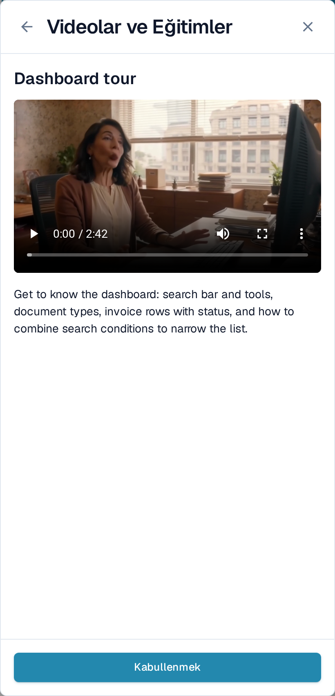

# Videolar ve Eğitimler

**Videolar ve Eğitimler**, üzerinde çalıştığınız sayfadan ayrılmadan kısa DocBits videolarını oynatır. Videolar konulara göre gruplandığı için önünüzdeki işe uyan videoyu hızlıca bulursunuz.

## Paneli açma

Video simgesi üst çubuğun en sağında, yardım simgesinden sonra yer alır.

<figure><figcaption>
Video simgesi üst çubuktaki son simgedir.
</figcaption></figure>

* En az bir video kabul edilmediği sürece simge **küçük bir noktayla birlikte sarı** görünür.
* Tüm videoları kabul ettiğinizde simge üst çubuktaki diğer simgelerle aynı rengi alır.

**Videolar ve Eğitimler** panelini sağ tarafta açmak için simgeyi seçin.

<figure><figcaption>
Panel, konu listesiyle açılır. Her konu, içindeki video sayısını gösteren bir klasördür.
</figcaption></figure>

## Bir konuya göz atma

Panel, **konu klasörleriyle** açılır; örneğin belge işleme, iş akışları, e-belgeler veya yönetim. Bir klasör kaç video içerdiğini gösterir ve henüz kabul etmediğiniz bir video barındırdığı sürece **YENİ** işaretini taşır.

Açmak için bir klasör seçin. İçinde o konunun videolarını ve konu genişse bunları gruplayan başka klasörleri bulursunuz; örneğin **E-Documents** altındaki **Countries** klasörü. Üstteki yol çizgisi ve geri oku bir seviye yukarı çıkarır. Bir klasörden açtığınız video, kapattığınızda aynı klasöre döner.

<figure><figcaption>
Videolarını ve alt klasörlerini görmek için bir konuyu açın.
</figcaption></figure>

## Video arama

Tüm konularda aynı anda arama yapmak için **Videoları ara** alanına yazın. Her sonuç, ait olduğu klasörü belirtir; böylece videonun nerede durduğunu bilirsiniz. Arama, konu ve klasör adlarını da bulur; büyük/küçük harf ve aksan farkını dikkate almaz.

<figure><figcaption>
Arama tüm konuları kapsar ve her sonucun klasörünü gösterir.
</figcaption></figure>

Konu klasörlerine dönmek için arama alanını temizleyin.

## Bir videoyu izleme ve kabul etme

Paneldeki oynatıcıda açmak için bir video seçin. Başlık ve kısa açıklama, videonun neyi anlattığını belirtir.

<figure><figcaption>
Videoyu panelde oynatın, ardından kabul edin.
</figcaption></figure>

Videoyu izledikten sonra **Kabullenmek** seçeneğini kullanın. Video yalnızca sizin kullanıcınız için izlenmiş sayılır: **YENİ** işareti sizin için videodan ve klasöründen kalkar, kabul edilmemiş video kalmadığında üst çubuktaki simge griye döner. Diğer kullanıcılar kendi kabul etmedikleri videoları görmeye devam eder.

## Yöneticilere ve kullanıcılara yönelik videolar

* **Yönetici** işaretli videolar yöneticilere yöneliktir. Yöneticiler panelde hem yönetici hem de son kullanıcı videolarını görür; son kullanıcılar yalnızca son kullanıcı videolarını görür.
* Bir video arayüz dilinizde yoksa İngilizce sürümü **EN** gibi bir dil koduyla gösterilir.


Ekran görüntüleri, uygulama Türkçe diline ayarlıyken DocBits test organizasyonunda alınmıştır. Video başlıkları ve bazı klasör adları henüz Türkçeye çevrilmediği için İngilizce görünür ve **EN** koduyla işaretlenir.

