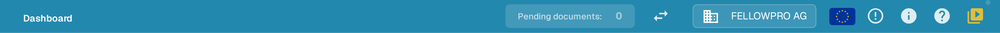
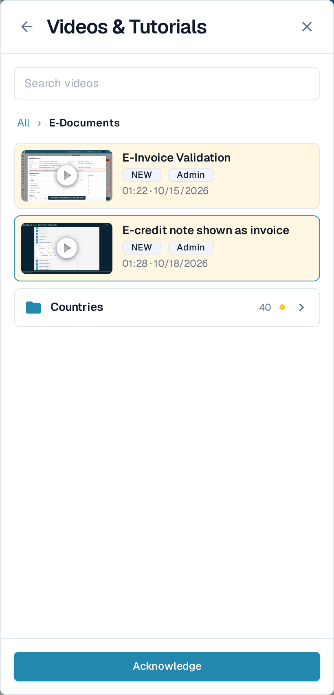
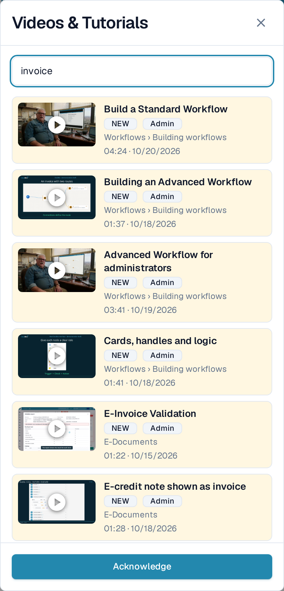

# Video zapisi i uputstva

**Videos & Tutorials** pušta kratke DocBits video zapise, a da pritom ne napuštate stranicu na kojoj radite. Video zapisi su grupisani po temama, pa brzo pronalazite onaj koji odgovara zadatku pred vama.

## Otvaranje panela

Ikonica za video nalazi se na desnom kraju gornje trake, iza ikonice za pomoć.

<figure><figcaption>
Ikonica za video je poslednja ikonica u gornjoj traci.
</figcaption></figure>

* Ikonica je **žuta sa malom tačkom** sve dok bar jedan video zapis nije potvrđen.
* Dobija boju ostalih ikonica u traci čim potvrdite svaki video zapis.

Izaberite ikonicu da biste otvorili **Videos & Tutorials** kao panel sa desne strane.

<figure><figcaption>
Panel se otvara na listi tema. Svaka tema je fascikla sa brojem video zapisa.
</figcaption></figure>

## Pregledanje teme

Panel se otvara na **fasciklama tema**, na primer **Document processing**, **Workflows**, **E-Documents** ili **Administration**. Fascikla pokazuje koliko video zapisa sadrži i oznaku **NEW** sve dok u njoj postoji video zapis koji još niste potvrdili.

Izaberite fasciklu da biste je otvorili. U njoj se nalaze video zapisi te teme, a kod obimnih tema i dodatne fascikle koje ih grupišu, kao što je **Countries** u okviru **E-Documents**. Putanja na vrhu i strelica za nazad vode vas jedan nivo naviše. Video zapis otvoren iz fascikle vraća se u tu fasciklu kada ga zatvorite.

<figure><figcaption>
Otvorite temu da biste videli njene video zapise i podfascikle.
</figcaption></figure>

## Pretraga video zapisa

Upišite pojam u polje **Search videos** da biste pretražili sve teme odjednom. Svaki rezultat navodi fasciklu kojoj pripada, na primer **Workflows › Building workflows**, pa znate gde se video zapis nalazi. Pretraga pronalazi i nazive tema i fascikli i ne razlikuje velika i mala slova ni dijakritike.

<figure><figcaption>
Pretraga obuhvata sve teme i uz svaki rezultat prikazuje njegovu fasciklu.
</figcaption></figure>

Ispraznite polje za pretragu da biste se vratili na fascikle tema.

## Gledanje i potvrđivanje video zapisa

Izaberite video zapis da biste ga pustili u panelu. Naslov i kratak opis govore šta video zapis obrađuje.

<figure><figcaption>
Pustite video zapis u panelu, a zatim ga potvrdite.
</figcaption></figure>

Izaberite **Acknowledge** kada odgledate video zapis. Time se označava kao pogledan samo za vašeg korisnika: oznaka **NEW** nestaje za vas na video zapisu i na njegovoj fascikli, a ikonica u gornjoj traci postaje siva čim ne preostane ništa za potvrđivanje. Ostali korisnici i dalje vide sopstvene nepotvrđene video zapise.

## Video zapisi za administratore i za korisnike

* Video zapisi označeni sa **Admin** namenjeni su administratorima. Administratori u panelu vide i administratorske i korisničke video zapise; krajnji korisnici vide samo korisničke.
* Ako video zapis nije dostupan na jeziku vašeg interfejsa, prikazuje se engleska verzija sa oznakom jezika kao što je **EN**.


Snimci ekrana prikazuju DocBits test organizaciju sa aplikacijom na engleskom jeziku, jer aplikacija nema srpski interfejs. Nazivi u interfejsu su zato na snimcima na engleskom.

