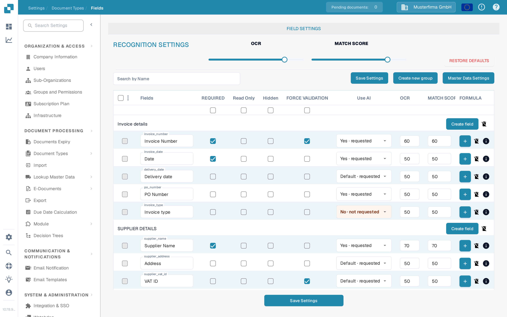
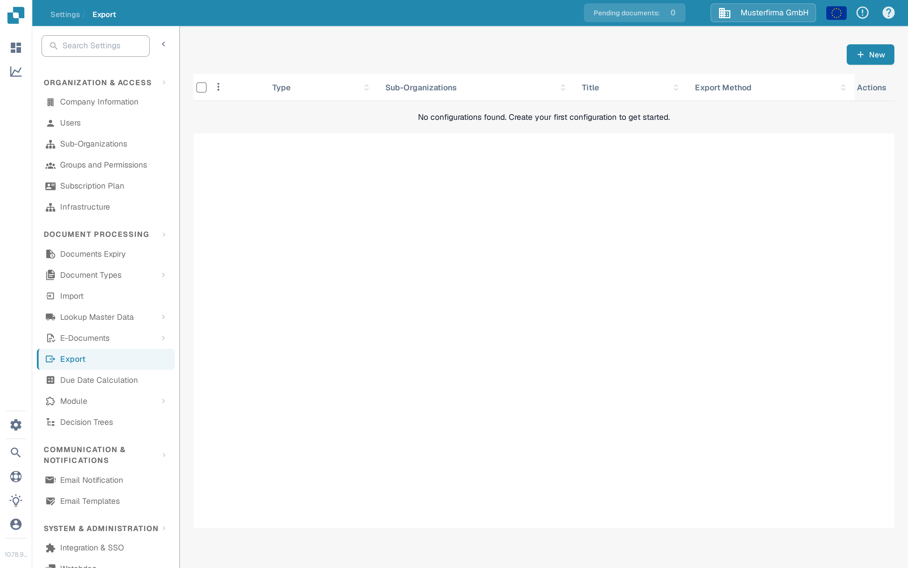
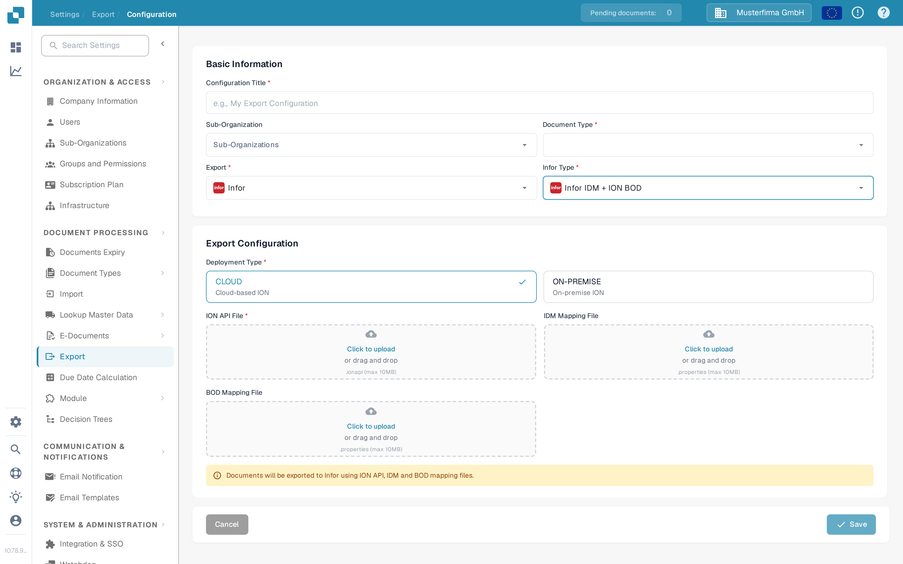

# Creating a BOD Mapping File

A BOD mapping file (`.properties`) tells DocBits which Infor document type and which Infor identifiers to use when a document is exported to Infor ION. DocBits ships one with every Infor export configuration. You download it, fill in the values for your Infor environment, and upload it again in **Settings → Export**.

This page explains how to edit the mapping file, how to find the two values it needs from ION Desk, and how to upload it in DocBits. If the export configuration does not exist yet, start with [Creating an ION API File](creating-an-ion-api-file.md) and [Create an Infor ION API endpoint for DocBits exports](creating-an-ion-api-endpoint.md).

## Editing the mapping file

Open the downloaded `.properties` file in any plain-text editor. The walkthrough below uses Visual Studio Code, but Notepad, TextEdit or any similar editor works.

The file contains three groups of entries:

* **Static values** start with `SFV_` and are written directly into the exported message. The most important ones are the accounting entity (`SFV_AccountingEntityID`), the logical ID of the connection point (`SFV_LogicalID`) and the action code (`SFV_actionCode`).
* **Generated fields** start with `GFV_` and are filled by DocBits while exporting, for example the creation date.
* **Index field mappings** list the DocBits fields that are copied into the Infor BOD, for example `INVOICE_ID` or `PO_NUMBER`.

<figure><figcaption>
The mapping file in a text editor. Entries with the <strong>SFV_</strong> prefix are static values, entries with <strong>GFV_</strong> are filled by DocBits.
</figcaption></figure>

Change the accounting entity (`SFV_AccountingEntityID`) to the company you export for, for example `200` or `921_VVB`. Keep the same value that your Infor environment uses for that company.

### Check the document code

The document type list at the end of the file connects a DocBits document type to an Infor document type, for example `Invoice=LN_SupplierInvoice`. The left-hand value must match the document type code that DocBits uses, and the right-hand value must match the document type in your Infor environment.

To read the DocBits code, open **Settings → Document Types → Fields** and select the document type you export. The code is the last part of the page address in your browser, for example `.../settings/fields/INVOICE` means the code is `INVOICE`. The same code appears in the field list of the document type; see [Fields](../../administration-and-setup/settings/global-settings/document-types/fields/README.md) for an explanation of that page.

<figure><figcaption>
The document code is the last part of the page address: <strong>/settings/fields/INVOICE</strong>.
</figcaption></figure>

### Check the logical ID

The static value `SFV_LogicalID` must contain the logical ID of the connection point that DocBits uses to send documents to ION. The file shipped with your configuration already contains a default such as `lid://infor.ims.docbits-export`; replace it with the logical ID of your own connection point if they differ.

To read the logical ID, open ION Desk, go to **Connect → Connection Points** and open the connection point used for DocBits. Its **Logical ID** field is shown on the **Connection** tab, for example `lid://infor.ims.docbits-prod-export`. Infor describes connection points and the two available types in [Application connection points](https://docs.infor.com/inforos/2024.x/en-us/useradminlib_cloud/iondeskceug_cloud_osm/documentflowdesk_applicationconnectionpointdetails.html).

<figure><figcaption>
The <strong>Logical ID</strong> on the <strong>Connection</strong> tab of the connection point.
</figcaption></figure>

<figure><figcaption>
Copy the value of the logical ID into <code>SFV_LogicalID</code>.
</figcaption></figure>

## Create the connection point if it is missing

If no connection point exists for DocBits yet, create one first.

1. In ION Desk, open **Connect → Connection Points** and select **+ Add**. Infor describes this list in [Application connection points](https://docs.infor.com/inforos/2024.x/en-us/useradminlib_cloud/iondeskceug_cloud_osm/documentflowdesk_applicationconnectionpointdetails.html).

<figure><figcaption>
Connection points in ION Desk; <strong>+ Add</strong> starts a new one.
</figcaption></figure>

2. Select **IMS via API Gateway** as the connection type. This type sends messages from your application to ION and lets API Gateway handle authentication. Infor explains it in [Creating an IMS connection point in ION Desk](https://docs.infor.com/inforos/2022.x/en-us/useradminlib_onpremises/ionopdg_on-premises/ffk1624974745295.html).

<figure><figcaption>
Choose the connection point type <strong>IMS via API Gateway</strong>.
</figcaption></figure>

3. Fill in the required fields. Use a speaking name such as `DocBits_export`. The value of **Logical ID Type** is fixed to `ims`. In **ION API Client Id**, enter the Client ID of the authorized app you created for DocBits; it is the `ci` value of the `.ionapi` file described in [Creating an ION API File](creating-an-ion-api-file.md).

<figure><figcaption>
The <strong>Connection</strong> tab of a new connection point.
</figcaption></figure>

4. Open the **Documents** tab and add the document types that DocBits may send, for example `Sync.CaptureDocument`. The export fails for a document type that is not listed here.

<figure><figcaption>
The <strong>Documents</strong> tab lists the document types the connection point accepts.
</figcaption></figure>

5. Save the connection point. ION Desk then shows the generated logical ID, for example `lid://infor.ims.docbits-sandbox-export`. Copy it into `SFV_LogicalID` in the mapping file and save the file.

<figure><figcaption>
After saving, the connection point shows the logical ID that belongs into the mapping file.
</figcaption></figure>

For a bidirectional setup, in which ION also sends messages back to DocBits, Infor documents the additional steps in [Changing the IMS connection point to a bidirectional connection point](https://docs.infor.com/inforos/2024.x/en-us/useradminlib_cloud/ioncedg_cloud_osm/geq1625055021794.html). If the application has no IMS endpoint of its own, follow [Unidirectional IMS](https://docs.infor.com/inforosltr/2025.x/en-us/useradminlib_onpremises/iondeskopug/bij1703772017626.html).

## Upload the mapping file in DocBits

Open **Settings → Export** in DocBits. Each row is one export configuration; the **Export Method** column shows where the documents are sent. The [Export](../../administration-and-setup/settings/document-processing/export.md) page explains the list and the rules for active configurations.

<figure><figcaption>
The export list under <strong>Settings → Export</strong>.
</figcaption></figure>

Create a new configuration with **New** or open an existing one. Set **Export** to **Infor** and **Infor Type** to **Infor IDM + ION BOD**, then upload the three files of your environment: an **ION API File** (`.ionapi`), an **IDM Mapping File** and the **BOD Mapping File** (`.properties`). Either click **Click to upload** or drag the file into the field; DocBits then shows the file name in the field. The selected files are saved with the configuration when you select **Save**.

<figure><figcaption>
Upload the <strong>BOD Mapping File</strong> in the export configuration. The other two files belong to the same Infor environment.
</figcaption></figure>

After saving, export one test document and check its status in DocBits and in Infor ION. A saved configuration alone does not prove that the message arrived in Infor.
