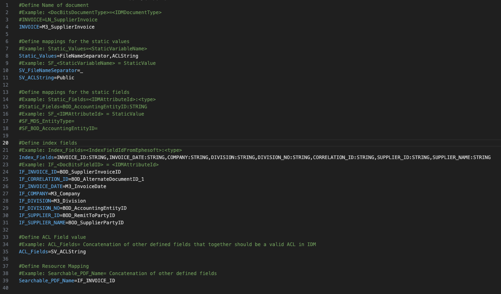
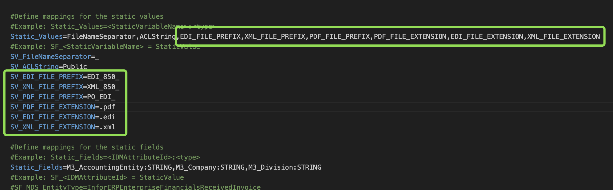
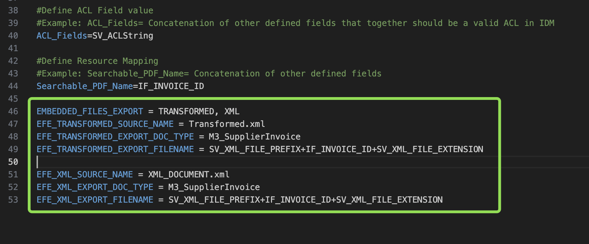
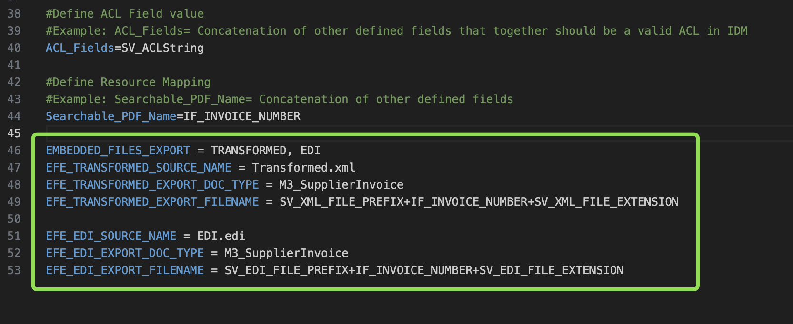

# Creazione di un file di mapping IDM

## Campi del file di mapping IDM

Quando si crea un file di mapping IDM, sono richiesti i seguenti campi:

* **Definizione del Tipo di Documento**
  * Assicurati che il codice del tipo di documento in DocBits corrisponda al nome utilizzato nell'URL delle impostazioni del campo, come per il file di mapping BOD.
  * Verifica che il nome del tipo di documento in IDM sia allineato con la configurazione del tuo sistema. Ad esempio, in M3 potrebbe essere **M3_SupplierInvoice**, mentre in LN sarà diverso in base alla tua configurazione.
    * Una guida su come navigare in IDM si trova in Document Manager in IDM in questa pagina.

```properties
#Define Name of document
#Example: <DocBitsDocumentType>=<IDMDocumentType>
#INVOICE=LN_SupplierInvoice
INVOICE=M3_SupplierInvoice
```

*   **Valori Statici**

    * Per prima cosa, definisci tutti i valori statici in un'unica riga utilizzando la chiave **Static_Values**:

    ```properties
    Static_Values=FileNameSeparator,ACLString
    ```

    * Poi, assegna i valori a ciascuna variabile statica utilizzando il prefisso **SV_**:

    ```properties
    SV_FileNameSeparator=_ 
    SV_ACLString=Public
    ```

```properties
#Define mappings for the static values
#Example: Static_Values=<StaticVariableName>
Static_Values=FileNameSeparator,ACLString
#Example: SF_<StaticVariableName> = StaticValue
SV_FileNameSeparator=_
SV_ACLString=Public
```

* **Campi Statici**
  * I campi statici servono a impostare valori specifici e immutabili per tutti i documenti. Questi valori restano coerenti tra i documenti.
  *   Inizia elencando tutti i campi **Static** utilizzati, specificando l'**IDMAttributeId** e il tipo.

      ```properties
      Static_Fields=BOD_AccountingEntityID:STRING,M3_Company:STRING,M3_Division:STRING
      ```
  *   Poi, assegna i valori statici a ciascun campo utilizzando il prefisso `SF_`:

      ```properties
      SF_BOD_AccountingEntityID=921_VVB
      SF_M3_Company=921
      SF_M3_Division=VVB
      ```

```properties
#Define mappings for the static fields
#Example: Static_Fields=<IDMAttributeId>:<type>
Static_Fields=BOD_AccountingEntityID:STRING,M3_Company:STRING,M3_Division:STRING
#Example: SF_<IDMAttributeId> = StaticValue
#SF_MDS_EntityType=InforERPEnterpriseFinancialsReceivedInvoice
SF_BOD_AccountingEntityID=921_VVB
SF_M3_Company=921
SF_M3_Division=VVB
```

* **Campi Indice**
  *   Inizia elencando tutti i campi indice utilizzati, specificando l'**IDMAttributeId** e il tipo.

      ```properties
      Index_Fields=delivery_note_id:STRING,delivery_date:STRING,CORRELATION_ID:STRING,ACCOUNTING_ENTITY:STRING,GROUP_ACCOUNTING_ENTITY:STRING,supplier_name:STRING,supplier_id:STRING,purchase_order:STRING
      ```
  *   Ogni campo mappato segue il formato:

      ```properties
      IF_<DocBitsFieldID> = <IDMAttributeId>
      ```

      * Conferma che **IndexFieldFromDocBits = IDMAttributeID**, in modo che la mappatura dei campi in DocBits sia allineata con gli attributi in IDM (Document Type → Attributes).\        Una guida su come navigare in IDM si trova in Document Manager in IDM in questa pagina.

```properties
#Define index fields
#Example: Index_Fields=<IndexFieldIdFromIDM>:<type>
Index_Fields=INVOICE_ID:STRING,INVOICE_DATE:STRING,COMPANY:STRING,DIVISION:STRING,DIVISION_NO:STRING,CORRELATION_ID:STRING,SUPPLIER_ID:STRING,SUPPLIER_NAME:STRING
#Example: IF_<DocBitsFieldID> = <IDMAttributeId>
IF_INVOICE_ID=BOD_SupplierInvoiceID
IF_CORRELATION_ID=BOD_AlternateDocumentID_1
IF_INVOICE_DATE=M3_InvoiceDate
IF_COMPANY=M3_Company
IF_DIVISION=M3_Division
IF_DIVISION_NO=BOD_AccountingEntityID
IF_SUPPLIER_ID=BOD_RemitToPartyID
IF_SUPPLIER_NAME=BOD_SupplierPartyID
```

* **Definizione del Campo ACL**

```properties
#Define ACL Field value
#Example: ACL_Fields= Concatenation of other defined fields that together should be a valid ACL in IDM
ACL_Fields=SV_ACLString
```

* **Nome Ricercabile in IDM**
  * Il **Searchable PDF Name** sarà il nome del documento in IDM.

```properties
#Define Resource Mapping
#Example: Searchable_PDF_Name= Concatenation of other defined fields
Searchable_PDF_Name=IF_INVOICE_ID 
```


<figure><figcaption></figcaption></figure>

## Esportazione di file XML ed EDI

Per esportare il file XML/EDI originale insieme al PDF generato, è necessario modificare il file di mapping IDM nella configurazione di esportazione. Prima di tutto, aggiorna la sezione **Static_Values** aggiungendo il prefisso e l'estensione del file. Dopo di che, definisci il mapping effettivo per garantire la corretta configurazione di esportazione.

Se un'esportazione delle fatture in IDM è già impostata, il PDF generato dovrebbe già essere incluso nell'esportazione. Se non hai bisogno del file XML, puoi saltare la parte successiva. Se invece hai bisogno del file XML, segui i passaggi seguenti.

### Aggiornamento dei valori statici:

Trova il campo **Static_Values** e aggiungi quanto segue:

```properties
,EDI_FILE_PREFIX,XML_FILE_PREFIX,PDF_FILE_PREFIX,PDF_FILE_EXTENSION,EDI_FILE_EXTENSION,XML_FILE_EXTENSION
```

Poi, aggiungi le seguenti voci sotto **SV_ACLString**:

```properties
SV_EDI_FILE_PREFIX=EDI_810_
SV_XML_FILE_PREFIX=XML_810_
SV_PDF_FILE_PREFIX=INV_EDI_
SV_PDF_FILE_EXTENSION=.pdf
SV_EDI_FILE_EXTENSION=.xml
SV_XML_FILE_EXTENSION=.xml
```

<figure><figcaption></figcaption></figure>

### Mapping XML

Aggiungi il seguente mapping in fondo al file:

<pre class="language-properties"><code class="lang-properties"><strong>EMBEDDED_FILES_EXPORT = TRANSFORMED, XML
</strong>EFE_TRANSFORMED_SOURCE_NAME = Transformed.xml
EFE_TRANSFORMED_EXPORT_DOC_TYPE = M3_SupplierInvoice
EFE_TRANSFORMED_EXPORT_FILENAME = SV_XML_FILE_PREFIX+IF_INVOICE_ID+SV_XML_FILE_EXTENSION

EFE_XML_SOURCE_NAME = XML_DOCUMENT.xml
EFE_XML_EXPORT_DOC_TYPE = M3_SupplierInvoice
EFE_XML_EXPORT_FILENAME = SV_XML_FILE_PREFIX+IF_INVOICE_ID+SV_XML_FILE_EXTENSION
</code></pre>

Nota: assicurati che **export_doc_type** sia impostato sul tipo di fattura IDM. In questo esempio è impostato per **M3**.

<figure><figcaption></figcaption></figure>

### Mapping EDI

Aggiungi il seguente mapping in fondo al file:

```properties
EMBEDDED_FILES_EXPORT = TRANSFORMED, EDI
EFE_TRANSFORMED_SOURCE_NAME = Transformed.xml
EFE_TRANSFORMED_EXPORT_DOC_TYPE = M3_SupplierInvoice
EFE_TRANSFORMED_EXPORT_FILENAME = SV_XML_FILE_PREFIX+IF_INVOICE_NUMBER+SV_XML_FILE_EXTENSION

EFE_EDI_SOURCE_NAME = EDI.edi
EFE_EDI_EXPORT_DOC_TYPE = M3_SupplierInvoice
EFE_EDI_EXPORT_FILENAME = SV_EDI_FILE_PREFIX+IF_INVOICE_NUMBER+SV_EDI_FILE_EXTENSION
```

Nota: assicurati che **export_doc_type** sia impostato sul tipo di fattura IDM. In questo esempio è impostato per **M3**.

<figure><figcaption></figcaption></figure>

### Gestore documenti in Infor

Vai a Document Manager e seleziona il nome del tipo di documento corrente che stai cercando di esportare, ad esempio Supplier Invoice.


Clicca sull'icona sopra, poi su Administration → Document Type e trova il tipo di documento che ti serve nell'elenco


Come mostrato di seguito, vedrai quindi il nome del tipo di documento così com'è in INFOR


Assicurati che il nome sia riportato esattamente così nel file di mapping IDM

## Caricamento del file in DocBits

Una volta preparato il file, caricalo nella tua configurazione di esportazione in DocBits. È disponibile in Settings → Export.


