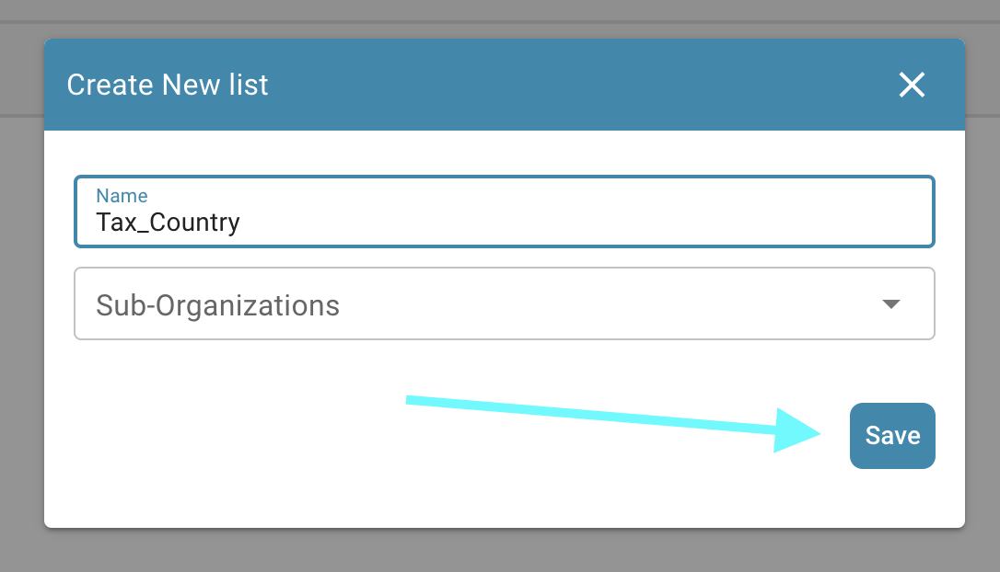
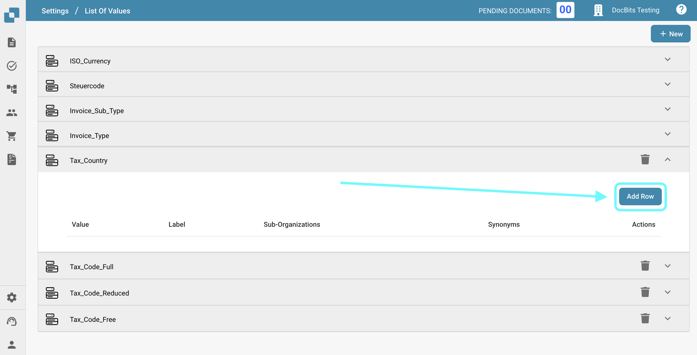
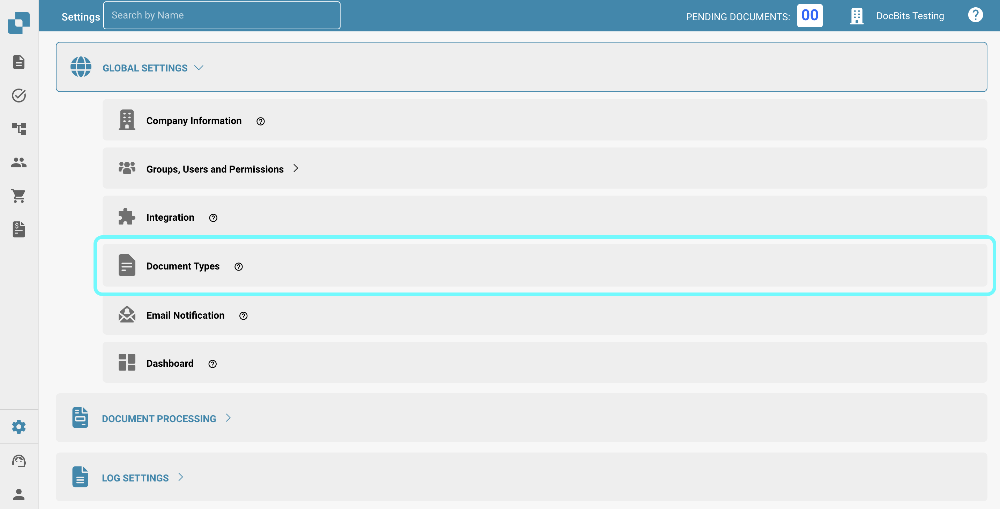
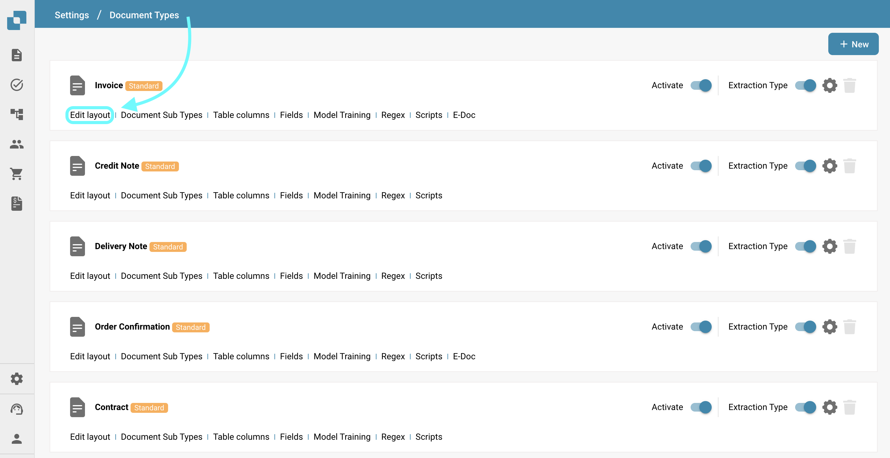
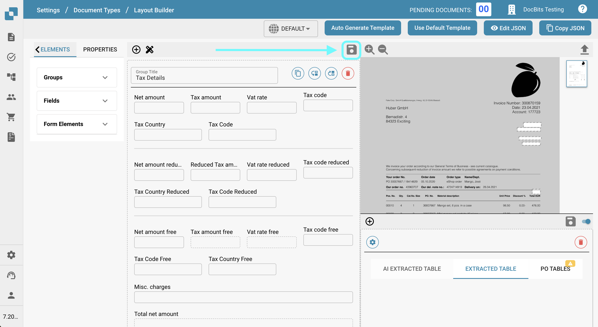
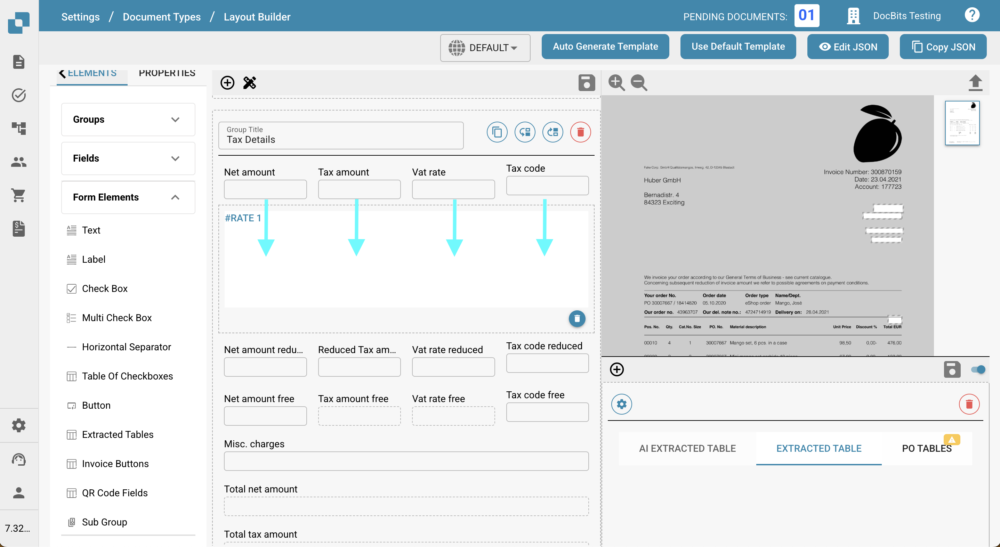

# 将税码导出到 LN

## **概述：**

\
本指南将带您完成设置流程，确保税码能够从 DocBits 正确导出到 LN。

## **单个税码**

### **步骤 1：设置值列表**

1.  前往 **Settings** -> **Document Processing** -> **List of Values**。

    <figure><figcaption>Settings：Document Processing > List of Values</figcaption></figure>
2.  点击 **New**。

    <figure><figcaption>List of Values 页面及已有列表</figcaption></figure>
3.  创建名为 `Tax_Country` 的列表，然后点击 **Save**。

    <figure><figcaption>创建列表 Tax_Country</figcaption></figure>
4.  再创建以下三个列表：

    * `Tax_Code_Full`
    * `Tax_Code_Reduced`
    * `Tax_Code_Free`

    
<figure><figcaption>创建列表 Tax_Code_Full</figcaption></figure> <figure><figcaption>创建列表 Tax_Code_Reduced</figcaption></figure> <figure><figcaption>创建列表 Tax_Code_Free</figcaption></figure>

5.  点击其中一个新建的列表以打开它。然后点击 **Add Row** 按钮添加新行。

    <figure><figcaption>在打开的列表中添加一行</figcaption></figure>
6.  输入 LN 中相应的所需值，然后点击 **Save** 保存更改。

    * 如果有多个值，可以点击 **Add More Values** 添加。

    
<figure><figcaption>在 Name 字段中输入 LN 税码</figcaption></figure> <figure><figcaption>通过 Add More Values 添加第二个值</figcaption></figure>

    * **注意：**您可以在 LN 中通过以下路径找到税码：**Common** → **Taxation** → **Master Data** → **Tax Codes** → **Tax Codes by Country**

    <figure><figcaption>LN：Common > Taxation > Master Data > Tax Codes > Tax Codes by Country</figcaption></figure>

### **步骤 2：在 DocBits 中添加字段**

1.  前往 **Settings** -> **Global Settings** -> **Document Types**。

    <figure><figcaption>Settings：Global Settings > Document Types</figcaption></figure>
2.  在要添加字段的文档类型对应的菜单中选择 **Fields**。

    <figure><figcaption>打开文档类型的 Fields 菜单</figcaption></figure>
3.  在 **VAT & Amounts** 下，按如下方式创建六个新字段：

    <figure><figcaption>Fields 选项卡：VAT &amp; Amounts 分组</figcaption></figure>

<table data-header-hidden><thead><tr><th width="306"></th><th width="139"></th><th width="119"></th><th></th></tr></thead><tbody><tr><td><strong>名称</strong></td><td><strong>标题</strong></td><td><strong>字段类型</strong></td><td><strong>值列表</strong></td></tr><tr><td><code>tax_country</code></td><td>税务国家/地区</td><td>下拉列表</td><td>Tax_Country</td></tr><tr><td><code>tax_country_2</code></td><td>税务国家/地区（减免）</td><td>下拉列表</td><td>Tax_Country</td></tr><tr><td><code>tax_country_3</code></td><td>免税国家/地区</td><td>下拉列表</td><td>Tax_Country</td></tr><tr><td><code>tax_code_without_country</code></td><td>税码</td><td>下拉列表</td><td>Tax_Code_Full</td></tr><tr><td><code>tax_code_without_country_2</code></td><td>减免税码</td><td>下拉列表</td><td>Tax_Code_Reduced</td></tr><tr><td><code>tax_code_without_country_3</code></td><td>免税税码</td><td>下拉列表</td><td>Tax_Code_Free</td></tr></tbody></table>

<figure><figcaption>字段 tax_country：Dropdown，列表 Tax_Country</figcaption></figure> <figure><figcaption>字段 tax_country_2：Dropdown，列表 Tax_Country</figcaption></figure> <figure><figcaption>字段 tax_country_3：Dropdown，列表 Tax_Country</figcaption></figure>

<figure><figcaption>字段 tax_code_without_country：Dropdown，列表 Tax_Code_Full</figcaption></figure> <figure><figcaption>字段 tax_code_without_country_2：Dropdown，列表 Tax_Code_Reduced</figcaption></figure> <figure><figcaption>字段 tax_code_without_country_3：Dropdown，列表 Tax_Code_Free</figcaption></figure>

4.  保存每个字段后，点击 **Save Settings** 应用更改。

    <figure><figcaption>点击 Save Settings 应用新字段</figcaption></figure>

### **步骤 3：编辑布局**

1.  前往 **Settings** -> **Global Settings** -> **Document Types**。

    <figure><figcaption>Settings：Global Settings > Document Types</figcaption></figure>
2.  打开要编辑的文档类型对应的 **Edit Layout** 菜单。

    <figure><figcaption>打开文档类型的 Edit layout</figcaption></figure>
3.  选择要应用税码的 **Document Origin**。

    <figure><figcaption>Layout Builder：选择 Document Origin</figcaption></figure>
4.  向下滚动到 **Tax Details** 部分。

    <figure><figcaption>滚动到 Tax Details 分组</figcaption></figure>
5. 展开 **Form Elements** 下拉菜单。
6.  在 **Tax Details** 部分使用 **Horizontal Separator Tool**。将其拖放到税务部分的子部分之间，以便清楚地分隔各部分并减少混淆。

    <figure><figcaption>展开 Form Elements</figcaption></figure>
7. 展开 **Form Fields** 下拉菜单。
8.  搜索 **Tax Country**，然后将该字段拖放到相应区域。

    <figure><figcaption>将 Tax Country 拖入 Tax Details 区域</figcaption></figure>
9.  搜索 **Tax Code**，然后将该字段拖放到对应区域。

    <figure><figcaption>将 Tax Code 拖入 Tax Details 区域</figcaption></figure>
10. 保存模板。

    <figure><figcaption>保存的模板及两个税务字段</figcaption></figure>

### 步骤 4：验证配置是否生效

在 DocBits 中上传新文档并选择正确的文档设置后，您现在应该可以选择在步骤 1 的列表中添加的税码。

<figure><figcaption>字段验证视图中的新下拉框</figcaption></figure>

## 多个税码

### **步骤 1：设置值列表**

1.  前往 **Settings** -> **Document Processing** -> **List of Values**。

    <figure><figcaption>Settings：Document Processing > List of Values</figcaption></figure>
2.  点击 **New**。

    <figure><figcaption>List of Values 页面及已有列表</figcaption></figure>
3.  创建名为 `Tax_Country` 的列表，然后点击 **Save**。

    <figure><figcaption>创建列表 Tax_Country</figcaption></figure>
4.  再创建以下三个列表：

    * `Tax_Code_Full`
    * `Tax_Code_Reduced`
    * `Tax_Code_Free`

    
<figure><figcaption>创建列表 Tax_Code_Full</figcaption></figure> <figure><figcaption>创建列表 Tax_Code_Reduced</figcaption></figure> <figure><figcaption>创建列表 Tax_Code_Free</figcaption></figure>

5.  点击其中一个新建的列表以打开它。然后点击 **Add Row** 按钮添加新行。

    <figure><figcaption>在打开的列表中添加一行</figcaption></figure>
6.  输入 LN 中相应的所需值，然后点击 **Save** 保存更改。

    * 如果有多个值，可以点击 **Add More Values** 添加。

    
<figure><figcaption>在 Name 字段中输入 LN 税码</figcaption></figure> <figure><figcaption>通过 Add More Values 添加第二个值</figcaption></figure>

    * **注意：**您可以在 LN 中通过以下路径找到税码：**Common** → **Taxation** → **Master Data** → **Tax Codes** → **Tax Codes by Country**

    <figure><figcaption>LN：Common > Taxation > Master Data > Tax Codes > Tax Codes by Country</figcaption></figure>

### **步骤 2：在 DocBits 中添加字段**

1.  前往 **Settings** -> **Global Settings** -> **Document Types**。

    <figure><figcaption>Settings：Global Settings > Document Types</figcaption></figure>
2.  在要添加字段的文档类型对应的菜单中选择 **Fields**。

    <figure><figcaption>打开文档类型的 Fields 菜单</figcaption></figure>
3.  在 **VAT & Amounts** 下，按如下方式创建六个新字段：

    <figure><figcaption>Fields 选项卡：VAT &amp; Amounts 分组</figcaption></figure>

<table data-header-hidden><thead><tr><th width="306"></th><th width="139"></th><th width="119"></th><th></th></tr></thead><tbody><tr><td><strong>名称</strong></td><td><strong>标题</strong></td><td><strong>字段类型</strong></td><td><strong>值</strong></td></tr><tr><td><code>tax_country</code></td><td>税务国家/地区</td><td>下拉列表</td><td>Tax_Country</td></tr><tr><td><code>tax_country_2</code></td><td>税务国家/地区（减免）</td><td>下拉列表</td><td>Tax_Country</td></tr><tr><td><code>tax_country_3</code></td><td>免税国家/地区</td><td>下拉列表</td><td>Tax_Country</td></tr><tr><td><code>tax_code_without_country</code></td><td>税码</td><td>下拉列表</td><td>Tax_Code_Full</td></tr><tr><td><code>tax_code_without_country_2</code></td><td>减免税码</td><td>下拉列表</td><td>Tax_Code_Reduced</td></tr><tr><td><code>tax_code_without_country_3</code></td><td>免税税码</td><td>下拉列表</td><td>Tax_Code_Free</td></tr></tbody></table>

<figure><figcaption>字段 tax_country：Dropdown，列表 Tax_Country</figcaption></figure> <figure><figcaption>字段 tax_country_2：Dropdown，列表 Tax_Country</figcaption></figure> <figure><figcaption>字段 tax_country_3：Dropdown，列表 Tax_Country</figcaption></figure>

<figure><figcaption>字段 tax_code_without_country：Dropdown，列表 Tax_Code_Full</figcaption></figure> <figure><figcaption>字段 tax_code_without_country_2：Dropdown，列表 Tax_Code_Reduced</figcaption></figure> <figure><figcaption>字段 tax_code_without_country_3：Dropdown，列表 Tax_Code_Free</figcaption></figure>

4.  保存每个字段后，点击 **Save Settings** 应用更改。

    <figure><figcaption>点击 Save Settings 应用新字段</figcaption></figure>

### **步骤 3：编辑布局**

1.  前往 **Settings** -> **Global Settings** -> **Document Types**。

    <figure><figcaption>Settings：Global Settings > Document Types</figcaption></figure>
2.  打开要编辑的文档类型对应的 **Edit Layout** 菜单。

    <figure><figcaption>打开文档类型的 Edit layout</figcaption></figure>
3.  选择要应用税码的 **Document Origin**。

    <figure><figcaption>Layout Builder：选择 Document Origin</figcaption></figure>
4.  向下滚动到 **Tax Details** 部分。

    <figure><figcaption>滚动到 Tax Details 分组</figcaption></figure>
5. 展开 **Form Elements** 下拉菜单。
6.  在 **Tax Details** 部分使用 **Sub Group** 工具。将其拖放到现有字段旁边。

    <figure><figcaption>选择 Sub Group 工具</figcaption></figure>
7.  要为子组命名，请点击该子组，并在 **Label** 字段中输入所需名称。

    
<figure><figcaption>将子分组拖到字段旁</figcaption></figure> <figure><figcaption>在 Label 字段中为子分组命名</figcaption></figure>

8.  将与此组对应的字段拖放到 **Sub Group** 字段中。

    <figure><figcaption>将税务字段移入子分组</figcaption></figure>
9. 展开 **Fields** 下拉菜单。
10. 搜索 **Tax**，然后将相应字段（例如 **Tax Country** 和 **Tax Code**）拖放到对应的子组中。

    <figure><figcaption>子分组中的 Tax Country 和 Tax Code</figcaption></figure>
11. 将步骤 5 到 10 重复两次，直到达到以下状态：

    <figure><figcaption>全额、减额和免税的三个子分组</figcaption></figure>
12. 保存模板。

    <figure><figcaption>保存多税码模板</figcaption></figure>

### 步骤 4：验证配置是否生效以及结果变化

在 DocBits 中上传新文档并选择正确的文档设置后，您可以选择在步骤 1 中添加的税码，并添加在步骤 3 中配置的多个税码。

* 文档将显示三个不同的部分：分别用于完整税额、减免税额和免税额。
* 点击某个部分中的加号按钮会创建副本，以便按选定的税率添加多笔申报。

<figure><figcaption>字段验证视图中的三个税务区块</figcaption></figure>

* 点击移除按钮即可删除部分。

<figure><figcaption>使用加号按钮添加另一个区块</figcaption></figure>

* 总金额将按所有部分的金额之和计算。
* 总金额的验证将根据所有税务部分进行调整。
* 只有在视图中添加字段后，才能对新部分应用脚本。

### LN 说明：

在 **LN** 中，USt Position 将根据税码/税务国家（地区）下拉菜单中的位置编号填写。导出时只会发送位置编号。

<figure><figcaption>LN：Tax Lines by External Invoice</figcaption></figure>

<figure><figcaption>LN：位置编号作为 USt Position 导出</figcaption></figure>

#### **导出映射**

要将税行关联到成本行：

1. 将 `TaxLine` 添加到 **InvoiceCostFields** 列表。
2. 按照以下示例添加条目：\
   `ICF_TaxLine = TF_position`

<figure><figcaption>导出映射：ICF_TaxLine = TF_position</figcaption></figure>
