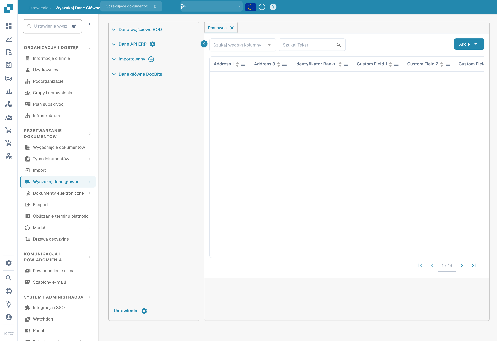

# Własne dane podstawowe

#### Aktywacja własnych danych podstawowych 

Na pulpicie przejdź do Ustawienia → Przetwarzanie dokumentów → Moduł.

.png>)

<figure><figcaption>
Moduły integracji dokumentów: skrypty, skanowanie, kody kreskowe i niestandardowe dane podstawowe. W przedstawionej wersji etykieta wyboru kodów kreskowych „Select” pozostaje angielska.
</figcaption></figure>

W sekcji Moduł aktywuj funkcję Custom Master Data, przesuwając suwak, jak pokazano poniżej.

#### Przegląd funkcji 

Aby dodać własne dane podstawowe do DocBits, przejdź w Ustawieniach do Master Data Lookup.

<figure><figcaption>
Wyszukiwanie danych podstawowych: źródła i tabela dostawców z ukrytymi wartościami.
</figcaption></figure>

Kliknij „Custom Master Data”

<figure><figcaption></figcaption></figure>

Następnie możesz utworzyć szablon (Template) lub punkt końcowy (Endpoint).

<figure><figcaption></figcaption></figure>

#### Tworzenie szablonu 

Pierwszym krokiem jest wybór między użyciem pliku ION API Twojej organizacji a użyciem OAuth2 i wprowadzeniem niezbędnych danych.

<figure><figcaption></figcaption></figure>

Następnie skonfigurujemy ustawienia wstępne. Tutaj wprowadzisz nazwę tabeli danych podstawowych oraz adres URL wywołania API.

<figure><figcaption></figcaption></figure>

Następnie należy podać ścieżkę JSON w notacji kropkowej. Więcej informacji o notacji kropkowej znajdziesz [tutaj](https://docs.hevodata.com/sources/engg-analytics/streaming/rest-api/writing-jsonpath-expressions/).

Na koniec musisz zmapować dane na kolumny, które chcesz utworzyć, jak w przykładzie poniżej.

<figure><figcaption></figcaption></figure>

Po wykonaniu tych czynności kliknij Done, aby utworzyć i wypełnić nowe dane podstawowe.

#### Tworzenie punktu końcowego 

Pierwszym krokiem jest wybór między użyciem pliku ION API Twojej organizacji, użyciem OAuth2 lub pozostawieniem tego pola pustego i wprowadzeniem niezbędnych danych.

<figure><figcaption></figcaption></figure>

Następnie skonfigurujemy ustawienia wstępne. Tutaj wprowadzisz nazwę tabeli danych podstawowych oraz adres URL wywołania API.

<figure><figcaption></figcaption></figure>

Następnie należy podać ścieżkę JSON w notacji kropkowej. Więcej informacji o notacji kropkowej znajdziesz [tutaj](https://docs.hevodata.com/sources/engg-analytics/streaming/rest-api/writing-jsonpath-expressions/).

Na koniec musisz zmapować dane na kolumny, które chcesz utworzyć, jak w przykładzie poniżej.

<figure><figcaption></figcaption></figure>

Po wykonaniu tych czynności kliknij Done, aby utworzyć i wypełnić nowe dane podstawowe.
