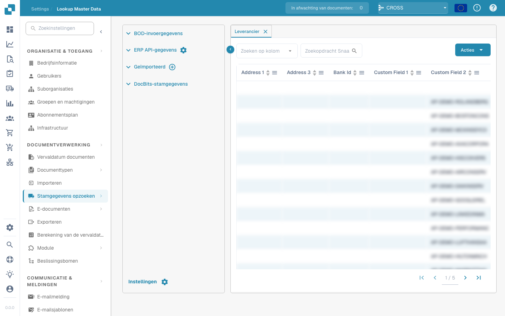

# Ordine di acquisto - FAQ

**Dove posso verificare se gli aggiornamenti di sincronizzazione del PurchaseOrderBOD sono implementati correttamente?**

Vai alla sessione _BOD Implementation Registration (bobod1100m000)_ in LN. Questa sessione consente di rivedere, modificare e registrare le implementazioni BOD standard e personalizzate, incluso il PurchaseOrderBOD.

\

<figure><figcaption></figcaption></figure>

**Come posso identificare la specifica implementazione BOD da verificare?**

Cerca i campi BOD Implementation Identifier e BOD Name. Il BOD Name indica in genere il tipo di BOD (ad es. PurchaseOrderBOD). Il BOD Implementation Identifier è un identificativo univoco di quella configurazione BOD.

\

**Che cosa significa la casella di controllo ‘Public’ nella sessione BOD Implementation Registration?**

La casella Public indica se l'implementazione BOD è disponibile per la comunicazione esterna.

• Selezionata: il BOD può essere scambiato al di fuori di LN (interfaccia pubblica e protetta).

• Deselezionata: il BOD è destinato solo all'elaborazione interna di LN (interfaccia protetta).

\

**Vedo un campo ‘Parent BOD Name’. A cosa serve?**

Il campo Parent BOD Name mostra il BOD padre se il BOD corrente è una versione derivata o dipendente. Se la casella Public è selezionata, questo campo sarà vuoto. In caso contrario, aiuta a comprendere la gerarchia delle implementazioni BOD.

\

**Come faccio a sapere se l'implementazione BOD è standard o personalizzata?**

Controlla la casella Standard.

• Selezionata: il BOD è un'implementazione standard fornita da LN.

• Deselezionata: il BOD è un'implementazione personalizzata definita dal tuo team o da un partner.

\

**A cosa serve la casella di controllo ‘Staging’?**

Se la casella Staging è selezionata, i BOD vengono prima messi in staging anziché essere pubblicati immediatamente. Possono poi essere pubblicati dalla sessione _Publish Staged BODs (bobod2200m000)_.

Nota: per il ProjectBudgetBOD lo staging è obbligatorio e non può essere modificato. Per i BOD dei dati anagrafici standard lo staging può essere abilitato manualmente, mentre per i BOD personalizzati può sempre essere configurato.

\

**In che modo la casella ‘Synchronous Processing’ influisce sulla gestione dei BOD in ingresso?**

Synchronous Processing determina l'azione da eseguire se un processo successivo alla ricezione di un BOD non riesce.

• Selezionata: il BOD in ingresso e il processo successivo devono andare entrambi a buon fine, altrimenti nessuno dei due viene elaborato.

• Deselezionata: il BOD in ingresso viene elaborato, ma se il processo successivo non riesce, deve essere gestito manualmente.

\

**Dove posso verificare se la funzione ‘Stage’ è attiva o meno per il mio BOD?**

Nella sessione _BOD Implementation Registration (bobod1100m000)_, controlla la casella Staging. Se non è selezionata, lo staging non è attivo per quel particolare BOD.

\

**Se il PurchaseOrderBOD non viene attivato a ogni aggiornamento, che altro devo considerare?**

• Verifica che l'opzione Staging sia impostata come desiderato. Se lo staging è disattivato, il BOD dovrebbe essere pubblicato immediatamente.

• Verifica che l'impostazione Synchronous Processing sia corretta per il tuo flusso di lavoro.

• Assicurati che BOD Implementation Identifier e BOD Name siano corretti e che tu stia lavorando sulla configurazione BOD giusta.

• Controlla se il BOD è standard o personalizzato e verifica se eventuali impostazioni personalizzate sostituiscono il comportamento standard.

\

**Esistono scenari in cui potrei non vedere gli aggiornamenti del PurchaseOrderBOD come previsto?**

Sì. Se il BOD non è configurato correttamente (impostazioni errate in Public, Staging o Synchronous Processing) o se è un'implementazione BOD personalizzata non allineata ai requisiti del tuo processo, gli aggiornamenti potrebbero non essere attivati come previsto. Rivedi la configurazione nella sessione _bobod1100m000_ e assicurati che tutti i parametri corrispondano al flusso di processo desiderato.
