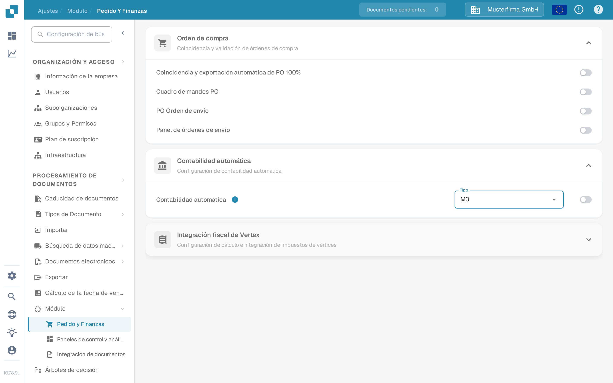
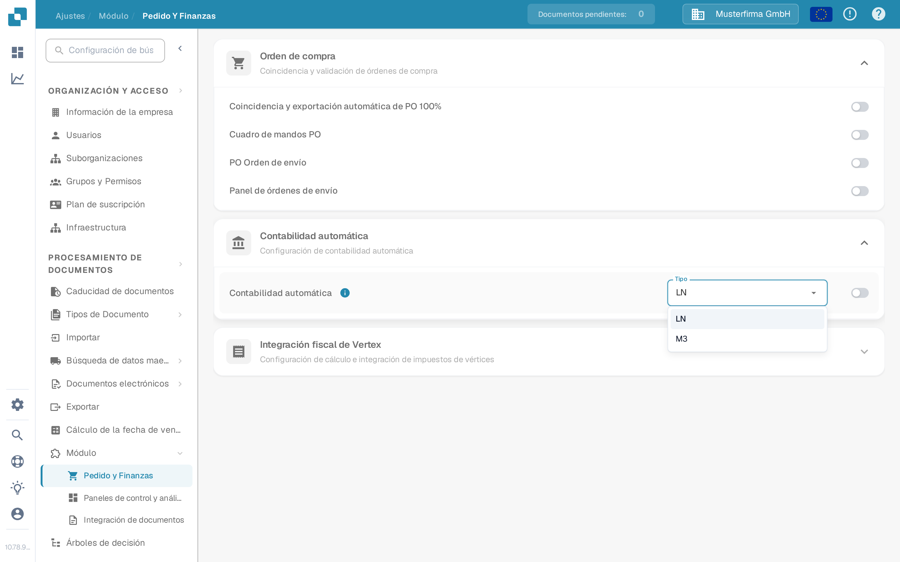

# Auto Accounting con Infor M3

Use esta guía para planificar los datos maestros necesarios para la autocontabilidad (Auto Accounting) de M3 en DocBits. Una opción activada por sí sola no importa cuentas ni elementos de costeo. Su administrador de Infor debe confirmar el mapeo de BOD, la operación de la API de DocBits y el resultado en su propia organización.

## Comprobar la opción de DocBits

Un administrador puede abrir **Ajustes → Módulo → Pedido Y Finanzas → Contabilidad automática**. El menú **Tipo** ofrece **LN** y **M3**. Elija **M3** solo para una integración con M3 y active el interruptor después de haber verificado el flujo de datos y los datos maestros necesarios. La opción vecina **Vertex-Integración fiscal** del mismo acordeón no forma parte de esta guía. Las capturas de pantalla siguientes muestran esta página en el entorno de pruebas de DocBits en español. El interruptor estaba **desactivado**, el Tipo actual era **LN** y abrir el menú no guardó ni modificó ninguna opción.

<figure><figcaption>
Ubique Contabilidad automática en Pedido Y Finanzas; en este ejemplo del entorno de pruebas está desactivada.
</figcaption></figure>

<figure><figcaption>
El menú Tipo ofrece LN y M3. No se seleccionó ninguna opción en este ejemplo.
</figcaption></figure>

## Preparar el flujo de datos de M3

1. Acuerde qué empresa de M3 y qué organización de DocBits intercambiarán datos. Consulte con su administrador de DocBits qué operación de API actual acepta los datos maestros de contabilidad. Evite copiar un endpoint o una credencial de una captura de pantalla de un entorno antiguo.
2. En M3, confirme que los BOD necesarios están habilitados para la entidad contable correspondiente. El ejemplo de un entorno anterior usaba `Sync.ChartOfAccounts` y `Sync.CodeDefinition` para las dimensiones contables. Confirme el nombre (noun), la versión y los campos exactos contra su configuración de M3 y el contrato de la API receptora. Infor describe cómo [habilitar la publicación de BOD](https://docs.infor.com/m3core/2025.x/en-us/useradminlib_cloud/m3cecoreag_cloud/wbr1509377469290.html).
3. En **ION Desk → Connect → Connection Points**, configure el origen de M3 y un destino de API con la operación de DocBits aprobada y una cuenta de servicio. En **Data Flows**, enrute solo los documentos aprobados, compruebe los filtros y el mapeo de campos y, a continuación, guarde y active el flujo. Vea la [lista de puntos de conexión de Infor](https://docs.infor.com/inforos/latest/en-us/useradminlib_cloud/iondeskceug/documentflowdesk_connectionpointmasterlist.html) y las [instrucciones de activación de flujos de datos](https://docs.infor.com/inforos/latest/en-us/useradminlib_cloud/iondeskceug/lsm1436532178755.html).
4. Publique un identificador de prueba no sensible desde M3. Una carga inicial puede usar **EVS006** de M3; los nombres de la acción y de la tabla dependen de la versión de M3 instalada. Siga las [instrucciones de carga inicial de Infor](https://docs.infor.com/m3core/2025.x/en-us/useradminlib_cloud/m3cecoreag_cloud/pbi1544012609638.html). En **ION OneView**, siga el identificador a través del flujo e inspeccione el resultado de la API con [Infor OneView](https://docs.infor.com/inforos/latest/en-us/useradminlib_cloud/iondeskceug/lsm1436532196155.html).
5. Compruebe el mismo identificador en DocBits en **Ajustes → Procesamiento de documentos → Búsqueda de datos maestros**. La [guía de API de M3 a DocBits](import-from-infor-m3-to-docbits-via-api.md) explica las comprobaciones de importación. Active la autocontabilidad de M3 solo cuando los registros necesarios estén presentes y su administrador haya validado el mapeo.

## Elementos de costeo

El ejemplo de un entorno anterior exportaba elementos de costeo de M3 **PPS280** a Excel, reducía las columnas y subía un CSV a través de una pantalla antigua de una API HTTP. Esa secuencia de capturas de pantalla no es un procedimiento de importación general seguro: los nombres de las columnas, el delimitador, el endpoint y la autenticación necesitan confirmación para el entorno actual. Use la guía actual de la [tabla de elementos de costeo](table-extraction-for-costing-element.md) para preparar el archivo e inspeccionar los controles de CSV disponibles en DocBits. No suba ningún archivo hasta que el administrador haya comprobado sus columnas contra la tabla de destino.

Si un BOD llega a ION pero no aparece ninguna fila en DocBits, inspeccione la ruta de ION, la respuesta de la API, la organización, el identificador y el mapeo antes de activar la función. No deduzca el éxito de un flujo activado ni de datos de demostración existentes.

Esta página reemplaza 43 capturas de pantalla de un entorno antiguo de Infor con controles actuales de DocBits y pasos con enlaces a las fuentes. No había ningún entorno de Infor ni transferencia de BOD en vivo disponibles para una prueba de extremo a extremo; el administrador de su entorno debe validar el mapeo, la importación y el resultado contable finales.
