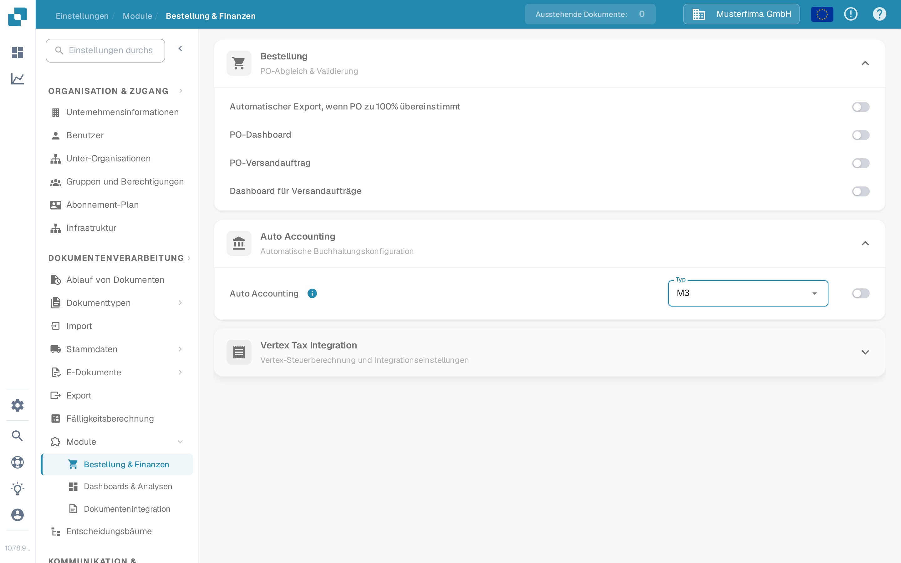

# Auto Accounting mit Infor M3

Diese Anleitung hilft Ihnen, die Stammdaten für M3-Auto-Accounting in DocBits zu planen. Eine aktivierte Einstellung allein importiert keine Konten oder Kostenelemente. Ihr Infor-Administrator muss die BOD-Zuordnung, die DocBits-API-Operation und das Ergebnis in Ihrer eigenen Organisation bestätigen.

## DocBits-Einstellung prüfen

Ein Administrator kann **Einstellungen → Module → Bestellung & Finanzen → Auto Accounting** öffnen. Das Menü **Typ** bietet **LN** und **M3** an. Wählen Sie **M3** nur für eine M3-Integration und aktivieren Sie den Schalter erst, nachdem Datenfluss und erforderliche Stammdaten geprüft wurden. Die Screenshots zeigen die englischsprachige Sandbox **DocBits Documentation Test A**. Dort war der Schalter **aus**, die eingestellte Option unter **Typ** war **LN**, und das Öffnen des Menüs hat keine Einstellung gespeichert oder geändert.

<figure><figcaption>
Auto Accounting unter Bestellung &amp; Finanzen finden; in diesem Sandbox-Beispiel ist es deaktiviert.
</figcaption></figure>

<figure><figcaption>
Das Menü Typ bietet LN und M3 an. In diesem Beispiel wurde keine Option ausgewählt.
</figcaption></figure>

## M3-Datenfluss vorbereiten

1. Vereinbaren Sie, welches M3-Unternehmen und welche DocBits-Organisation Daten austauschen. Klären Sie mit Ihrem DocBits-Administrator, welche aktuelle API-Operation die Buchhaltungsstammdaten entgegennimmt. Übernehmen Sie keinen Endpunkt und keine Zugangsdaten aus einem Screenshot eines älteren Mandanten.
2. Bestätigen Sie in M3, dass die erforderlichen BODs für die betreffende Buchhaltungseinheit aktiviert sind. Das frühere Mandantenbeispiel verwendete `Sync.ChartOfAccounts` und `Sync.CodeDefinition` für Buchhaltungsdimensionen. Prüfen Sie das genaue Noun, die Version und die Felder gegen Ihre M3-Konfiguration und den API-Vertrag der empfangenden Seite. Infor beschreibt das [Aktivieren der BOD-Veröffentlichung](https://docs.infor.com/m3core/2025.x/en-us/useradminlib_cloud/m3cecoreag_cloud/wbr1509377469290.html).
3. Konfigurieren Sie in **ION Desk → Connect → Connection Points** die M3-Quelle und ein API-Ziel mit der freigegebenen DocBits-Operation und dem Service-Konto. Routen Sie unter **Data Flows** nur die freigegebenen Dokumente, prüfen Sie Filter und Feldzuordnung, und speichern und aktivieren Sie dann den Datenfluss. Siehe die [Infor-Liste der Connection Points](https://docs.infor.com/inforos/latest/en-us/useradminlib_cloud/iondeskceug/documentflowdesk_connectionpointmasterlist.html) und die [Anleitung zum Aktivieren von Datenflüssen](https://docs.infor.com/inforos/latest/en-us/useradminlib_cloud/iondeskceug/lsm1436532178755.html).
4. Veröffentlichen Sie einen unempfindlichen Testbezeichner aus M3. Ein erster Import kann M3 **EVS006** verwenden; Aktion und Tabellennamen hängen von der installierten M3-Version ab. Folgen Sie den [Infor-Anleitungen zum ersten Laden](https://docs.infor.com/m3core/2025.x/en-us/useradminlib_cloud/m3cecoreag_cloud/pbi1544012609638.html). Verfolgen Sie in **ION OneView** den Bezeichner durch den Datenfluss und prüfen Sie das API-Ergebnis mit [Infor OneView](https://docs.infor.com/inforos/latest/en-us/useradminlib_cloud/iondeskceug/lsm1436532196155.html).
5. Prüfen Sie denselben Bezeichner in DocBits unter **Einstellungen → Dokumentenverarbeitung → Stammdaten**. Die [Anleitung zum M3-Import über die API](import-from-infor-m3-to-docbits-via-api.md) erklärt die Importprüfungen. Aktivieren Sie M3-Auto-Accounting erst, wenn die erforderlichen Datensätze vorhanden sind und Ihr Administrator die Zuordnung geprüft hat.

## Kostenelemente

Das ältere Mandantenbeispiel exportierte Kostenelemente aus M3 **PPS280** nach Excel, reduzierte Spalten und lud eine CSV über einen alten HTTP-API-Bildschirm hoch. Diese Screenshot-Folge ist kein sicheres allgemeines Importverfahren: Spaltennamen, Trennzeichen, Endpunkt und Authentifizierung müssen für die aktuelle Umgebung bestätigt werden. Nutzen Sie die aktuelle [Anleitung zur Kostenelement-Tabelle](table-extraction-for-costing-element.md), um die Datei vorzubereiten, und sehen Sie sich die verfügbaren DocBits-CSV-Steuerungen an. Laden Sie keine Datei hoch, bevor der Administrator ihre Spalten gegen die Zieltabelle geprüft hat.

Erreicht ein BOD ION, erscheint aber keine Zeile in DocBits, prüfen Sie die ION-Route, die API-Antwort, die Organisation, den Bezeichner und die Zuordnung, bevor Sie die Funktion aktivieren. Schließen Sie nicht aus einem aktivierten Datenfluss oder vorhandenen Demodaten auf Erfolg.

Diese Seite ersetzt 43 Screenshots aus einem älteren Infor-Mandanten durch aktuelle DocBits-Steuerungen und Schritte mit Quellenverweisen. Für einen End-to-End-Test war kein Infor-Mandant und keine live BOD-Übertragung verfügbar; Ihr Mandantenadministrator muss die endgültige Zuordnung, den Import und das Buchhaltungsergebnis prüfen.
