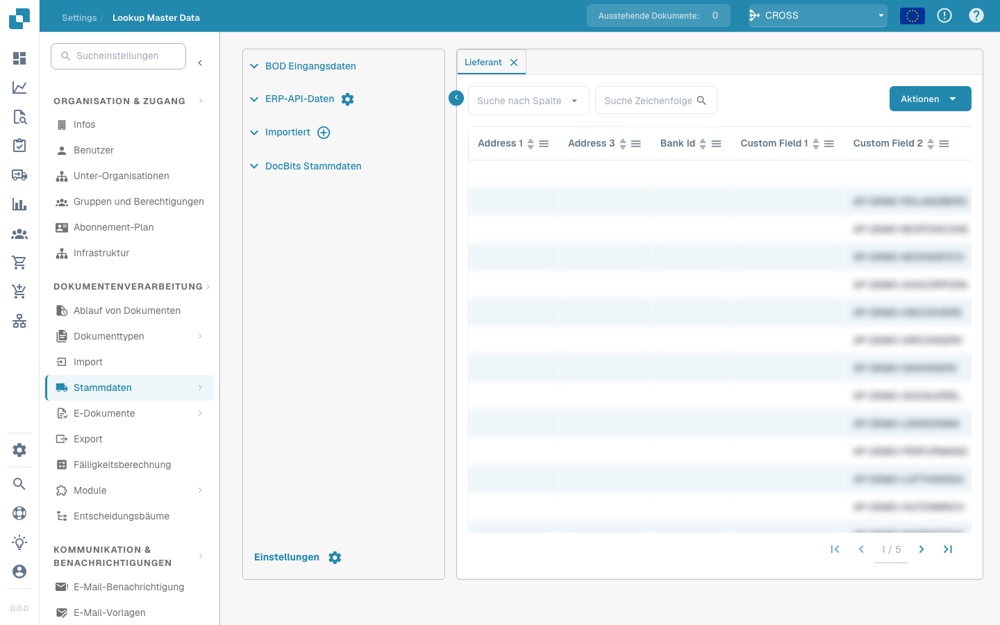

# 如何导入所有供应商

* [ ] 登录 Infor OS 环境并进入 M3 应用。建议：请确保您拥有管理员权限，以便运行所有程序。

<figure><figcaption></figcaption></figure>

* [ ] 运行程序 _**evs006**_。按 command + R，您将看到用于搜索和启动程序的打开标签页。

<figure><figcaption>
<em><strong>evs006</strong></em>
</figcaption></figure>

* [ ] 打开 _**evs006**_ 后，您会看到一个空表格。请填写 “BOD noun” 和 “Table” 列。“BOD noun” 填写 “SupplierPartyMaster”，“Table” 填写 M3 供应商表 “CIDMAS”。

<figure><figcaption></figcaption></figure>

<figure><figcaption></figcaption></figure>

* [ ] 填写这些列后，点击屏幕上方栏中的 CREATE 按钮。随后会进入以下屏幕。

<figure><figcaption></figcaption></figure>

<figure><figcaption></figcaption></figure>

* [ ] 在 “BOD Description” 中填写 SupplierPartyMaster。

<figure><figcaption></figcaption></figure>

* [ ] 点击 Next。（位于屏幕左下方）。

<figure><figcaption></figcaption></figure>

* [ ] 在此窗口中点击 Next。

<figure><figcaption></figcaption></figure>

* [ ] 现在，您会看到一个已填入 BOD SupplierPartyMaster 的表格。右键点击该 BOD，然后选择 Related > Run。

<figure><figcaption></figcaption></figure>

* [ ] 在下一个窗口中选择 “Sync”，然后点击 Next。

<figure><figcaption></figcaption></figure>

完成上述所有步骤后，您便已激活用于从 CIDMAS 表导入所有供应商的 BOD。几分钟后，您应该就能在 DocBits 中看到供应商。
