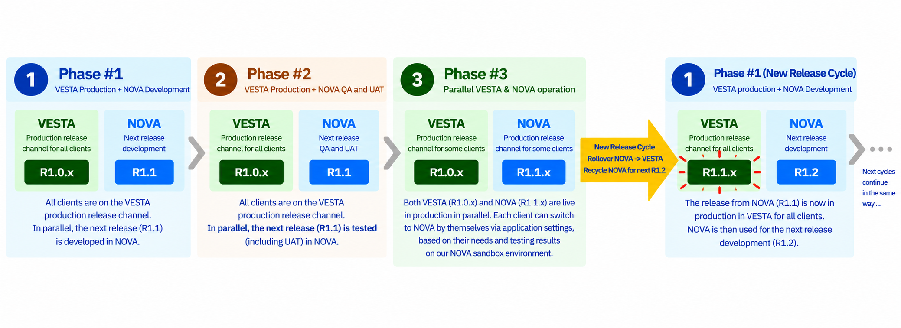
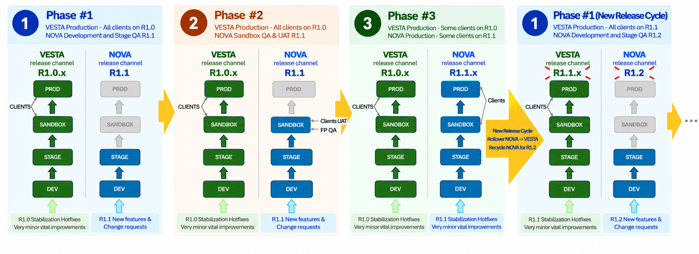

# DocBits Release Lifecycle Strategy

With the rollout of the upcoming minor release R1.1,&#x20;DocBits will introduce a new release lifecycle strategy based on two release channels: VESTA and NOVA.

**NOVA** is the channel for introducing new major and minor releases, such as **Rx** and **Rx.y**. **VESTA** continues to provide the existing production release.

## Release channels

| Channel | Role in the lifecycle |
| --- | --- |
| **VESTA** | Provides the current production release. |
| **NOVA** | Provides the next release as it progresses through development, testing, and production availability. During parallel production, NOVA and VESTA both offer live production releases. |

## Lifecycle overview

Each cycle consists of three phases. A FELLOWPRO-managed rollover then brings the NOVA production release into VESTA and starts the next cycle.

| Phase | VESTA | NOVA | What this means for your organization |
| --- | --- | --- | --- |
| **1. Development** | R1.0.x in production | R1.1 in development | Continue using VESTA while the next release is prepared. |
| **2. QA and acceptance testing** | R1.0.x in production | R1.1 in QA and UAT | Evaluate the upcoming release in the NOVA sandbox while production work continues on VESTA. |
| **3. Parallel production** | R1.0.x in production | R1.1.x in production | Remain on VESTA or independently switch to NOVA when ready. |

After the rollover, all customers use VESTA R1.1.x, and NOVA is recycled for development of R1.2. Phase 1 begins again with these updated versions.

### Phase 1 — Development

VESTA provides the current production release, R1.0.x, while the next release, R1.1, is developed in NOVA. Your organization continues its day-to-day work on VESTA throughout this phase.

### Phase 2 — QA and acceptance testing

The upcoming NOVA release progresses through quality assurance (QA) and user acceptance testing (UAT). You can evaluate it in the NOVA sandbox to assess how the changes fit your organization's workflows and prepare for adoption.

VESTA R1.0.x remains the production release during this phase. You can switch to NOVA for production use once it becomes available in Phase 3.

### Phase 3 — Parallel production

VESTA R1.0.x and NOVA R1.1.x are both live production releases. Your organization decides whether and when to switch to NOVA, based on your needs and the results of your sandbox evaluation.

To adopt NOVA during this phase:

1. Evaluate the release in the NOVA sandbox.
2. Decide when your organization is ready to use it in production.
3. In DocBits, go to **Settings > Company Information > Release Channel** and select **NOVA**.

During parallel production, you can also switch back to VESTA by going to **Settings > Company Information > Release Channel** and selecting **VESTA**.

Channel switching is self-service. FELLOWPRO does not select which customers should move to NOVA. You may continue using VESTA throughout parallel production and adopt the new release through the subsequent rollover.

## Release rollover and the next cycle

FELLOWPRO manages the rollover once the NOVA release is ready to become the common production release and acceptance of the planned transition has been obtained from all customers:

**NOVA R1.1.x → VESTA R1.1.x**

### Advance announcement and customer acceptance

FELLOWPRO announces the planned rollover to all customers in advance by email and seeks their acceptance of the transition. You are invited to contact FELLOWPRO with any concerns or objections so they can be discussed before the rollover. The rollover and recycling of NOVA proceed only once the release is ready and all customers have accepted the planned transition.

### What changes at rollover

| Change | Outcome |
| --- | --- |
| **The NOVA release becomes the VESTA release** | R1.1.x becomes the common production release in VESTA for all customers. |
| **The previous release is retired** | R1.0.x is decommissioned and is no longer available through either channel or by any other means. |
| **NOVA is recycled for the next release** | Development of R1.2 begins in NOVA, starting Phase 1 of the next cycle. |

The same three phases then repeat with the new version numbers.

The diagram below illustrates the release cycle described above in greater detail.

### Release cadence

The planned cadence differs between major and minor releases introduced through NOVA and hotfixes applied to the production releases in VESTA and NOVA.

#### Major and minor releases through NOVA

FELLOWPRO currently plans a cycle of approximately **3–4 months for major and minor releases** introduced through the NOVA release channel, such as **Rx** and **Rx.y**. This estimate applies to the release lifecycle described above, including the subsequent rollover into VESTA and recycling of NOVA for the next release. It does not describe the frequency of hotfixes.

This interval reflects our present planning estimate; it is not a fixed schedule, a maximum cycle duration, or a guarantee of a release or rollover date. The timing of each rollover and the recycling of NOVA depends on both **release readiness and acceptance of the planned transition by all customers**. If additional time is needed to achieve release readiness, address customer concerns, or obtain acceptance from every customer, the cycle will be extended and may take longer than four months.

FELLOWPRO communicates each planned rollover in advance. Any indicative timing remains subject to these conditions being met.

#### Hotfixes in VESTA production

Hotfixes for the VESTA production release are expected approximately **once a month, or at somewhat longer intervals**. This is an indicative cadence rather than a fixed schedule or guaranteed delivery date.

#### Stabilization hotfixes in NOVA production

A general cadence cannot be specified for stabilization hotfixes in NOVA production. NOVA introduces entirely new releases, so the timing and frequency of these hotfixes depend on the stabilization needs of the particular release. They therefore do not follow the indicative monthly cadence for VESTA or the 3–4 month cycle for major and minor releases.

## Responsibilities and customer choice

| Transition | Who manages it | What to expect |
| --- | --- | --- |
| **Switch between VESTA and NOVA during Phase 3** | Your organization | Evaluate NOVA in the sandbox and choose whether and when to switch. Use **Settings > Company Information > Release Channel** to select NOVA or return to VESTA during parallel production. |
| **Roll over NOVA R1.1.x into VESTA R1.1.x** | FELLOWPRO | Review the advance email announcement, raise any concerns or objections, and confirm acceptance of the planned transition. FELLOWPRO proceeds once the release is ready and all customers have accepted. |

## Frequently asked questions

### Can we remain on VESTA while NOVA is available in production?

Yes. During Phase 3, you may remain on VESTA or switch to NOVA when your organization is ready. At the subsequent rollover, the new release becomes VESTA and the previous release is retired.

### How do we switch to NOVA or back to VESTA?

During Phase 3, go to **Settings > Company Information > Release Channel** in DocBits and select **NOVA** to adopt the new production release, or **VESTA** to return to the current VESTA production release. Your organization makes this choice independently, based on its needs and evaluation of NOVA in the sandbox. This choice applies while both releases are available in parallel; the previous VESTA release is retired at rollover.

### When is NOVA available for production use?

NOVA becomes a live production release in Phase 3, after development and QA/UAT. During this phase, VESTA and NOVA run in production in parallel with different software versions.

### How will we know about the rollover, and can we raise objections?

FELLOWPRO emails all customers in advance and seeks acceptance of the planned transition. You are invited to raise any concerns or objections with FELLOWPRO. The rollover and recycling of NOVA proceed only once the release is ready and acceptance has been obtained from all customers.

### Can we continue using R1.0.x after the rollover?

No. R1.0.x is decommissioned at rollover and is no longer available through either channel or by any other means. R1.1.x becomes the common VESTA production release for all customers.

### How does the rollover differ from our switch to NOVA?

Your switch to NOVA during Phase 3 is a self-service choice about when to adopt the new production release. The rollover is the subsequent transition managed by FELLOWPRO: NOVA R1.1.x becomes VESTA R1.1.x, the previous release is retired, and the next cycle begins.

### What happens to NOVA after the rollover?

NOVA is recycled for development of the next release, R1.2 in this example. VESTA provides R1.1.x while NOVA progresses through development, QA/UAT, and parallel production again.

### Is a major or minor release guaranteed every three to four months?

No. The approximate 3–4 month cadence for major and minor releases introduced through NOVA is a current planning estimate, not a guaranteed schedule or a maximum duration. Rollover and recycling of NOVA require both release readiness and acceptance from all customers. If either condition requires more time, the cycle will be extended and may exceed four months. FELLOWPRO communicates each planned rollover in advance.
