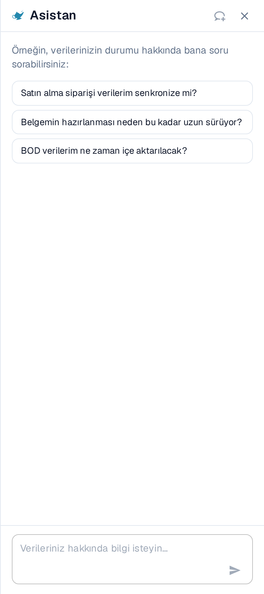

# Kontrol Paneli Araçları

Arama çubuğunun sağındaki, diğer kontrol paneli araçlarını bulacaksınız.

<figure><figcaption></figcaption></figure>

* Liste Yenile: Bu, tarayıcı sekmenizi yenilemeden kontrol panelini güncellemek için kullanılır.
* Gelişmiş Ayarlar: Bu konu hakkında daha fazla bilgi sayfanın daha aşağısında mevcuttur.
* Analiz: Bu, DocBits'e yüklediğiniz belgeler hakkında daha fazla içgörü sağlar.
* Yükle: Bu konu hakkında daha fazla bilgi bir sonraki bölümde bulunmaktadır.
* Asistan (lamba): Kontrol panelinin yanında, verilerinizin durumuyla ilgili sorular sorabileceğiniz paneli açar.

<figure><figcaption></figcaption></figure>

## Verileriniz hakkında soru sorma

Araç çubuğundaki lamba simgesi, kontrol panelinin yanında **Asistan** panelini açar. Burada verilerinizin durumuyla ilgili sorularınızı günlük dille sorabilirsiniz, örneğin:

* Satın alma siparişi verilerim senkronize mi?
* Belgemin hazırlanması neden bu kadar uzun sürüyor?
* BOD verilerim ne zaman içe aktarılacak?

Önerilen sorulardan birini seçin ya da kendi sorunuzu **Verileriniz hakkında bilgi isteyin…** alanına yazıp okla gönderin.

<figure><figcaption>
Asistan paneli kontrol panelinin yanında açılır ve başlamak için sorular önerir.
</figcaption></figure>


Lamba simgesi yalnızca asistan kuruluşunuz için etkinleştirildiğinde görünür. Görmüyorsanız yöneticinize başvurun.

