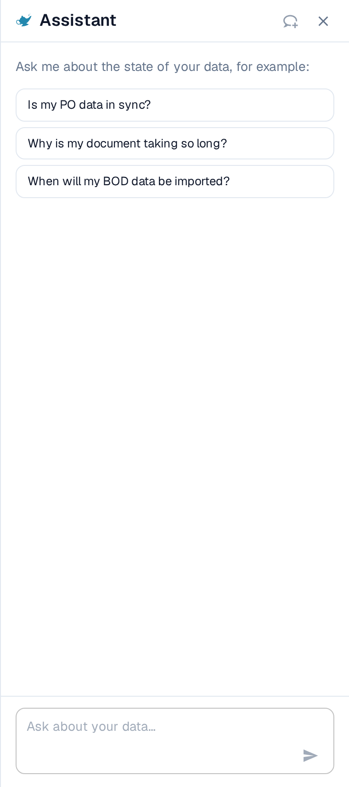

# Alatke kontrolne table

Desno od trake za pretragu, pronaći ćete druge alatke kontrolne table.

<figure><figcaption></figcaption></figure>

* Osveži listu: Koristi se za ažuriranje kontrolne table bez potrebe da osvežite karticu pregledača.
* Napredne postavke: Više informacija o ovoj temi dostupno je dalje na ovoj stranici.
* Analitika: Pruža vam dodatne uvide o dokumentima koje ste otpremili na DocBits.
* Otpremi: Više informacija o ovoj temi u sledećem odeljku.
* Asistent (lampa): Otvara panel **Assistant** pored kontrolne table, u kojem možete postavljati pitanja o stanju svojih podataka.

<figure><figcaption></figcaption></figure>

## Pitanja o stanju vaših podataka

Ikona lampe u traci sa alatkama otvara panel **Assistant** pored kontrolne table. U njemu pitanja o stanju podataka postavljate običnim jezikom, na primer:

* Da li su moji podaci o porudžbini sinhronizovani?
* Zašto se moj dokument obrađuje tako dugo?
* Kada će moji BOD podaci biti uvezeni?

Izaberite jedno od predloženih pitanja ili upišite svoje u polje **Ask about your data…** i pošaljite ga strelicom.

<figure><figcaption>
Panel Assistant se otvara pored kontrolne table i predlaže pitanja za početak.
</figcaption></figure>


Ikona lampe se prikazuje samo kada je asistent uključen za vašu organizaciju. Ako je ne vidite, obratite se administratoru. Interfejs na snimku je na engleskom, jer DocBits nema srpski prevod.

