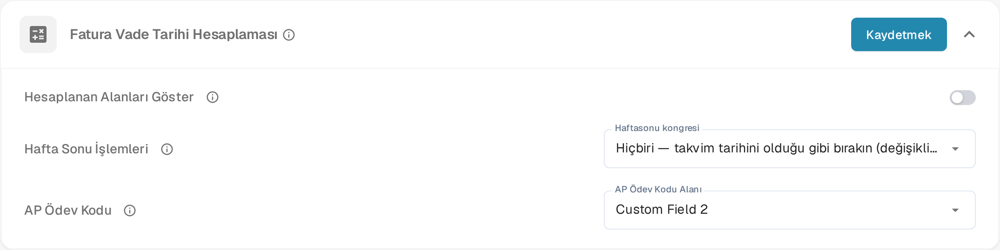
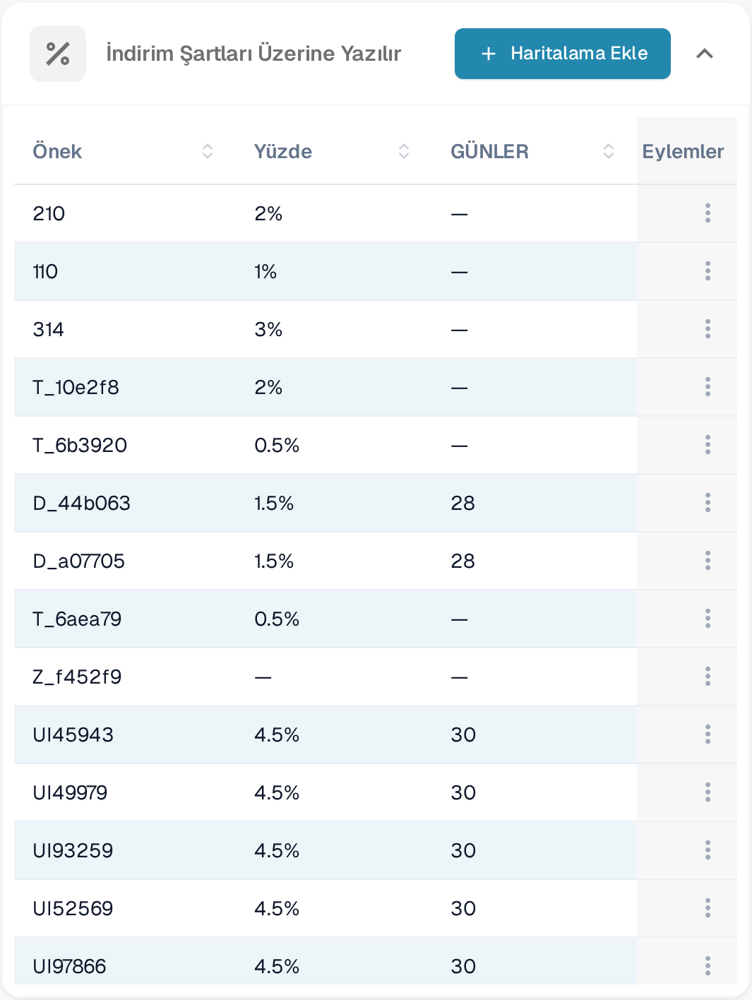
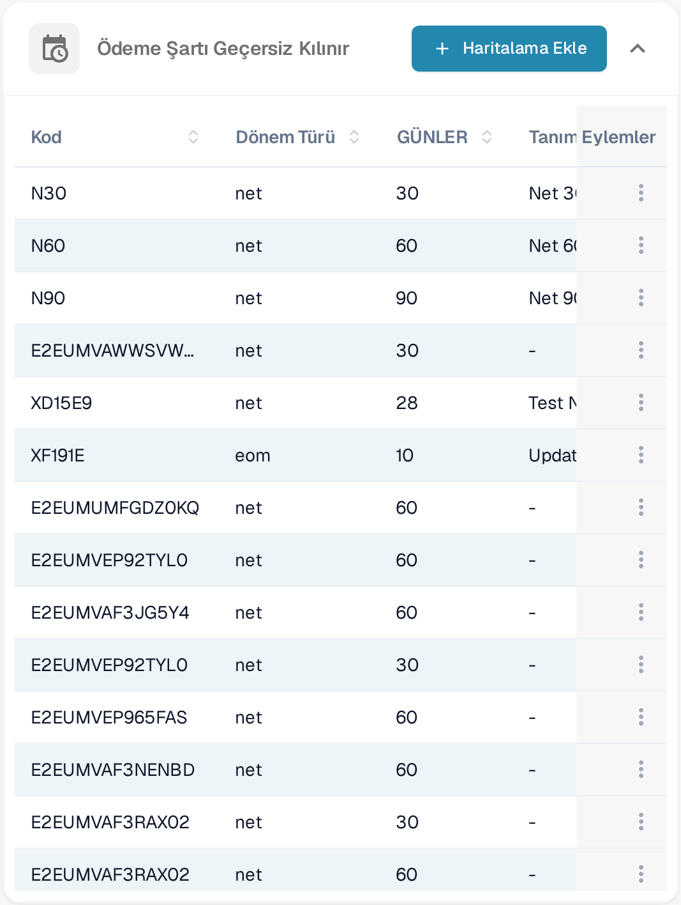
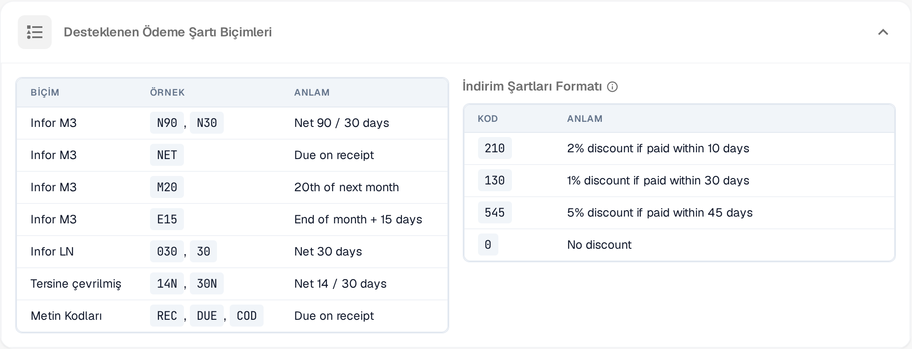

# Vade Tarihi Hesaplama

<figure><figcaption>
Vade Tarihi Hesaplama ayarları
</figcaption></figure>

**Vade Tarihi Hesaplama** sayfası (**Belge İşleme → Vade Tarihi Hesaplama**), DocBits'in fatura vade tarihlerini, iskonto (Skonto) vade tarihlerini ve ödeme koşullarını faturalarda bulunan ödeme koşulu kodlarından nasıl hesapladığını denetler.

**Fatura Vade Tarihi Hesaplaması** kartı genel ayarları barındırır. Bu karttaki değişiklikleri kartın sağ üst köşesindeki **Kaydetmek** düğmesiyle kaydedin. Sayfanın devamında indirim ve ödeme şartı eşlemelerinin yer aldığı tablolar ile desteklenen biçimlerin listesi bulunur.

## Hesaplanan Alanları Göster

Otomatik olarak hesaplanan fatura alanlarının — vade tarihi, iskonto vade tarihi, ödeme koşulları ve AP atama kodu — Alan Ayarları'nda ve Hızlı Arama ile e-posta şablonlarında değişken olarak görünmesi için **Hesaplanan Alanları Göster**'i etkinleştirin. Özel belge türleri asla etkilenmez.

## Fatura Vade Tarihi Hesaplaması

### Hafta Sonu İşlemleri

**Haftasonu kongresi** seçimiyle, Cumartesi veya Pazara denk gelen bir vade tarihinin nasıl ayarlanacağını belirleyin. Bu kural **hem** fatura vade tarihi **hem de** iskonto (Skonto) vade tarihi için geçerlidir.

| Kural | Etki |
|-------|------|
| **Hiçbiri** | Takvim tarihini olduğu gibi bırakır, değişiklik yapmaz. |
| **Takip eden işlem** | Cumartesi/Pazar günlerini bir sonraki Pazartesi gününe alır. |
| **Önceki Cuma** | Cumartesi/Pazar günlerini bir önceki Cuma gününe taşır. |
| **En yakın** | Cumartesi → Cuma, Pazar → Pazartesi. |
| **Değiştirilmiş Takip Tarihi** | Bir sonraki aya sarkmadığı sürece gelecek Pazartesi; sarkarsa bir önceki Cuma. |

### AP Ödev Kodu

Tedarikçi ödeme şartlarını otomatik fatura yönlendirmesi için AP ödev kodlarıyla eşleştirmek üzere **AP Ödev Kodu Alanı**'nı seçin.

## İndirim Şartları Üzerine Yazılır

<figure><figcaption>
İndirim şartları üzerine yazılır
</figcaption></figure>

Belirli bir öneki bir indirim yüzdesi ve gün sayısıyla eşlemek için **İndirim Şartları Üzerine Yazılır** tablosunu kullanın. **Önek**, **Yüzde** ve gün sayısı sütunlarından oluşan yeni bir satır eklemek için **Haritalama Ekle**'ye tıklayın. Var olan bir eşlemeyi değiştirmek veya silmek için satır sonundaki menüyü (⋮) kullanın.

## Ödeme Şartı Geçersiz Kılınır

<figure><figcaption>
Ödeme şartı geçersiz kılınır
</figcaption></figure>

**Ödeme Şartı Geçersiz Kılınır** tablosunda bir ödeme şartı kodunu dönem türü, gün sayısı ve tanımıyla eşleyin. **Kod**, **Dönem Türü**, gün sayısı ve **Tanım** alanlarından oluşan yeni bir satır için **Haritalama Ekle**'ye tıklayın; bir eşlemeyi değiştirmek veya silmek için satır sonundaki menüyü (⋮) kullanın.

## Desteklenen Biçimler

<figure><figcaption>
Desteklenen ödeme koşulu ve iskonto biçimleri
</figcaption></figure>

DocBits aşağıdaki ödeme koşulu ve iskonto kodlarını tanır.

**Desteklenen Ödeme Koşulu Biçimleri**

| Biçim | Örnek | Anlamı |
|-------|-------|--------|
| Infor M3 | `N90`, `N30` | Net 90 / 30 gün |
| Infor M3 | `NET` | Teslimde ödenir |
| Infor M3 | `M20` | Sonraki ayın 20'si |
| Infor M3 | `E15` | Ay sonu + 15 gün |
| Infor LN | `030`, `30` | Net 30 gün |
| Reversed | `14N`, `30N` | Net 14 / 30 gün |
| Metin Kodları | `REC`, `DUE`, `COD` | Teslimde ödenir |

**İskonto Koşulu Biçimi** — iskonto koşulları erken ödeme iskontolarını 3 haneli kodlar olarak kodlar: ilk hane iskonto yüzdesi, son iki hane ise ödeme yapılması gereken gün sayısıdır.

| Kod | Anlamı |
|-----|--------|
| `210` | 10 gün içinde ödenirse %2 iskonto |
| `130` | 30 gün içinde ödenirse %1 iskonto |
| `545` | 45 gün içinde ödenirse %5 iskonto |
| `0` | İskonto yok |
